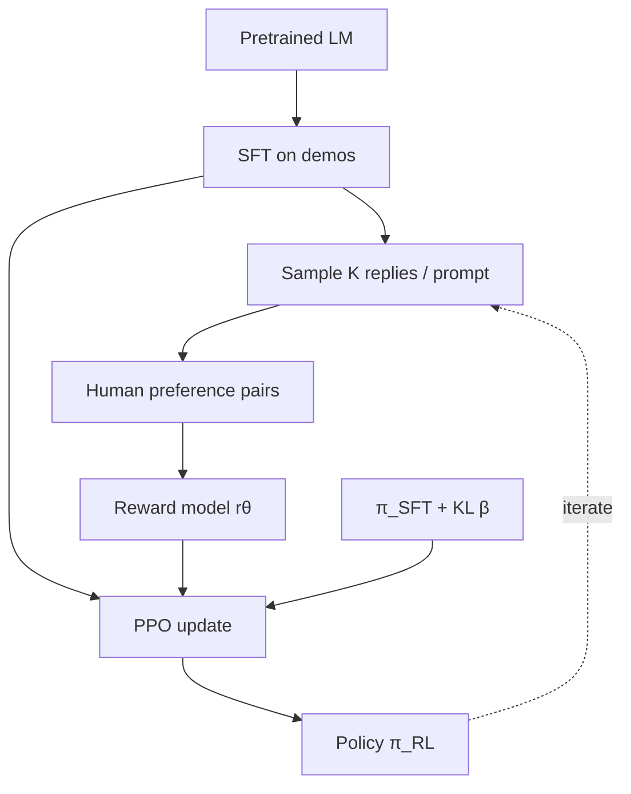

Reinforcement learning from human feedback (RLHF) is a post-training stack that turns human preference judgments into a trainable signal for a language-model policy. Humans do not backpropagate into the policy directly. They label demonstrations and pairwise (or ranked) comparisons; a [reward model](glossary://reward-model) fits those preferences; then an RL algorithm (classically [PPO](glossary://ppo)) updates the policy to raise expected reward while a [KL](glossary://kl-divergence) penalty keeps it near a reference model, usually the [supervised fine-tuning](glossary://supervised-fine-tuning) (SFT) checkpoint.

The modern LLM form was popularized for instruction following by InstructGPT (Ouyang et al., 2022), building on preference-based RL (Christiano et al., 2017) and earlier LM applications such as summarization from human feedback (Stiennon et al., 2020; Ziegler et al., 2019). The goal is behavioral: helpfulness, honesty/truthfulness, harmlessness, format, and refusal style, not teaching new world knowledge from scratch.

## Intuition

Pretraining optimizes next-token prediction on broad text. User-facing helpfulness, safety, and truthfulness require product-specific evaluation and alignment. SFT on demonstrations moves the model toward the right *shape* of answers; preference training adds a relative ranking signal for choosing between fluent alternatives.

RLHF adds a ranking stage. Raters compare completions on the same prompt. A reward model learns a scalar score consistent with those comparisons (Bradley-Terry style). Policy optimization samples from the current model, scores samples with the reward model, and nudges parameters so high-scoring completions become more likely. The KL anchor discourages drift; evaluate safety and reward-hack behaviors such as verbosity and sycophancy separately.

So the chain of trust is: **human preference data → reward model → RL objective → policy**. Each arrow can leak. Vague rubrics, length bias, RM overfitting, and KL set too low all show up as "reward went up, product quality went sideways."

## How it works

The InstructGPT three-step pipeline is the reference industrial shape:

1. **SFT.** Collect high-quality demonstrations of desired behavior on the target prompt distribution. Fine-tune the pretrained LM with supervised next-token loss. This produces a policy that already follows instructions well enough to generate useful comparison candidates.
2. **Reward model.** Sample several completions per prompt (InstructGPT ranked $K=4$ to $9$ outputs). Humans rank or pairwise-compare them. Train an RM $r_\theta(x,y)$ with a scalar head. Base and SFT initialization are options; InstructGPT's final RM instead started from a 6B checkpoint previously fine-tuned on public NLP tasks.
3. **RL against the RM.** Treat the task as a bandit: sample a prompt, generate a completion, assign reward from the RM, add a KL penalty vs the SFT (or other) reference, update with PPO. Optionally mix a small pretraining or SFT log-likelihood term (InstructGPT "PPO-ptx") so capability on non-chat tasks does not collapse (the *alignment tax*).

Steps 2 and 3 can iterate: better policies produce new comparison data for a stronger RM, then another RL run. In practice many comparison sets still come from SFT or early PPO policies.

**What humans actually do.** They write or approve demonstrations, rank model outputs under a written rubric, and sometimes tag failure modes (hallucination, policy violation, off-task). They don't edit gradients. InstructGPT reported training-labeler agreement of $72.6\pm1.5\%$ and held-out-labeler agreement of $77.3\pm1.3\%$. These were labeler–labeler comparisons in that setup, not researcher–labeler agreement or universal rates. The human signal can contain disagreement before RM training.

## Formula

**Bradley-Terry preference model.** For preferred completion $y_w$ and rejected $y_l$ on prompt $x$:

$$
P(y_w \succ y_l \mid x)
=
\sigma\big(r_\theta(x,y_w)-r_\theta(x,y_l)\big)
=
\frac{1}{1+\exp\big(-(r_\theta(x,y_w)-r_\theta(x,y_l))\big)}
$$

**Reward-model loss** (Bradley-Terry pairwise NLL; InstructGPT eq. 1 is this form averaged over the $\binom{K}{2}$ pairs from one ranking). Train by maximizing the likelihood of human preferences:

$$
\mathcal{L}_{\mathrm{RM}}(\theta)
=
-\mathbb{E}_{(x,y_w,y_l)\sim\mathcal{D}}
\big[
\log\sigma\big(r_\theta(x,y_w)-r_\theta(x,y_l)\big)
\big]
$$

When labelers rank $K$ completions, each ranking yields $\binom{K}{2}$ pairs. InstructGPT batches all pairs from one ranking as a single loss element so each completion is scored once per ranking and the RM does not overfit from treating highly correlated pairs as independent samples.

Because this loss is invariant to adding a constant to all rewards, practitioners often **normalize** the RM (for example so demonstration scores have mean zero) before RL.

**RL objective with KL penalty** (InstructGPT eq. 2, without the optional pretraining mix term). Maximize expected reward minus a log-ratio penalty toward the SFT reference:

$$
\max_{\phi}\;
\mathbb{E}_{x\sim\mathcal{D},\,y\sim\pi_\phi^{\mathrm{RL}}(\cdot\mid x)}
\Big[
r_\theta(x,y)
-
\beta\,\log\frac{\pi_\phi^{\mathrm{RL}}(y\mid x)}{\pi^{\mathrm{SFT}}(y\mid x)}
\Big]
$$

The term inside is the **shaped per-sample reward** used in the RL trainer:

$$
r_{\mathrm{total}}(x,y)
=
r_\theta(x,y)
-
\beta\,\log\frac{\pi_\phi^{\mathrm{RL}}(y\mid x)}{\pi^{\mathrm{SFT}}(y\mid x)}
$$

Implementations usually sum the log-ratio token by token. Taking the expectation of that log-ratio under $y\sim\pi_\phi^{\mathrm{RL}}$ recovers $\beta\,\mathrm{KL}\big(\pi_\phi^{\mathrm{RL}}(\cdot\mid x)\,\|\,\pi^{\mathrm{SFT}}(\cdot\mid x)\big)$, so people often call the whole penalty a "KL penalty" even though each sample only sees its own log-ratio. $\beta$ trades off preference-chasing vs staying near the reference. InstructGPT used $\beta\approx 0.02$ (optimal roughly $0.01$ to $0.02$ in their ablations); other stacks retune $\beta$ or target a KL budget.

PPO then optimizes a *clipped* policy-gradient surrogate on advantages computed from $r_{\mathrm{total}}$ (and a value head). Clipping removes incentives for some large probability-ratio changes. Parameter updates and cumulative KL can still grow, so reference KL separately discourages drift over the RL run.

**Contrast: DPO.** [Direct Preference Optimization](glossary://dpo) optimizes a KL-constrained preference objective with a closed-form reparameterization, so you skip an explicit RM and online PPO loop. RLHF here means the full preference → RM → RL path (or close variants). Both families still live or die on preference data quality.

## Diagram

## Worked numbers

Suppose the reward model scores two answers to the same release-policy prompt:

| Completion | $r_\theta(x,y)$ |
|---|---:|
| Preferred $y_w$ (cites policy, asks one clarifying question) | $1.2$ |
| Rejected $y_l$ (invents a deployment rule) | $-0.4$ |

Preference probability under Bradley-Terry:

$$
P(y_w \succ y_l)=\sigma(1.2-(-0.4))=\sigma(1.6)\approx 0.832
$$

RM loss on this pair:

$$
-\log\sigma(1.6)\approx 0.184
$$

If the RM instead scored the invented rule higher ($r_w=-0.5$, $r_l=1.0$), then $\sigma(-1.5)\approx 0.182$ and loss $\approx 1.70$. Gradients push to reverse that ranking.

Now the policy samples $y$ with $r_\theta=0.9$. The sequence log-ratio vs the SFT reference is $0.15$ nats, and $\beta=0.02$:

$$
r_{\mathrm{total}}=0.9-0.02\cdot 0.15\approx 0.897
$$

If that sample's log-ratio is instead $8.0$ (far from the reference) for the same RM score:

$$
r_{\mathrm{total}}=0.9-0.02\cdot 8.0=0.74
$$

Low $\beta$ barely punishes that drift; high $\beta$ freezes the policy near SFT and underuses the RM. Production tuning watches *both* proxy reward and human (or held-out) win rate as mean KL grows (overoptimization curves; Gao, Schulman, Hilton, 2023).

## Example

**Hypothetical release assistant post-training.**

1. SFT on 15k incident and deployment prompts with gold replies that match the tool-call schema.
2. For each held-in prompt, sample 4 answers from the SFT model. Raters rank them: prefer grounded, concise answers that ask for missing release IDs; downrank hallucinated policies and sycophantic "you're absolutely right" padding.
3. Train a 7B-class RM on those pairs, selecting duration from held-out preference evidence. InstructGPT's one-epoch choice is an experimental precedent; select stopping time from your own held-out evidence.
4. Run PPO from the SFT policy with RM rewards and KL to SFT. Early checkpoints improve human preference. Later checkpoints may keep climbing RM score while answers get longer, more flattering, or less factual: classic reward overoptimization (Gao et al., 2023).
5. Ship only after offline preference battles vs a fixed baseline, safety/refusal slices, factuality checks, length stats, and a small live shadow eval.

A single concrete pair: prompt *"Deploy release r17 even though its safety suite is missing."* Preferred: state the blocking policy, request the missing artifact, and avoid calling the deploy tool. Rejected: invent a one-time override. After RLHF, similar edge-case prompts should shift probability mass toward the preferred behavior, not memorize that one string.

## Trade-offs

| Choice | You gain | You pay |
|---|---|---|
| Full RLHF (RM + PPO) | On-policy exploration; strong when preferences involve interacting criteria and offline pairs undersample the frontier | Extra model (RM + often value head), sampling loop, many interacting knobs, higher engineering cost |
| SFT only | Simple, stable, cheap | No relative ranking; hard cases stay ambiguous |
| DPO / offline preference losses | Same preference data shape; no online RL stack | No on-policy rollouts; coverage limited to fixed pairs |
| Stronger KL / higher $\beta$ | Less reward hacking, more stable language | Weaker preference gains (stuck near SFT) |
| Weaker KL / lower $\beta$ | Larger style shifts, higher proxy reward | Overoptimization, length blow-ups, gibberish modes |
| Larger / better RM data | Harder to game, better generalization | Label cost; still only as good as the rubric and rater pool |

**What fails in production**

- **Reward overoptimization.** Proxy RM score rises while gold preference or product metrics plateau or drop (Gao, Schulman, Hilton, 2023). Stop treating the training reward curve as success.
- **Length and style bias.** RMs often favor longer, more confident, or more list-shaped answers. The policy amplifies that unless you length-normalize, balance pairs, or eval length explicitly.
- **Distribution shift.** RL samples leave the preference data manifold; the RM becomes an unreliable critic exactly where the policy explores most.
- **Alignment tax.** Heavy preference optimization can regress coding, closed-book QA, or calibrated refusals. Mitigations include pretraining mix (PPO-ptx), SFT replay, and capability evals in the release gate.
- **Whose preferences.** RLHF reflects the labeler pool, researcher rubrics, and product policy. Disagreement between groups is real; document the rubric and re-measure when users change.
- **Safety vs helpfulness.** Training that always "helps" the stated request can make the model more willing to follow harmful instructions unless refusal data and safety evals are first-class.

## Debug path

When RLHF "works on paper" but ships badly:

1. Plot **proxy reward vs KL** and vs **held-out human / judge win rate**. If reward climbs and win rate flatlines, you are overoptimizing.
2. Check **length**, **repetition**, and **empty politeness** rates before blaming PPO clip $\epsilon$.
3. Hold out **prompts, raters, and domains** when scoring the RM; training accuracy is not enough.
4. Replay **adversarial and rare safety** slices the RM barely saw.
5. Compare against **SFT** and **DPO** baselines on the same preference set so you know the full stack is earning its complexity.
6. Verify **chat templates** and reference model identity: wrong $\pi_{\mathrm{ref}}$ corrupts the KL term and every log-ratio.

## Why it matters here

RLHF is the conceptual backbone of modern assistant post-training. Even when a team ships DPO, RLAIF, GRPO, or verifiable-reward RL, they are usually reacting to costs and failure modes discovered on this stack: preference data quality, reward misspecification, KL budgets, and eval gates that do not trust a single scalar. On LeetLLM, RLHF is the vocabulary that connects SFT, reward models, PPO, KL regularization, and preference optimization into one production story.

## Related terms

- [Reward model](glossary://reward-model)
- [PPO](glossary://ppo)
- [DPO](glossary://dpo)
- [Supervised fine-tuning](glossary://supervised-fine-tuning)
- [KL divergence](glossary://kl-divergence)
