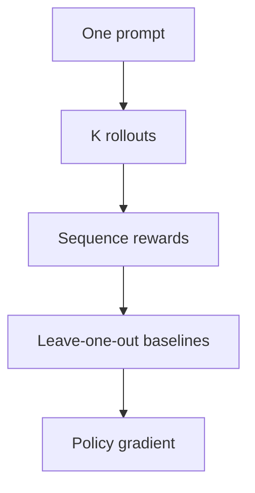

**RLOO** is an online policy-gradient method that samples several completions for one prompt and uses mean reward of other completions as baseline for each sample. It removes learned critic used by [PPO](glossary://ppo).

For $K\geq2$ completions with rewards $R_i$:

$$
b_i=\frac{1}{K-1}\sum_{j\ne i}R_j,
\qquad
A_i=R_i-b_i.
$$

Policy update is proportional to $A_i\nabla\log\pi_\theta(y_i\mid x)$, treating the computed advantage as fixed during differentiation. Under independent current-policy samples, the other samples' rewards give an action-independent baseline, preserving the estimator's expectation. Its variance effect depends on the reward distribution and group size.

## When it fits

- Reward arrives for complete response or trajectory.
- Learned value model is too expensive.
- Fresh [on-policy](glossary://on-policy) groups are affordable.
- Sequence-level credit is acceptable.

## Failure modes

Small groups produce high-variance baselines. Long tool trajectories still share one coarse outcome credit. Stale rollouts turn supposedly on-policy estimator into [off-policy](glossary://off-policy) approximation.

## Example

Four rollouts score `[1.0, 0.6, 0.2, 0.0]`. First rollout baseline is mean of other three, not group mean including itself. Its positive advantage reinforces sampled sequence without value network.

## Why it matters here

RLOO is useful decision point between critic-heavy PPO and group-normalized GRPO when reward is sequence-level and group sizes stay small.

## Related terms

- [Policy gradient](glossary://policy-gradient)
- [PPO](glossary://ppo)
- [GRPO](glossary://grpo)
- [Advantage](glossary://advantage)
- [RL rollout](glossary://rl-rollout)
