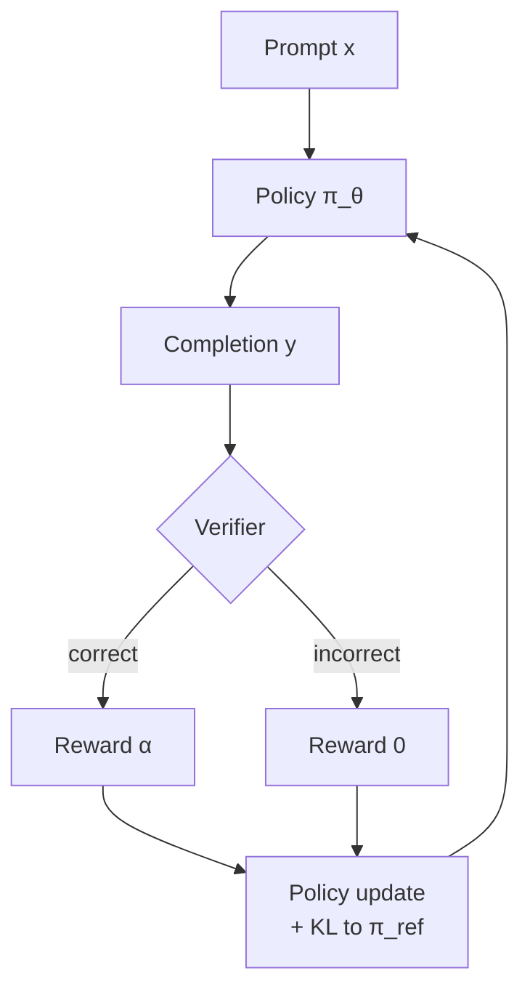

**Reinforcement learning with verifiable rewards (RLVR)** is post-training that optimizes a language-model policy with rewards from an automatic checker instead of a learned [reward model](glossary://reward-model). The checker is a program: exact answer match after extraction, unit tests in a [sandbox](glossary://sandbox), schema or constraint validators, or other deterministic rules. Correct completions get a positive scalar; incorrect ones get zero (or a small penalty). Policy optimizers such as [PPO](glossary://ppo) or [GRPO](glossary://grpo) then raise the probability of trajectories the checker accepts.

The open Tülu 3 recipe (Lambert et al., 2024) introduced an RLVR stage with a KL-regularized loop and verification function $v(x,y)$ replacing the learned reward. The related pattern, labeled *rule-based rewards*, appears in DeepSeek-R1-Zero (DeepSeek-AI, 2025). Verifier cost and correctness depend on the task. Measure generalist capabilities separately after training; task-specific verifiers and rewards cover only the behaviors they check.

## Diagram



## Intuition

RLHF needs humans (or a proxy) to rank style, helpfulness, and safety. That signal is soft, expensive, and easy to game once a neural reward model becomes the scoreboard. RLVR applies only where *success is machine-checkable*. You do not ask a rater whether `fib(10)` is right; you run tests. You do not debate the AIME answer; you extract the boxed integer and compare.

The training loop is deliberately simple:

1. Sample many completions per prompt (often a group of $G$ for GRPO).
2. Score each with $v$ (binary, or binary plus format / partial credit).
3. Take policy-gradient steps toward high-reward completions, usually with a KL anchor to a reference policy so the model does not abandon general language behavior.

Compared with pure [supervised fine-tuning](glossary://supervised-fine-tuning), RLVR can amplify rare successes already in the base distribution: if the model sometimes solves a problem at [pass@k](glossary://pass-at-k) with large $k$, RL can concentrate mass so pass@1 rises. Compared with RLHF, it skips preference collection and reward-model training *for the dimensions the verifier covers*. Subjective quality, tone, and open-ended safety still need preference data, judges, or humans.

Nathan Lambert's framing is useful: RLVR uses automatic *verification functions*. Code and instruction-following can have many valid solutions, so a verifier can check constraints and outcomes without comparing against one target string.

## Formula

Tülu 3 writes the RLVR objective as KL-regularized expected reward (same skeleton as RLHF, verification function instead of reward model). Prefer one of these equivalent shapes so KL is not misread as a per-sample scalar inside a naive sample average:

$$
\max_{\pi_\theta}
\;
\mathbb{E}_{y \sim \pi_\theta(\cdot \mid x)}
\big[
v(x,y)
\big]
-
\beta\,
\mathrm{KL}\big(\pi_\theta(\cdot \mid x)\,\|\,\pi_{\mathrm{ref}}(\cdot \mid x)\big)
$$

or the per-sample shaped reward used in many PPO/GRPO stacks, $R = v(x,y) - \beta \log\big(\pi_\theta(y\mid x)/\pi_{\mathrm{ref}}(y\mid x)\big)$, whose expectation recovers the same KL penalty.

with binary verifiable reward (Tülu 3 uses $\alpha = 10$, chosen in pilots and left fixed; many code setups use $\alpha = 1$):

$$
v(x,y)
=
\begin{cases}
\alpha & \text{if the completion is verifiably correct}, \\
0 & \text{otherwise}.
\end{cases}
$$

DeepSeek-R1-Zero uses *rule-based* rewards without a neural RM on reasoning data, combining accuracy and format:

$$
R_{\mathrm{rule}} = R_{\mathrm{acc}} + R_{\mathrm{format}}
$$

$R_{\mathrm{acc}}$ is answer match (math) or test-suite pass (code). $R_{\mathrm{format}}$ rewards structure such as `<think>…</think>` before the final answer so extraction and analysis stay reliable. R1 deliberately avoids outcome or process *neural* reward models on these tasks because they are easy to hack at large RL scale.

When the optimizer is GRPO, group-normalized advantages turn the same sparse $v$ into a local ranking. For a prompt with group rewards $\{r_i\}_{i=1}^{G}$:

$$
A_i = \frac{r_i - \mathrm{mean}(\{r_j\})}{\mathrm{std}(\{r_j\})}
$$

(with explicit handling when group variance is zero: the group-relative task advantages are zero, though KL or other objective terms can still produce gradients).

## Example

**Math (outcome verification).** Prompt: sum of primes less than 20. The model emits a chain of thought ending in `\boxed{77}`. The verifier extracts the boxed value and compares to $77$:

$$
v = \alpha \quad \text{if extracted answer equals ground truth, else } 0.
$$

A boxed integer other than $77$ gets $0$. Wrong reasoning that happens to end with $77$ still passes this outcome-only check. Correct reasoning with a formatting failure may also get $0$ unless you add a separate format term (R1-style) or a softer extractor.

**Code (execution verification).** Prompt: implement `fib(n)` with `fib(0)=0`, `fib(1)=1`. Reward is all-tests-pass vs any-fail (or fractional credit for fraction of tests):

The runner below must return a boolean test outcome and raise separately for infrastructure failures. Task-level time limits can count as failure when the benchmark specifies that rule; a broken sandbox service is a measurement error.

```python
def code_reward(solution: str, tests: list, timeout_s: float = 2.0) -> float:
    passed = run_in_sandbox(solution, tests, timeout_s=timeout_s)
    if not isinstance(passed, bool):
        raise TypeError("runner must return a boolean test outcome")
    return float(passed)  # infrastructure errors propagate, not mislabeled as 0
```

**Worked group (GRPO-style).** Eight samples on one hard coding prompt; two pass hidden tests ($r=1$), six fail ($r=0$):

| Statistic | Value |
|-----------|-------|
| mean $r$ | $2/8 = 0.25$ |
| std $r$ | $\sqrt{(2\cdot 0.75^2 + 6\cdot 0.25^2)/8} \approx 0.433$ |
| $A$ for a pass | $(1 - 0.25) / 0.433 \approx +1.73$ |
| $A$ for a fail | $(0 - 0.25) / 0.433 \approx -0.58$ |

Passes are reinforced relative to fails *within this prompt*. If all eight fail (or all eight pass), the group std is $0$ and task-relative advantages are zero; KL or other terms may still update the policy. Use an explicit zero-variance rule rather than divide by zero.

**Instruction constraints (IFEval-style, as in Tülu 3).** Prompt: answer in exactly three bullet points, each under twelve words. A constraint checker returns $\alpha$ only if all constraints hold. No human rater is required for that dimension.

## How it works

**1. Build verifiable tasks.** Each training item is a prompt $x$ plus a checker $v_x$. Math needs gold answers and robust extraction. Code needs [hidden tests](glossary://hidden-tests), sandboxes, timeouts, and resource limits. Instruction-following needs executable constraint predicates.

**2. Choose difficulty.** For group-relative binary rewards, all-fail or all-pass groups lack a within-group task signal. Measure success rates at the intended sampling settings and choose a curriculum with informative variation; avoid treating one estimated success-rate band as a universal rule.

**3. Roll out and verify.** Sample $G$ completions per prompt (or a PPO batch). Run $v$ for every completion. Optional extras: format reward, language-consistency reward, length penalties, non-EOS penalties (Tülu 3 uses $-10$ if generation hits max length without EOS).

**4. Optimize.** PPO (Tülu 3) or GRPO / related variants (DeepSeekMath, R1). Reference regularization can discourage drift. Evaluate chat and safety behavior on held-out outcomes, and select regularization with the risk of verifier exploitation in mind.

**5. Evaluate beyond the training verifier.** Track pass@1 and pass@k on held-out suites the training checker never saw. Watch response length, KL to reference, and non-verifiable evals (general chat, safety). Rising training reward with flat held-out performance warrants investigation for overfitting, verifier exploits, distribution differences, and measurement noise; it doesn't identify one cause by itself.

## Trade-offs

| | RLVR | RLHF (learned RM) | SFT only |
|---|---|---|---|
| Signal | Objective, low noise when $v$ is sound | Preference-shaped, noisy | Imitation of fixed targets |
| Cost | Verifier engineering + many rollouts | Rater data + RM train + RL | Data curation, fewer rollouts |
| Best for | Math, code, schemas, constraints, agents with checkable goals | Style, helpfulness, complex safety | Teaching formats and cold-start behaviors |
| Failure mode | Reward hacking of a narrow checker | RM hacking, sycophancy, length bias | No search over better-than-demo solutions |

**What fails in production**

- **Checker exploits.** Models optimize verifier reward $v$; public tests, weak equivalence checking, or answer leakage can teach shortcuts. Use hidden tests, randomized cases, canonicalization, and a held-out suite never used as $v$ during training.
- **Sparse or saturated rewards.** All-zero groups waste compute; all-one groups stop learning. Fix difficulty filters, temperature, or curriculum.
- **Outcome-only blindness.** Binary final-answer rewards can reinforce lucky guesses or wrong CoTs that happen to end correctly (especially short numeric answers). Mitigations: better extraction, process checks where you can afford them, or metrics that care about CoT validity on eval.
- **Capability narrowness.** Heavy RLVR on math/code can drift chat style or multilingual behavior unless you mix tasks, keep KL, or interleave preference RL.
- **Verifier infra.** Sandbox escapes, flaky tests, non-determinism, and slow graders dominate wall-clock. Deterministic, isolated, timeout-bounded execution is part of the algorithm, not ops afterthought.
- **Domain gap.** Unit tests cover machine-checkable outcomes. Pair RLVR with RLHF/DPO to evaluate soft skills, open-ended writing, and many safety cases.

Research still debates how far binary RLVR *expands* reasoning versus *compresses search* toward paths the base model already had (pass@k at large $k$ vs pass@1). For engineers shipping systems, the operational claim is sharper: when you can check success cheaply, RLVR is the scalable way to turn rare correct samples into reliable first-try behavior.

## Why it matters here

RLVR is the post-training pattern behind modern reasoning and coding models: checkable work becomes unlimited training signal without preference labels for every sample. Understanding it clarifies when to invest in verifiers and sandboxes, when you still need a reward model, how GRPO/PPO consume binary rewards, and how pass@k relates to what RL is actually amplifying.

## Related terms

- [Reward model](glossary://reward-model)
- [RLHF](glossary://rlhf)
- [GRPO](glossary://grpo)
- [PPO](glossary://ppo)
- [pass@k](glossary://pass-at-k)
