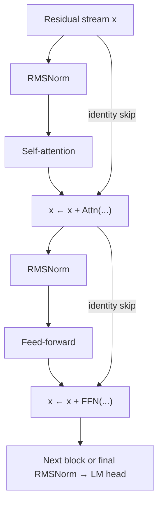

**Root mean square layer normalization (RMSNorm)** rescales an activation vector by its root mean square, then multiplies by a learned per-feature gain, without subtracting the mean (Zhang and Sennrich, NeurIPS 2019). For one token hidden state $x \in \mathbb{R}^{d}$, it divides $x$ by $\mathrm{RMS}(x)$ and applies $\gamma$. With hidden-axis normalization, statistics don't mix batch items or sequence positions. A broader `normalized_shape` can include those axes, so inspect the actual configuration.

The design is a deliberate simplification of [LayerNorm](glossary://layernorm). LayerNorm re-centers (mean subtraction) and re-scales (divide by standard deviation). Zhang and Sennrich hypothesized that re-centering invariance is dispensable for stable training, and that re-scaling alone is the property that matters. Dropping the mean cuts arithmetic and memory traffic on a bandwidth-bound op while keeping activation magnitude under control. Modern decoder stacks (Llama-family and many peers) keep Pre-norm residual placement and swap LayerNorm for RMSNorm on the [residual stream](glossary://residual-stream).

## Intuition

Each token carries a $d$-dimensional feature vector. Attention and the MLP read that vector; if magnitudes grow layer after layer, matmuls and [softmax](glossary://softmax) become brittle under [mixed precision](glossary://mixed-precision), and [gradients](glossary://gradient) can explode or vanish. LayerNorm resets mean and variance. RMSNorm only answers: "how large is this vector in RMS sense?" and forces that RMS toward a fixed scale (up to the learned $\gamma$).

Because there is no mean subtraction, a uniform offset across features survives. That is the geometric difference from LayerNorm: LayerNorm projects out the all-ones direction before rescaling; RMSNorm only shrinks or stretches the existing direction. Empirically that is enough for large Transformers. When the feature mean is already near zero, the two ops agree closely.

RMS is the quadratic mean:

$$
\mathrm{RMS}(x) = \sqrt{\frac{1}{d}\sum_{i=1}^{d} x_i^{2}}
$$

Scaling the whole input by a positive constant scales the RMS by the same constant, so the ratio $x / \mathrm{RMS}(x)$ is scale-invariant (before $\epsilon$ and $\gamma$). That re-scaling invariance, not mean centering, is the invariance the paper keeps.

## Formula

Paper form (Zhang and Sennrich Eq. 4), for summed inputs $a \in \mathbb{R}^{n}$ and gain $g$:

$$
\bar{a}_{i} = \frac{a_{i}}{\mathrm{RMS}(a)}\, g_{i}, \qquad
\mathrm{RMS}(a) = \sqrt{\frac{1}{n}\sum_{i=1}^{n} a_{i}^{2}}
$$

Production form for a token feature vector $x \in \mathbb{R}^{d}$ (matches PyTorch `nn.RMSNorm` and common Llama-style code), with $\epsilon$ inside the square root:

$$
\mathrm{RMS}(x) = \sqrt{\frac{1}{d}\sum_{i=1}^{d} x_i^{2} + \epsilon}, \qquad
\mathrm{RMSNorm}(x) = \frac{x}{\mathrm{RMS}(x)} \odot \gamma
$$

- $\gamma \in \mathbb{R}^{d}$ is a learnable scale (gain), usually initialized to ones. There is typically **no bias** $\beta$.
- $\epsilon > 0$ stabilizes the denominator. Checkpoint configs often use $10^{-5}$ or $10^{-6}$; in current PyTorch, `nn.RMSNorm` often defaults $\epsilon$ from the opmath dtype machine epsilon when `eps=None` (version-sensitive; pin `eps` in configs you care about).
- Reduction is over the last $D$ axes given by `normalized_shape`. For tensors of shape $(B, T, d)$, that is almost always the final hidden size $d$: one independent normalization per `(batch, time)` position.
- When $\frac{1}{d}\sum_i x_i = 0$, LayerNorm and RMSNorm coincide for the same $\epsilon$ convention (up to affine params).

**$\epsilon$ placement is part of the numeric definition.** Llama-style kernels often compute `rsqrt(mean(x²) + eps)` (epsilon inside). Some older snippets write `x / (rms + eps)` (epsilon outside). Those are not the same for tiny RMS. Match the reference checkpoint and fused kernel, not a blog formula.

Scalar reference forward. Production low-precision implementations commonly accumulate the reduction in FP32:

```python
import math

def rms_norm(x, gamma, eps=1e-6):
    # x: list of floats (one token); gamma same length
    d = len(x)
    if d == 0 or len(gamma) != d or eps < 0:
        raise ValueError("nonempty matching vectors and nonnegative eps required")
    mean_sq = sum(v * v for v in x) / d
    inv_rms = 1.0 / math.sqrt(mean_sq + eps)
    return [g * v * inv_rms for g, v in zip(gamma, x)]
```

## Worked numbers

Take $x = [3.0,\ 1.0,\ -1.0,\ 5.0]$, $\epsilon = 0$, $\gamma = \mathbf{1}$.

$$
\frac{1}{4}(9 + 1 + 1 + 25) = 9, \qquad \mathrm{RMS}(x) = 3
$$

$$
\mathrm{RMSNorm}(x) = [1.0,\ 1/3,\ -1/3,\ 5/3] \approx [1.000,\ 0.333,\ -0.333,\ 1.667]
$$

Mean of $x$ is $2.0$, so the output still has nonzero mean. LayerNorm on the same vector would first subtract $2$, then divide by $\sigma = \sqrt{5}$, yielding zero-mean unit-variance features (before any nontrivial $\gamma, \beta$). Same magnitude control intent; different residual-stream geometry.

With $\epsilon = 10^{-6}$ the denominator is $\sqrt{9 + 10^{-6}} \approx 3.000000167$, so the change is negligible here. It only matters when $\mathrm{RMS}(x)$ is near zero or under low precision.

## How it works

1. Take one position's hidden state $x$ of width $d$ (ignore batch and sequence for the reduction).
2. Compute mean of squares over those $d$ features; take $\sqrt{\cdot + \epsilon}$ (or `rsqrt`).
3. Divide $x$ by that scalar (broadcast).
4. Multiply elementwise by learned $\gamma$.
5. Feed the result into the next op (attention QKV projections, FFN, or LM head), depending on Pre-norm vs Post-norm placement.

In Pre-norm Llama-style blocks the residual stream is not mean-centered at the add; each sublayer sees a magnitude-controlled view of $x$:

$$
x \leftarrow x + \mathrm{Attn}(\mathrm{RMSNorm}(x))
$$

$$
x \leftarrow x + \mathrm{FFN}(\mathrm{RMSNorm}(x))
$$

A final RMSNorm usually sits before the unembedding / LM head so logits see a controlled scale after many residual adds. Placement is architectural: wrong Pre/Post wiring with correct math still breaks a checkpoint.

## Diagram



## Example

A 7B-class decoder with hidden size $d = 4096$, Pre-norm RMSNorm, and two norms per block across $L = 32$ layers applies $2L$ residual norms plus one final norm: 65 RMSNorm calls per forward over the sequence. Each call reduces over 4096 features per token. At decode time batch and sequence may be 1; the reduction is still well defined because it never needs other tokens or batch mates.

When you load weights into a custom runtime, compare against the reference on a short prompt:

- normalized axis (last dim vs accidental full-tensor reduce)
- $\epsilon$ value and whether it is inside or outside the sqrt
- $\gamma$ shape and name (`weight` / `scale` / `g`)
- compute dtype of the mean-of-squares (FP32 accumulate vs pure BF16)
- fused kernel (attention+norm, residual+norm) vs naive ops

A single mismatched $\epsilon$ or axis often looks like "the model is dumb everywhere," not a local layer failure.

## Trade-offs

| | LayerNorm | RMSNorm |
|---|---|---|
| Mean subtract | Yes | No |
| Scale statistic | $\sigma$ (std of centered $x$) | $\mathrm{RMS}(x)$ |
| Affine params | $\gamma$ and usually $\beta$ | $\gamma$ only (usual) |
| Invariances (paper) | Re-center + re-scale | Re-scale |
| Cost | Mean + variance + two affine | Mean of squares + one affine |
| Common LLM use | GPT-2-style stacks, many older models | Llama, Mistral, Gemma, Qwen, and similar |

Original paper measurements report comparable quality to LayerNorm with wall-clock reductions of roughly 7% to 64% in the tested architectures and implementations. Treat that range as historical evidence; measure the current GPU kernel and end-to-end model. A gain-only RMSNorm has half the affine parameters of LayerNorm configured with both gain and bias; bias-free LayerNorm has the same affine count.

RMSNorm implementations still need numerical care. Reductions under FP16 need wider accumulation; BF16 is usually friendlier but fused kernels can still cast differently than a reference eager path. Tensor-parallel / sequence-parallel shards must reduce over the full logical hidden dimension, including values held on other shards, unless the algorithm is rewritten accordingly.

## Why it matters here

RMSNorm appears in Llama-style decoder stacks. It ties residual-stream geometry, pre-norm block structure, mixed-precision stability, and weight-porting bugs into one primitive. Knowing the paper formula, the $\epsilon$ convention, the missing mean, and the configured normalization axes helps prevent silent quality regressions.

## Related terms

- [LayerNorm](glossary://layernorm)
- [Residual stream](glossary://residual-stream)
- [Transformer](glossary://transformer)
- [Mixed precision](glossary://mixed-precision)
- [Feed-forward network](glossary://feed-forward-network)
