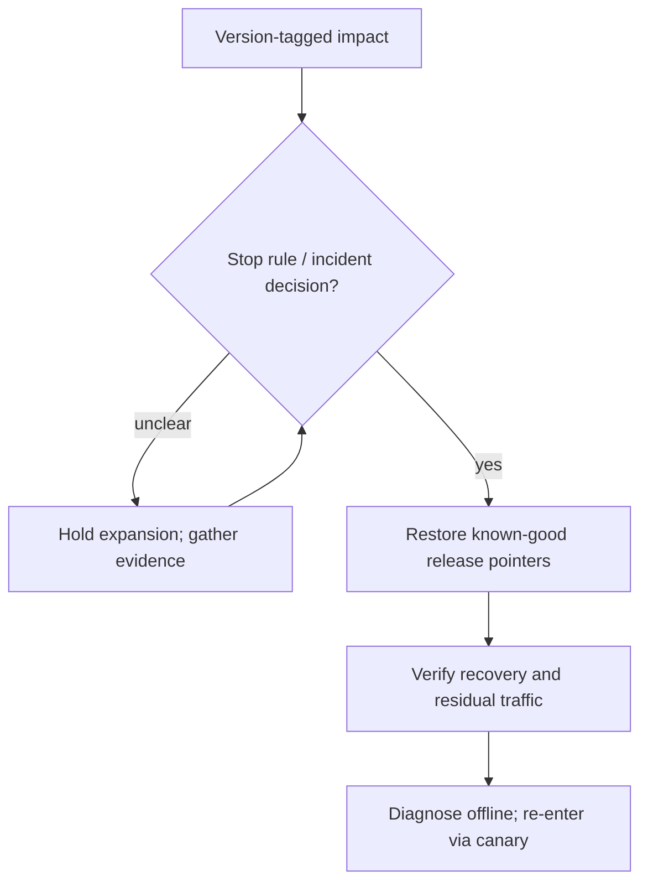

A **rollback** restores a previous **known-good** configuration, artifact, or traffic assignment after a change causes unacceptable quality, safety, cost, or reliability impact. The unit that moves is usually a **pointer** (model alias, [feature flag](glossary://feature-flag), gateway weight, prompt version, index id), not a rebuild of the model during the incident. Google SRE frames the operating rule plainly: when unexpected behavior appears, **roll back first and diagnose afterward** so recovery time stays short.

A rollback is the inverse of a [rollout](glossary://rollout): you deliberately reduce exposure of the candidate until control (or an older approved version) owns traffic again. A [kill switch](glossary://kill-switch) stops a risky path; a rollback reinstates a specific prior good state. In practice you often do both: stop the bad tool or route, then pin the model alias back to `prod-stable`.

## Intuition

Think of production as a set of versioned dials (code image, model weights, prompt, retriever, policy, schema). A launch turns some dials forward. A rollback turns the **same dials back** to values you already ran under real load. If the dial cannot go back (one-way migration, deleted artifact, irreversible data rewrite), you do not have a rollback; you have a **forward fix** plan, and that plan must exist *before* the launch.

Google SRE practice treats rollbacks as **normal operations**, not failure theater. Teams that never roll back often discover during an outage that automation, schema order, or artifact retention made rollback harder than a panic roll-forward. Practice under calm conditions so the path is easy and trusted when metrics burn.

## How it works

A production-ready rollback is a short, predeclared loop:

1. **Detect with version tags.** Metrics and traces must be attributable to code SHA, model id, prompt version, index version, and flag value. Fleet averages hide a bad 5% canary until it is too late.
2. **Decide against prewritten stop rules.** Error budget burn, safety failures, cost spike, latency SLO break, citation drop, or tool-write incidents. Ambiguous quality bugs may need a human; clear reliability and safety signals can auto-revert traffic weight.
3. **Execute one known operation.** Flip flag to $0\%$, set gateway weight to control, repoint model alias, disable tool pack. Do **not** invent a cherry-pick under pager pressure unless the change is irreversible.
4. **Verify recovery.** Control metrics return to baseline; candidate residual traffic goes to zero; caches and sticky sessions do not keep serving the bad path indefinitely.
5. **Diagnose offline.** Root cause, evals, and a fixed candidate come *after* user impact is contained. Then re-enter through [canary rollout](glossary://canary-rollout), not a second all-or-nothing push.

### Time to recovery

Time to recovery for one bad release can be decomposed as:

$$
T_{\text{recovery}} \approx t_{\text{detect}} + t_{\text{decide}} + t_{\text{execute}} + t_{\text{verify}}.
$$

MTTR averages recovery times across incidents with the same start/end convention. Rollback design attacks the last three terms: stop rules cut $t_{\text{decide}}$, control-plane flips cut $t_{\text{execute}}$, and smoke checks cut $t_{\text{verify}}$. Version-tagged SLIs cut $t_{\text{detect}}$. Routing rollback contains new exposure; completed writes and destructive migrations require separate recovery or compensation.

### What actually moves in AI systems

| Surface | Typical rollback action | Often hard to reverse |
|---|---|---|
| Model route / alias | Point gateway at previous registry version | Deleted registry artifact; cold GPU image |
| Prompt / chat template | Restore prior template id | Client caches of system prompts |
| Retriever / ranker | Previous ranker flag or service | New features required by the new prompt |
| Vector index | Route queries to prior index id | Full re-embed of the corpus |
| Safety threshold | Restore prior threshold or classifier | Labels already written under new policy |
| Tool allowlist | Remove write tools or restore allowlist | Side effects already committed |
| App binary / config | Previous container image or config map | One-way DB schema without expand/contract |
| Feature flag / split | Set treatment share to $0\%$ | Sticky assignment + long multi-turn sessions |

Code rollback alone leaves the incident in place when live pointers still target the bad artifact. Track the release as a **full behavior graph** that includes the git SHA and every live artifact pointer.

## Diagram



## Example

Support chat canaries a new model route `support-v7` at $5\%$ sticky by conversation id. Control remains `support-v6` (previous registry export, warm replica). Predeclared stop rules on the same 15-minute window: safety policy failures $> 0.1$ percentage points absolute over control, p95 end-to-end latency $> 2.5$s, or citation-present rate drop $> 2$ percentage points vs control.

After 20 minutes:

| Metric (same slices) | Control `v6` | Canary `v7` |
|---|---|---|
| p95 latency | $1.9$s | $3.4$s |
| Citation-present rate | $91\%$ | $88\%$ |
| Safety failures | $0.02\%$ | $0.18\%$ |
| Cost per answered chat | \$0.012 | \$0.019 |

Safety, latency, and citation-present all trip stop rules. Incident command (or automation) runs the **one** recovery action already drilled:

```text
# Conceptual control-plane ops (names vary by stack)
set_traffic_weight(route="support", version="v7", weight=0)
set_model_alias("support-prod", target="support-v6")
# optional: kill_switch for a bad write tool if side effects started
```

These are two conceptual changes within one drilled recovery workflow. Couple their version identities and handle partial failure, or use one atomic release-pointer change when the control plane supports it.

Within the flag/config propagation window, new conversations land on `v6`. Sticky sessions already on `v7` either drain with a max age or are forced to control on the next turn if the flag is non-sticky for emergency. Operators confirm:

- canary request share $\to 0$
- fleet p95 and safety rates return toward control
- no residual writes from a half-launched tool schema

Only then does the team open traces, re-run the [eval gate](glossary://eval-gate) suite against `v7`, and plan a fixed candidate. They do **not** patch `v7` live under the pager as the primary recovery.

```python
def resolve_model_route(ctx, flags, registry):
    # Treatment share collapses to 0 on rollback; alias always resolvable.
    use_v7 = flags.percentage(
        "support_model_v7",
        default=0,
        key=ctx.conversation_id,
    )
    alias = "support-v7" if use_v7 else "support-prod"  # prod -> v6
    return registry.resolve(alias)  # must keep prior export warm and addressable
```

## Data and schema boundaries

Some launches are easy to roll back because they only move traffic. Others **mutate state**. Re-embedding a corpus, changing feature definitions, or running a destructive schema migration may require a forward fix, dual-write period, or restore plan. SRE practice for incompatible changes is **expand then contract**: ship a version that can read old *and* new schema, migrate data, then ship features that require the new shape. At each step you can roll the binary back one version without undoing the data.

Before launch, name:

- previous artifact ids (model, prompt, index, image) that still exist and are loadable
- traffic pointer and how long sticky assignments retain the candidate
- cache keys that might keep serving bad answers after the flip
- migration safety (expand/contract, dual-read, dual-write)
- owner, smoke test, and max acceptable execution time under incident

A rollback plan is ready when it can restore a tested artifact during an incident without rebuilding unknown components.

## Trade-offs

| Choice | Upside | Cost |
|---|---|---|
| Pointer / flag rollback | Seconds to minutes; low risk if drilled | Both versions must stay deployable and warm |
| Full binary redeploy as "rollback" | Works when config plane is missing | Slow; easy to ship the wrong image under stress |
| Roll-forward cherry-pick | Avoids schema reverse | Far from known-good; high mistake rate under pressure |
| Keep previous model cold | Saves GPU cost | Cold start makes rollback miss the MTTR budget |
| Auto-rollback on hard SLIs | Fast containment | False positives amputate healthy canaries |
| Manual-only quality rollback | Human judgment on noisy metrics | Longer user exposure while on-call decides |

When a change is reversible, roll back to a **known-good** state under pressure. Reserve roll-forward for irreversible data steps or security patches where staying on the old version is riskier. Keep the previous serving artifact **warm** through the high-risk window after a full cutover, often hours to days.

## Why it matters here

LLM and RAG systems fail in production-only ways: long-tail documents, provider latency, tool side effects, safety edges offline evals miss. [Canary rollouts](glossary://canary-rollout) and [traffic splits](glossary://traffic-split) limit blast radius, but they only help if reversing the dial is one trusted step. Rollback planning turns AI launches into recoverable experiments: keep the prior model, prompt, index, and policy addressable; tag every request with versions; predeclare stop rules against [SLOs](glossary://slo); practice the flip. Without that, every prompt tweak and model alias change is an all-or-nothing bet that the next hour of real traffic will only need a heroic forward fix.

## Related terms

- [Canary rollout](glossary://canary-rollout)
- [Feature flag](glossary://feature-flag)
- [Traffic split](glossary://traffic-split)
- [Kill switch](glossary://kill-switch)
- [SLO](glossary://slo)
