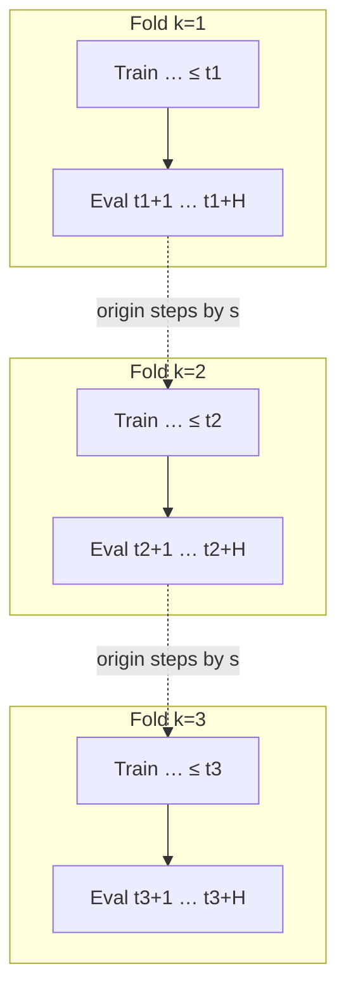

**Rolling-origin evaluation** (also called evaluation on a *rolling forecasting origin*, time-series cross-validation, or walk-forward backtesting) scores a forecaster at **several successive cutoffs**. At each **forecast origin** $t$, the model may use only information available up to $t$, then issues forecasts for horizons $h=1,\ldots,H$. Later observed values $y_{t+h}$ become the labels. The origin then advances by a step $s$ (often one day, one week, or the production retrain cadence), and the process repeats.

The name comes from the forecasting literature: Tashman (2000) contrasts **fixed-origin** out-of-sample tests (one train cutoff, one holdout stretch) with **rolling-origin** tests that update the origin successively so each lead time is scored many times. Hyndman and Athanasopoulos call the same idea *time series cross-validation* and note that accuracy is averaged over the successive test sets. Ordinary random train/test splits violate the core rule: the model cannot learn from the future.

## Intuition

A single lucky holdout week can flatter a weak model (or bury a good one) if that week happens to be quiet, stormy, or dominated by one promo. Rolling origins answer a harder question: **does the same production recipe stay honest across several realistic "as of" dates?**

Think of each fold as a frozen production run:

1. Freeze information available at origin $t_k$ (later observations are unavailable; future calendar events can be legal if already known).
2. Fit or refresh the model under that information set $\mathcal{I}_{t_k}$.
3. Forecast the next $H$ steps exactly as serving would.
4. When the future arrives, score $\hat{y}_{t_k+h|t_k}$ against $y_{t_k+h}$.
5. Roll $t_{k+1} = t_k + s$ and repeat.

Expanding history (more past each fold) matches "retrain on all data so far." A fixed-length training window matches "always use the last $W$ days." Both are rolling-origin designs; they differ only in how $\mathcal{I}_{t}$ grows.

## Formula

Let origins be $t_1 < t_2 < \cdots < t_K$, step $s = t_{k+1}-t_k$, and horizon cap $H$. The $h$-step forecast from origin $t_k$ and its error are

$$
\hat{y}_{t_k+h|t_k} = f\!\left(\mathcal{I}_{t_k}\right),\qquad
e_{t_k+h} = y_{t_k+h} - \hat{y}_{t_k+h|t_k},
\quad h \in \{1,\ldots,H\}.
$$

A common summary is mean absolute error pooled over origins and horizons with complete actuals:

$$
\mathrm{MAE} = \frac{1}{N}\sum_{k=1}^{K}\sum_{h=1}^{H}\mathbf{1}_{t_k+h\le T}\,
\bigl|e_{t_k+h}\bigr|,
\qquad
N = \sum_{k=1}^{K}\sum_{h=1}^{H}\mathbf{1}_{t_k+h\le T}.
$$

Better operational reports keep **error by horizon** (and by fold), for example

$$
\mathrm{MAE}(h) = \frac{1}{K_h}\sum_{k\,:\,t_k+h\le T}
\bigl|y_{t_k+h} - \hat{y}_{t_k+h|t_k}\bigr|,
$$

where $K_h$ is the number of origins that still have an observation at lead $h$. The same skeleton works for RMSE, MASE, pinball loss, or interval coverage: change the loss, not the origin schedule.

**Design knobs that belong in the protocol, not in a footnote:**

| Knob | Typical choices | Why it matters |
| --- | --- | --- |
| Origin step $s$ | Daily; weekly on Monday; every retrain job | Must match how often production issues forecasts |
| Horizon $H$ | Same $H$ as the product contract | $h=1$ skill does not imply $h=14$ skill |
| Train window | Expanding from $t_{\min}$; fixed last $W$ points | Expanding favors more data; fixed favors recent regime |
| Gap / embargo | 0; label lag; feature publish lag | Late labels and late features must not enter $\mathcal{I}_{t}$ |
| Refit policy | Full retrain; update only state; frozen params | Mimic real recalibration cost and freshness |

Fixed-origin evaluation is the special case $K=1$. It is cheaper and still useful as a smoke test, but it does not average over origin risk.

## Diagram



Each eval block sits strictly after its origin. Features, scalers, holiday flags, and embeddings used in fold $k$ must be constructible from $\mathcal{I}_{t_k}$ alone (same rule as a [point-in-time join](glossary://point-in-time-join)).

## Example

Daily GPU batch-job volume, weekly seasonality, production contract: **every Sunday night** issue a **7-day-ahead** path ($H=7$), retrain on all history so far. Three rolling origins:

| Fold | Origin $t_k$ (train through) | Eval window | Role |
| --- | --- | --- | --- |
| 1 | Sun 2026-01-18 | Mon 01-19 … Sun 01-25 | Quiet baseline week |
| 2 | Sun 2026-01-25 | Mon 01-26 … Sun 02-01 | Includes a Friday launch spike |
| 3 | Sun 2026-02-01 | Mon 02-02 … Sun 02-08 | Post-launch recovery |

Seasonal-naive (lag 7) on fold 2 might show absolute errors roughly $1,3,2,1,28,1,1$ (Friday's launch is the $28$), so fold MAE $\approx 5.3$ jobs, while fold 1 on a calm week might sit near $0.9$. A single fixed origin on week 1 would crown the baseline as nearly perfect and miss the launch failure mode entirely.

```text
time →
[======== train ≤ 01-18 ========]|-- H=7 eval --|
[=========== train ≤ 01-25 ===========]|-- H=7 eval --|
[============== train ≤ 02-01 ==============]|-- H=7 eval --|
```

```python
# Expanding-window rolling origin for daily series y[0..T-1]
# origins are inclusive end indices of the training prefix
H, step = 7, 7
origin_ends = [14, 21, 28]  # e.g. Sundays after enough history
fold_maes = []
for t in origin_ends:
    # train on y[: t+1]; forecast y[t+1 : t+1+H]
    pred = seasonal_naive_forecast(y[: t + 1], H=H, season=7)
    actual = y[t + 1 : t + 1 + H]
    if len(actual) < H:
        continue  # constant-horizon evaluation requires a complete future path
    if len(pred) != H:
        raise ValueError("forecaster must return exactly H predictions")
    err = [a - p for a, p in zip(actual, pred)]
    fold_maes.append(sum(abs(e) for e in err) / H)
# report per-fold and per-horizon metrics alongside mean(fold_maes)
```

If production forecasts only on Mondays, do not invent daily origins just because they give more folds. Extra synthetic origins measure a task you do not run.

## How it works

1. **Freeze the product contract.** Cadence, $H$, required features, gap for late labels, and whether intervals must be scored.
2. **Choose origins on the calendar production would have used.** Prefer real issue timestamps over evenly spaced research folds when logs exist.
3. **For each origin:** build train features with event-time cutoffs, fit or update $f$, emit the $H$-step path (and intervals if claimed), store immutable forecast rows keyed by `(origin, horizon, entity)`.
4. **Join later actuals** only after they arrive; never rewrite the forecast row when labels land.
5. **Aggregate carefully.** Overall MAE for ranking; $\mathrm{MAE}(h)$ and slice tables (weekday, promo, cold-start entity, region) for failure hunting; fold-level boxplots when $K$ is large enough to show origin variance.
6. **Gate with the same recipe.** A model that wins average MAE but loses every $h=H$ day or every holiday origin is not ready.

### Expanding vs fixed training window

- **Expanding:** train set is $1..t_k$. Matches "always use full history." Early folds have less data; later folds dominate compute.
- **Fixed window:** train set is $(t_k-W+1)..t_k$. Useful when older regimes are toxic or storage is capped. Window $W$ becomes a hyperparameter you can overfit if you tune it on the same origins you report.

### Constant vs shrinking holdout

With a **constant holdout** of length $H$, stop when fewer than $H$ future points remain so every origin contributes a full path. With a **non-constant holdout**, late origins may only score $h=1,\ldots,H' < H$; that increases one-step sample size on short series but complicates horizon comparisons. Prefer constant $H$ when the product always needs a full path.

## What fails in production

| Failure | What you see | Fix |
| --- | --- | --- |
| Random or shuffled split | Offline MAE collapses after launch | Chronological origins only; audit $\max(\text{train time}) < \min(\text{eval time})$ |
| One fixed origin | Winner flips when the holdout week changes | Raise $K$; require multi-origin stability |
| Horizon pooled only | Great average, useless day-$H$ path | Report $\mathrm{MAE}(h)$ and path metrics |
| Feature leakage across time | Unrealistically low errors | Point-in-time joins; no global scaler fit on full series; future promo/calendar inputs only if actually known at the origin |
| Cadence mismatch | Daily backtest, weekly ship | Align $s$, issue time, and retrain policy with serving |
| Label/feature lag ignored | Train uses next-day final counts | Embargo / gap equal to publish delay |
| Selection on the backtest | Many models, report only the best $K$-fold score | Hold a final untouched period or nested scheme after model choice |
| Interval claims untested | Sharp intervals, poor coverage live | Score coverage and width on the same origins as point MAE |

Rolling-origin evaluation measures forecast skill before a capacity decision depends on the model. Pair this offline evidence with live monitoring for [concept drift](glossary://concept-drift).

Overlapping forecast windows and neighboring origins can produce dependent errors. More folds are not automatically more independent evidence; preserve temporal dependence when estimating uncertainty in a model comparison.

## Why it matters here

LeetLLM forecasting and demand-alert lessons treat rolling origins as the default evidence standard: one future window is fragile, and random splits leak future launches into training. When you compare a seasonal naive baseline to a learned forecaster, both must face the same origin schedule, horizon, and information cutoff. Interval coverage, alert precision, and rollback decisions inherit that schedule. If the backtest does not look like the Sunday-night job that will run in production, the metric is answering a different question than the pager will.

## Related terms

- [Forecast horizon](glossary://forecast-horizon)
- [Forecast error](glossary://forecast-error)
- [Seasonal naive forecast](glossary://seasonal-naive-forecast)
- [Mean absolute error](glossary://mean-absolute-error)
- [Point-in-time join](glossary://point-in-time-join)
