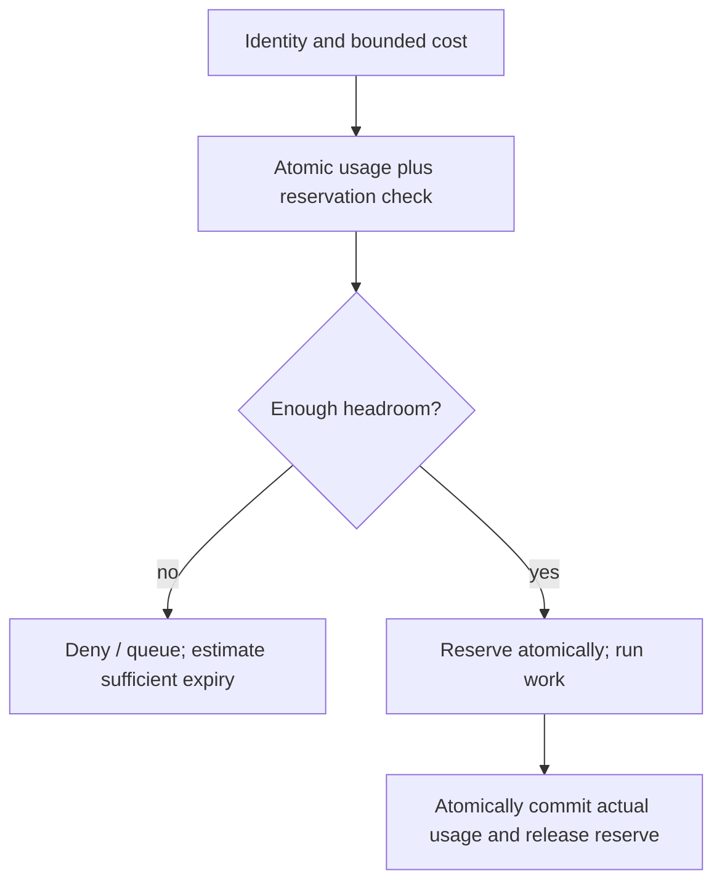

A **rolling quota** (also called a **sliding-window quota**) measures usage over a moving lookback interval of length $W$, not a fixed calendar bucket. Here the perimeter convention counts consumption in $(t - W,\, t]$: an event expires exactly $W$ after its timestamp. Capacity returns as old usage ages out of that window, not at a shared midnight or top-of-hour reset.

This is the long-horizon cousin of a sliding-window [rate limit](glossary://rate-limit). Rate limits usually guard short windows (seconds to minutes). Rolling quotas usually guard hours to days of token, dollar, or request allowance for a plan, tenant, or seat. Gateway products such as Apigee expose both styles under one Quota policy: `calendar` / fixed interval reset versus `type="rollingwindow"`, which recalculates the preceding interval on every request.

## Intuition

A fixed daily quota is a bucket that empties and then snaps full again at a wall-clock perimeter. A rolling quota is a trailing tape of usage: every unit you spent $W$ ago falls off the left edge as time advances, freeing room for new work.

That changes product behavior:

- **Fixed window:** spend everything at 23:50, sleep through midnight, spend everything again at 00:10. Two full allowances in twenty minutes.
- **Rolling window:** those 23:50 spends still occupy the tape until about 23:50 the next day. There is no free double-spend at the perimeter.

Capacity returns **gradually** as individual events or coarse buckets expire, which feels more like a sliding budget than a hard daily reset button.

## How it works

At request evaluation time the enforcer does three things:

1. **Resolve identity** (user, seat, workspace, API key, project).
2. **Sum weight** in the open window: requests, tokens, dollars, or a weighted mix.
3. **Compare** to allowance $L$. If remaining headroom is enough for the estimated cost, allow (and usually **reserve**); otherwise reject, delay, or degrade.

Exactness depends on the storage model:

| Implementation | What you store | Accuracy | Cost |
| --- | --- | --- | --- |
| **Sliding-window log** | Timestamp (and weight) per event | Exact over $(t-W,t]$ | Memory and prune cost grow with event rate |
| **Sliding-window counter** | Two buckets of width $W$ with a weighted previous bucket, or a ring of smaller buckets covering $W$ | Approximate within buckets | Two counters or a bucket ring per identity |
| **Fixed window** | One counter per calendar slot | Exact inside the slot; weak at edges (perimeter burst) | Cheapest; worst perimeter double-spend |

For LLM products, track **tokens** or **dollars of model spend** alongside request count. One long-context agent turn can burn more of a rolling 24h token quota than hundreds of short chats. Weight the event by estimated (then actual) tokens the same way you weight a [metered billing](glossary://metered-billing) row.

Because output length is unknown at request evaluation time, an enforcer can **reserve** before the model call and **reconcile** after completion. Strict enforcement needs a conservative upper bound backed by output and tool-loop caps; an uncapped estimate can be exceeded, allowing usage beyond the allowance. Keep in-flight reservations active until reconciliation, even if the job outlives the usage window. Keep check-and-reserve atomic across the shared counter to prevent concurrent streams from overspending the same headroom.

## Formula

Let $W$ be the window length, $L$ the allowance, and $u(\tau)$ the usage weight at time $\tau$. Remaining headroom at time $t$ is:

$$
R(t) = L - \sum_{\tau \in (t-W,\, t]} u(\tau)
$$

allow a new event of weight $c$ only if $R(t) \ge c$ (or $\ge$ reserved estimate $\hat{c}$).

**Exact log check** (sliding-window log): keep events with timestamps; drop those at or before $t - W$; sum the rest. Subtract outstanding reservations too when allowing concurrent work.

**Cloudflare-style sliding counter** (approximate rolling rate from two fixed buckets). Let $C_{\mathrm{prev}}$ be the previous bucket total, $C_{\mathrm{cur}}$ the current bucket total, $W$ the bucket width, and $e$ the elapsed time inside the current bucket. Approximate usage in the trailing window:

$$
\hat{U} = C_{\mathrm{prev}} \cdot \frac{W - e}{W} + C_{\mathrm{cur}}
$$

Cloudflare’s published example: limit $50$ req/min, $C_{\mathrm{prev}} = 42$, $C_{\mathrm{cur}} = 18$, $e = 15\,\mathrm{s}$, $W = 60\,\mathrm{s}$:

$$
\hat{U} = 42 \cdot \frac{60 - 15}{60} + 18 = 42 \cdot 0.75 + 18 = 49.5
$$

One more request tips the estimate over the limit. The method assumes roughly uniform traffic inside the previous bucket, so it provides an estimate; use a strict counter when a formal bound is required. Cloudflare's published 400M-request evaluation reported about 6% average error vs true rate, 0.003% misclassified requests, and no false positives (sources blocked while under the true rate). These figures describe a historical Cloudflare product snapshot.

**Apigee rolling window (product semantics):** for `type="rollingwindow"` with interval $1$ day, a request at 17:01 counts usage since 17:01 the previous day. The counter recalculates on each request as the lookback edge moves, creating a continuous rolling window.

Always read the product's exact reset semantics. A fixed interval anchored to the first request is still different from continuously measuring the preceding $W$ units of time; “quota” alone does not identify the algorithm.

## Worked numbers

Plan: **100,000 tokens per seat per rolling 24 hours**. Events:

| Time (UTC) | Event | Tokens | Rolling 24h total after event |
| --- | --- | --- | --- |
| Day 1, 14:00 | RAG chat | 4,000 | 4,000 |
| Day 1, 18:30 | Long agent run | 70,000 | 74,000 |
| Day 1, 22:00 | Batch extract | 25,000 | 99,000 |
| Day 1, 22:05 | New chat (~3,000) | denied | 99,000 |
| Day 2, 14:00 | First 4k ages out | (age-out) | 95,000 |
| Day 2, 18:30 | 70k ages out | (age-out) | 25,000 |
| Day 2, 18:31 | New 40k job | allowed | 65,000 |

At Day 1 22:05 a fixed “calendar day” quota that reset at 00:00 would still deny (same day). A fixed quota that already flipped at midnight Day 2 would allow a full second 100k burn before the heavy Day 1 traffic aged out under a rolling policy. Rolling keeps yesterday’s 70k agent run in view until 18:30 Day 2.

Reserve-then-reconcile on a concurrent pair at Day 2 18:31 with $R = 75{,}000$ free:

```python title="rolling-quota-reserve.py"
# Window sum already computed for identity; remaining = L - window_sum
remaining = 75_000
estimate_a, estimate_b = 40_000, 40_000  # two agent starts

# Wrong: both check remaining without locking / reserving
# both see 75k >= 40k and both allow → 80k actual risk of overshoot

# Serialized accounting sketch only. In a shared store, execute
# check and decrement together in one transaction / atomic script.
if remaining >= estimate_a:
    remaining -= estimate_a  # reserved
# second call sees 35k < 40k → reject or queue

# After stream A finishes with actual 36_200 tokens:
# release unused reservation: remaining += (40_000 - 36_200)
# commit actual into the durable event log / bucket
```

If you only commit after the response and never reserve, two parallel 40k jobs both pass a 75k check and the seat ends at $25k + 40k + 40k = 105k$ in-window tokens against a 100k promise.

## Example

A hypothetical support copilot sells “100k standard-model tokens per seat in the last 24 hours.” This copy states the moving window without implying a midnight reset.

Implementation:

- **Unit:** sum of input + output tokens on the standard route (premium route has its own rolling fair-use band).
- **Window:** $W = 24\mathrm{h}$ rolling, identity = `workspace_id:seat_id`.
- **Storage:** a Redis sorted set with timestamp scores and unique event IDs, plus weights stored by event ID, or a ring of 1-minute counters spanning 24 hours. Identical timestamp/weight pairs must not overwrite distinct events.
- **reservation path:** bound input plus maximum output and loop cost; atomically check and `RESERVE`; call model; atomically commit actual usage and release the reservation. Deduplicate by job ID and reconcile cancellations and partial failures too.
- **client interfaces:** on denial, identify the window, current headroom, and estimated earliest expiry that frees enough capacity for this request. The oldest event alone might not suffice; future usage and active jobs can change the estimate.

OpenAI-style provider limits (RPM, TPM, RPD, TPD) are separate short- and long-horizon controls you must also respect as a *caller*. Your product rolling quota is an additional policy on *your* tenants so one seat cannot burn the whole workspace or your provider budget. Response headers such as `x-ratelimit-remaining-tokens` and `x-ratelimit-reset-tokens` describe provider headroom; mirror the same clarity for your own rolling seat budget in the product UI.

## Diagram



## Trade-offs

| Choice | Prefer when | Cost |
| --- | --- | --- |
| Exact event log | Disputes, support, strict fairness, moderate QPS | Memory; need TTL or prune |
| Sliding counter / minute buckets | High QPS edge enforcement | Approximation; coarser age-out |
| Fixed calendar day/month | Billing periods, invoices, “resets on the 1st” UX | perimeter double-spend; stampede at reset |
| Token bucket | Smooth short-term rate + controlled burst | Does not by itself encode “usage in last 24h” product copy |

Rolling quotas are harder to explain than “resets at midnight” but harder to game at edges. Fixed windows pair better with [metered billing](glossary://metered-billing) periods. Many systems use **both**: calendar month for invoices, rolling 24h for interactive fairness, and short token-bucket or RPM limits for gateway protection.

## Debug path

For a disputed denial, print a single decision record:

- identity key and plan allowance $L$
- window length $W$ and algorithm (log vs counter vs calendar)
- window start $t - W$, decision time $t$, clock source and perimeter convention (a shared wall-clock source of truth for membership; process-local monotonic clocks cannot define a shared $(t-W,t]$ across nodes or restarts)
- bucket or event list that contributed to the sum
- reserved vs committed tokens
- estimated $\hat{c}$ vs actual $c$ and reconciliation outcome
- whether another replica could allow without shared state

Common production failures:

- **perimeter double-count on fixed windows** mistaken for rolling policy in the docs.
- **No reservation** under concurrent agents.
- **Clock skew** across nodes shifting window edges (same UTC wall clock everywhere for membership).
- **Wrong identity** (IP vs user vs workspace) so limits bind on the wrong key.
- **Missing reconcile** after streaming cancel: reserve stuck forever or never charged.
- **Duplicate commits** on client retry without an idempotency key.

## Why it matters here

LLM usage is bursty, heavy-tailed, and multi-dimensional. Agent loops and long context can empty a daily allowance in minutes, then look “quiet” until a fixed window flips and the same load repeats. Rolling quotas keep recent burn in view, match how engineers reason about “in the last day,” and pair cleanly with reserve-and-reconcile token accounting. Curriculum topics on multi-tenant serving, plan packaging, [fair use limits](glossary://fair-use-limit), and provider TPM/RPD handling all assume you know whether the window moves with time or snaps on a calendar edge.

## Related terms

- [Quota](glossary://quota)
- [Rate limit](glossary://rate-limit)
- [Token bucket](glossary://token-bucket)
- [Fair use limit](glossary://fair-use-limit)
- [Metered billing](glossary://metered-billing)
