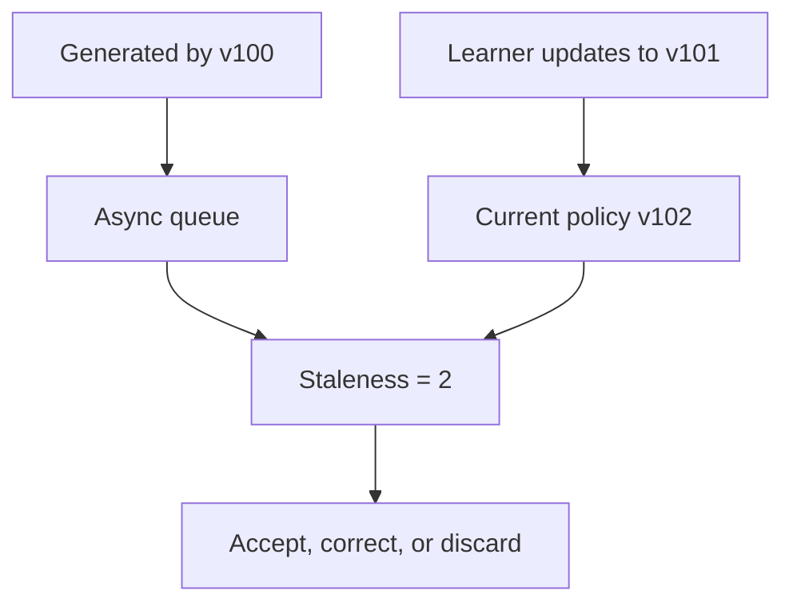

**Rollout staleness** measures how many policy updates separate the weights that generated a trajectory from the weights training on it. Staleness zero means the weight versions match; calling the data on-policy also requires matching the behavior distribution, including sampling transforms and runtime routing. Staleness two means two learner updates occurred after the rollout policy version.

Version distance approximates policy difference. Tiny learning-rate steps may leave ratios near one, while one aggressive update can create large drift. Operators should track both staleness and token-level policy ratios.

## Queue dynamics

Generation that outruns training fills queues with old work. Training that outruns generation starves for samples. A staleness manager rejects, replaces, or delays work to keep pipeline within its configured bound.

## Diagram

## Example

A trajectory generated under v130 arrives after learner reaches v132. It meets a `max_staleness_steps=2` bound, but extreme token ratios can still make it unsafe for an uncorrected update.

## Why it matters here

When a training setup omits token-level importance-sampling correction, bounded staleness, clipping statistics, and rollout-to-learner parity become especially important. A version bound describes freshness; those additional checks support unbiased and safe updates.

## Related terms

- [Asynchronous reinforcement learning](glossary://asynchronous-rl)
- [Policy ratio](glossary://policy-ratio)
- [Importance sampling](glossary://importance-sampling)
- [Training-serving skew](glossary://training-serving-skew)
- [Rollout](glossary://rollout)
