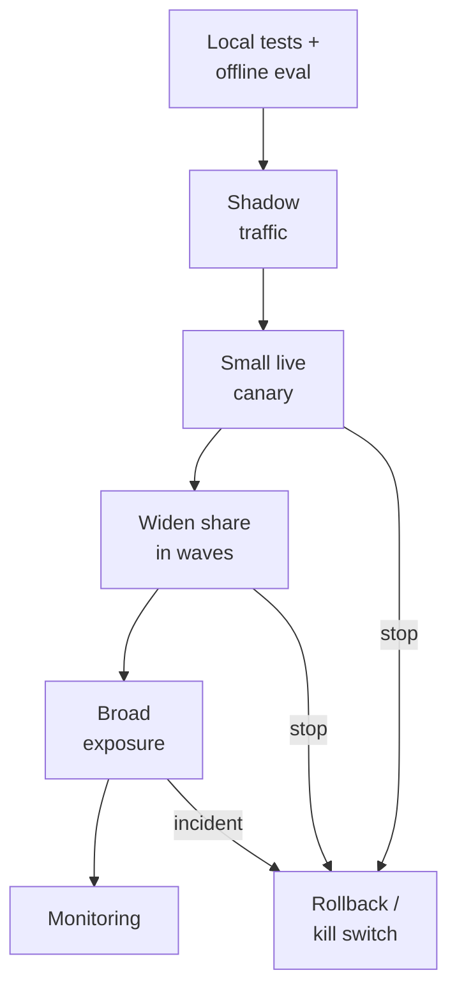

A **rollout** is the controlled process of exposing a change to more users, tenants, regions, or request slices over time, with explicit stages, metrics, stop conditions, and a known [rollback](glossary://rollback) path. Its goal is a **bounded blast radius**: learn under real load while most traffic still runs the previous known-good path.

Google SRE states the core rule plainly: non-emergency rollouts must proceed in stages. Binary *and* configuration changes introduce risk; you mitigate that risk by applying the change to small fractions of traffic and capacity at a time, supervising each stage, and rolling back first when something unexpected appears. Progressive deployment tooling (canary phases, wave-based promotion, blue/green traffic cutovers) is how platforms implement that discipline at scale.

In AI systems a rollout is often multi-artifact. The live path may change a model alias, prompt template, retriever index, safety policy, feature flag, cache key, and app binary on different clocks. A rollout plan that only tracks "the container image" leaves those other pointers free to drift.

In reinforcement learning and RLHF, *rollout* also means sampling a trajectory (prompts and completions, or agent steps) under the current policy for training. That is data collection for optimization. This entry uses the **release and exposure control** meaning.

## Diagram

Each step answers a different question. Skipping from unit tests to all users leaves production-only failures (long-tail queries, provider latency, tool side effects, tenant mix) invisible until the whole fleet is already on the bad path.

## How it works

1. **Name the change set.** List every artifact that will move: code version, model route, prompt version, index/versioned embeddings, safety thresholds, feature flags, schema or migration, cache namespace. If two artifacts must stay compatible, say so before traffic moves.
2. **Climb the evidence ladder.** Prefer offline [eval gates](glossary://eval-gate) on pinned suites, then [shadow traffic](glossary://shadow-traffic) when side effects can stay read-only, then a [canary rollout](glossary://canary-rollout) or small sticky [traffic split](glossary://traffic-split), then broader waves (tenant, region, percentage).
3. **Hold and compare.** Each stage needs a hold window long enough for the failure modes you care about, and metrics that are **version-attributable** (tags for code, model, prompt, retriever, flag, stage). Whole-fleet averages hide a bad 2% cohort.
4. **Advance or reverse.** Step shares only while predeclared stop rules stay green. Rollback should be one control-plane action (route weight, flag, alias pin), not a rebuild. A [kill switch](glossary://kill-switch) covers emergency zeroing when a staged reverse is still too slow.
5. **Supervise until stable.** Staged rollouts need eyes or reliable automation on error rate, latency, cost, safety, and quality slices. Check [sample-ratio](glossary://sample-ratio-mismatch) health for randomized splits against their eligible assignment population; deliberate tenant or region waves need cohort-specific checks instead. After 100%, keep a post-release watch across relevant traffic patterns and diurnal cycles.

### Rollout plan minimum

Write down stages, owners, metrics, stop conditions, rollback path, and any state that must stay compatible across versions. Include what happens if the change is half-launched by day's end (who owns the intermediate state overnight, which version serves new sessions, whether dual-writes continue).

| Stage | Typical question | User-visible? |
|---|---|---|
| Offline eval | Does the frozen suite still pass? | No |
| Shadow | How does the candidate score on live inputs? | No |
| Canary / small split | Is live impact safe to expand? | Yes, small |
| Wave / region / tenant expand | Does risk stay bounded under broader mix? | Yes, growing |
| Full + post-watch | Can the change stay at full exposure? | Yes |

## Example

A hypothetical team ships a new hybrid retriever (BM25 + dense) and a prompt that expects the new citation fields. Plan:

| Stage | Exposure | Hold | Gate |
|---|---|---|---|
| Offline | Golden + regression suite | CI | Citation presence $\ge$ baseline $-1$ pp; safety rows $100\%$ pass |
| Shadow | $10\%$ of live queries, read-only | $2$ h peak | Diff rate, p95 retrieval, cost/query vs control |
| Canary | $1\%$ sticky by conversation id | $45$ min | Error rate, p95 e2e, acceptance, tool writes |
| Expand | $5\% \to 25\% \to 50\%$ | $30$-$60$ min each | Same SLIs; no sample-ratio skew |
| Full | $100\%$ | $24$ h watch | SLO burn, support tags, slice regressions |

Illustrative canary observations: control p95 $1.9$s, canary p95 $2.1$s; citation-present $91\%$ vs $90\%$; zero observed extra safety failures. Advance only if these meet predeclared thresholds with enough samples; rare harm can remain unseen in a finite sample. At $25\%$, token cost per answered chat rises $40\%$ with no acceptance gain and breaches the cost gate. **Stop expansion**, flip the flag back to the previous retriever+prompt pair, and keep the dual-index warm only if needed for diagnosis.

Tag every request with `code_sha`, `model_route`, `prompt_id`, `index_id`, `flag_key`, `rollout_stage`, and metric window so post-mortems can reconstruct what users actually hit.

## What moves

AI rollouts often involve more than code:

- **Serving:** container image, gateway route, autoscaling policy
- **Models:** checkpoint alias, LoRA adapter, provider model id, temperature / decoding config
- **Prompts and policies:** template version, tool allowlist, safety thresholds, system instructions
- **Data plane:** embeddings, vector index build, feature store definitions, schema migrations
- **Runtime state:** cache keys, KV/prefix cache namespaces, sticky session affinity

Record the active set of those versions for the cohort under test. "We rolled out the app" is incomplete if the model alias or index still points at the old (or wrong) artifact. Shadow requests must suppress write side effects and have bounded resource budgets: even answers hidden from users can overload shared backends.

## State compatibility

Rollouts fail when coexisting versions disagree about state:

- New prompt expects a retriever field the old index does not emit
- New app build reads a cache key shape written by an older worker
- New model route needs different safety thresholds than the shared policy service
- Dual-write migration half-done: readers and writers disagree on schema
- Sticky sessions broken: multi-turn chat alternates models mid-conversation

Name compatibility points **before** moving traffic. Prefer dual-read / dual-write windows, versioned cache namespaces, and sticky assignment by conversation or tenant until the old path is retired. If rollback cannot restore a coherent state (for example, a one-way re-embed without keeping the previous index), plan a data-plane forward fix with its own recovery path.

## Trade-offs

| Choice | When it helps | Cost |
|---|---|---|
| Many small stages | High-risk tools, multi-tenant RAG, write side effects | Longer calendar time; more ops attention |
| Short holds + sharp metrics | High QPS, homogeneous traffic, frequent deploys | Miss rare failures if the window is too short |
| Long holds + broad slices | Low QPS, diverse tenants, safety-sensitive paths | Slower ship; harder to keep one canary clean |
| All-at-once (tiny change, easy rollback) | Config typo fix with instant reverse, no state risk | Zero progressive evidence if you guessed wrong |

Risk of the change, traffic diversity, shared backends (GPU pools, vector stores), and whether the change mutates data should set stage size and hold length. Feature flags implement exposure control; the evidence ladder determines when to expand.

## Why it matters here

LeetLLM treats AI launches as staged system changes because model behavior, data assets, and product code can fail independently, and often only under production mix. Offline scores can pass while live latency, cost, tool writes, or long-tail retrieval break. A disciplined rollout turns those risks into ordered bets: prove offline, prove on live inputs without user impact when possible, prove on a small live share, then expand, always with a drilled reverse path.

## Related terms

- [Canary rollout](glossary://canary-rollout)
- [Shadow traffic](glossary://shadow-traffic)
- [Traffic split](glossary://traffic-split)
- [Rollback](glossary://rollback)
- [Feature flag](glossary://feature-flag)
