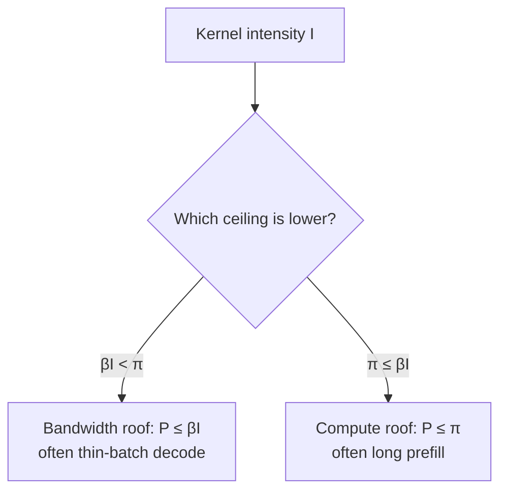

The **roofline model** is a bound-and-bottleneck performance model: it plots an upper limit on attainable compute rate against a kernel's [arithmetic intensity](glossary://arithmetic-intensity) (FLOPs per byte of off-chip memory traffic). At each intensity, the kernel cannot exceed the lower of peak FLOP/s and peak bandwidth times that intensity. Williams, Waterman, and Patterson (Commun. ACM, 2009) introduced it as a visual tool for multicore floating-point code; the same geometry now guides GPU and LLM serving analysis on [HBM](glossary://hbm).

It provides an **upper bound** on attainable performance. Real kernels run on or below the roof because of latency, launch overhead, imperfect occupancy, non-ideal memory patterns, and communication.

## Formula

Let $\pi$ be peak compute (FLOP/s), $\beta$ peak sustainable memory bandwidth (bytes/s), and $I$ operational (arithmetic) intensity (FLOPs/byte). Attainable performance $P$ satisfies

$$
P \le \min(\pi,\; \beta \cdot I)
$$

The **ridge point** (machine balance) is where the flat compute roof meets the sloped bandwidth roof:

$$
I_{\mathrm{ridge}} = \frac{\pi}{\beta}
$$

- If $I < I_{\mathrm{ridge}}$, the **diagonal** bandwidth roof is the tighter bound. Raising peak FLOPs alone doesn't raise that bound.
- If $I > I_{\mathrm{ridge}}$, the **horizontal** compute roof is tighter. Raising bandwidth alone doesn't raise that bound.

The roofline sets theoretical bounds for the kernel. Compare achieved performance and utilization with both bounds to identify its actual bottleneck.

Williams et al. define operational intensity as work per byte of traffic **between last-level cache and DRAM** (after the hierarchy filters reuse), not processor-to-cache traffic. On GPUs the analogous off-chip pool is usually HBM. Algorithmic estimates of $I$ (compulsory reads/writes only) can differ from profiler-measured $I$ (actual HBM transactions).

## Diagram

On a log-log plot the bandwidth limit is a 45-degree diagonal; peak FLOP/s is a horizontal line. The broken line they form is the "roofline." A kernel is a vertical line at its $I$; where that line meets the roof is the theoretical ceiling for that hardware.

## Worked numbers

### H100 SXM ridge (dense Tensor Core BF16)

Public H100 SXM figures commonly used for this sketch: peak HBM bandwidth $\beta \approx 3.35$ TB/s and dense BF16/FP16 Tensor Core peak near $\pi \approx 989$ TFLOPS (datasheet peaks near $1979$ TFLOPS usually include 2:1 structured sparsity). Ridge intensity:

$$
I_{\mathrm{ridge}} \approx \frac{989 \times 10^{12}}{3.35 \times 10^{12}} \approx 295\ \text{FLOPs/byte}
$$

A kernel must do on the order of hundreds of FLOPs per HBM byte before the flat roof is even reachable. That bar is high for thin matrix-vector work.

### Weight-only intensity for a linear layer

For $y = Wx$ with $W \in \mathbb{R}^{n \times n}$ in BF16 (2 bytes/element), counting a multiply-add as 2 FLOPs and charging only weight traffic once:

$$
W_{\mathrm{flops}} \approx 2 n^{2},\qquad Q_{\mathrm{weights}} \approx 2 n^{2},\qquad I \approx 1\ \text{FLOP/byte}
$$

With token batch $B$ sharing the same weights (matrix-matrix), weight-only intensity scales roughly as $I \approx B$. Activations, KV-cache reads/writes, and kernel epilogues still reduce measured $I$.

### Bandwidth ceiling at decode-like intensity

At $I = 1$ FLOP/byte on that H100 sketch:

$$
P_{\mathrm{mem}} = \beta \cdot I \approx 3.35 \times 10^{12}\ \text{FLOP/s} \approx 3.35\ \text{TFLOPS}
$$

versus ~989 TFLOPS peak compute. The memory roof is two orders of magnitude lower. Under the model, saturated HBM can coincide with low Tensor Core utilization.

## Example

**Single-stream decode of a large dense model.** Each step produces one new token. Every linear layer streams nearly the full weight tensor for a matrix-vector (or very thin matrix-matrix) product and also touches [KV cache](glossary://kv-cache) entries for attention. Intensity sits far left of the ridge.

Consequences:

1. If bandwidth dominates, seconds per token approach **bytes moved per step / sustained HBM bandwidth**; tokens/sec is the reciprocal. Queueing, launches, and communication can lower achieved throughput further.
2. Higher peak TFLOPS alone doesn't raise the bandwidth bound; a different GPU can also change cache, bandwidth, kernels, and scheduling.
3. Optimizations that cut traffic or raise reuse move the operating point: weight [quantization](glossary://quantization) (fewer bytes per parameter), larger continuous batches (more tokens per weight load), speculative verification of several draft tokens in one pass, fused kernels that avoid extra HBM round-trips.

**Long [prefill](glossary://prefill)** of the same model is the opposite geometry: one weight load multiplies many prompt positions ($M$ large). Intensity rises, the vertical line moves right, and the kernel can approach the compute roof. That is why [TTFT](glossary://ttft) and decode tokens/sec often respond to different serving knobs.

## How it works in LLM serving

| Workload | Geometry | Typical $I$ | Likely roof | What helps |
|---|---|---|---|---|
| Prefill, long prompt | matrix-matrix GEMMs | high | compute | better kernels, higher TFLOPS, FlashAttention-style fusion |
| Decode, batch $\approx 1$ | near matrix-vector + KV traffic | low | HBM bandwidth | quantize, fuse, cut KV bytes, speculative batch verify |
| Decode, large continuous batch | many sequences share weights | medium→high | can climb toward compute | continuous batching, higher concurrency |
| Naive attention materializing $N\times N$ | huge intermediate traffic | drops | HBM / capacity | [FlashAttention](glossary://flashattention) reduces HBM traffic; backward recomputation can add FLOPs |

**Ceilings under the roof.** The original paper also draws lower "ceilings" (e.g., missing SIMD, poor memory affinity) that you must clear before you can reach the ideal roof. On GPUs, analogous gaps include low occupancy, uncoalesced accesses, CPU-GPU sync, Python/runtime overhead, and NCCL all-reduce on multi-GPU runs. Hierarchical rooflines (HBM vs L2 vs shared memory) refine *which* memory level is the bottleneck; NVIDIA Nsight Compute and NERSC-style hierarchical analysis collect FLOPs and bytes per level.

## Debug path

1. **Name the hot kernel or phase** (e.g., decode GEMM, attention, all-reduce) alongside end-to-end latency.
2. **Estimate or measure $I$:** FLOPs from the algorithm (or profiler counters); bytes from HBM read+write transactions (device memory roofline) or hierarchical levels if available.
3. **Build the machine roof:** $\pi$ and $\beta$ from datasheet *or* empirical microbenchmarks (sustained bandwidth is often below pin peak).
4. **Place the kernel:** compute $P_{\mathrm{bound}} = \min(\pi, \beta I)$ and compare to achieved FLOP/s $= \mathrm{FLOPs}/\mathrm{time}$.
5. **Interpret the gap:**
   - Near the sloped roof, high HBM utilization, low Tensor Core util → memory-bound: cut HBM traffic or raise reuse.
   - Near the flat roof, high compute util → compute-bound: algorithmic FLOP reduction or faster math units matter more.
   - Far below both roofs → inspect launch overhead, stragglers, host stalls, locks, or network.

For a profiled region, compute intensity, the roof bound, achieved performance, and their ratio:

$$
\begin{aligned}
I &= \frac{\texttt{flop\_count}}{\texttt{hbm\_bytes}} \\
P_{\mathrm{roof}} &= \min(\texttt{peak\_flops},\;\texttt{peak\_bw} \cdot I) \\
P_{\mathrm{meas}} &= \frac{\texttt{flop\_count}}{\texttt{elapsed\_s}} \\
\mathrm{gap} &= \frac{P_{\mathrm{meas}}}{P_{\mathrm{roof}}}
\end{aligned}
$$

A gap of $1.0$ is ideal; a value much smaller than $1$ indicates other bottlenecks.

## Why it matters here

Roofline reasoning turns vague "the GPU is slow" into a decision tree for LLM systems: is this path under the **memory** roof or the **compute** roof? Prefill vs [decode](glossary://decode-phase), batching, quantization, FlashAttention, and speculative decoding all change either $I$ or how many HBM bytes move per useful FLOP. Without that map, teams optimize the wrong resource (chasing TFLOPS while HBM is the ceiling, or buying bandwidth when large GEMMs already sit on the flat roof).

## Related terms

- [Arithmetic intensity](glossary://arithmetic-intensity)
- [HBM](glossary://hbm)
- [Prefill](glossary://prefill)
- [Decode phase](glossary://decode-phase)
- [FlashAttention](glossary://flashattention)
