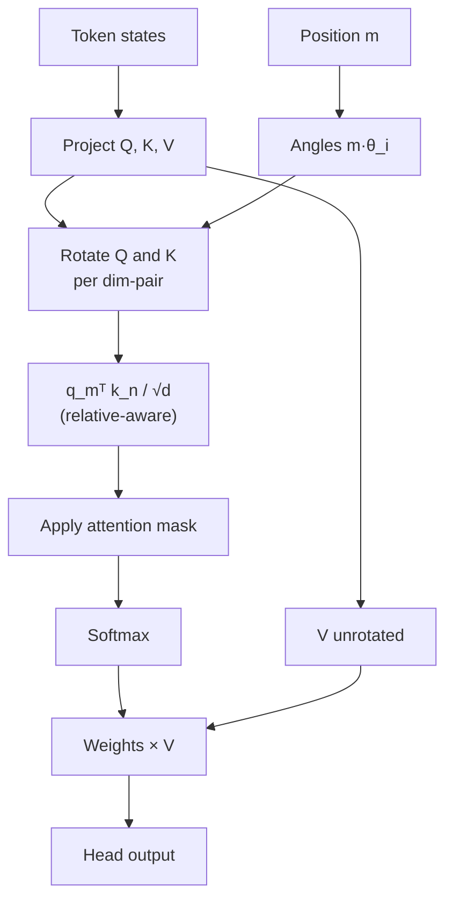

**RoPE** (Rotary Position Embedding) encodes token position by rotating pairs of dimensions in the query and key vectors before the attention score is computed. Absolute position $m$ becomes a set of 2D rotations at fixed frequencies; after both sides are rotated, the explicit rotary contribution to $\langle R_m q, R_n k\rangle$ depends on relative offset $n-m$. Su et al. introduced RoPE in RoFormer (arXiv:2104.09864). Decoder families including LLaMA use it.

Unlike additive sinusoids or learned position tables, RoPE does not add a position vector to the residual stream. It multiplies $Q$ and $K$ by orthogonal rotation matrices (implemented as cheap cos/sin multiplies). Values $V$ are usually left unrotated. There is no separate position embedding table to grow when you change max length.

## Intuition

Self-attention is a set operation over token vectors unless order is injected somewhere. RoPE injects order geometrically: treat consecutive pairs of head dimensions as 2D planes, and spin each plane by an angle proportional to the token's position.

If you rotate both a query and a key by the *same* absolute offset, their relative angle is unchanged, so the content part of the score is translation-equivariant along the sequence. What remains is sensitivity to how far apart the two tokens are. Nearby tokens share similar rotations on high-frequency planes; distant tokens differ a lot on those planes and still differ on slow, low-frequency planes. That multi-frequency mix is why RoPE can mark both local order and long-range structure without a learned bias table.

## How it works

For a full-head rotary implementation with even head dimension $d$ (partial implementations rotate only an even-width subspace):

1. Project tokens to $Q$, $K$, $V$ as usual (no absolute position added to embeddings).
2. For each position $m$, build angles $m\theta_i$ for $i = 0,\ldots,d/2-1$ with base frequencies $\theta_i$ (see Formula).
3. For each pair of dimensions $(2i, 2i+1)$, rotate the query (and key) coordinates by $m\theta_i$:
   $$
   \begin{pmatrix} x'_{2i} \\ x'_{2i+1} \end{pmatrix}
   =
   \begin{pmatrix}
   \cos(m\theta_i) & -\sin(m\theta_i) \\
   \sin(m\theta_i) & \cos(m\theta_i)
   \end{pmatrix}
   \begin{pmatrix} x_{2i} \\ x_{2i+1} \end{pmatrix}
   $$
4. Compute scaled scores $q_m^{\top} k_n / \sqrt{d}$, apply the attention mask, then softmax and mix $V$.

In code this is almost never a dense $d\times d$ multiply. Implementations precompute $\cos$ and $\sin$ caches and use the sparse form from the paper: $x \odot \cos + \mathrm{rotate\_pair}(x) \odot \sin$. Two common pair layouts exist:

- **Interleaved pairs:** dimensions $(0,1)$, $(2,3)$, … (paper-style / GPT-J-style).
- **Half-split rotate:** first $d/2$ dims vs second $d/2$ (common Hugging Face LLaMA path after a weight `permute` at conversion).

Both can be correct if weights and rotation layout match. Mixing an interleaved checkpoint with a half-split kernel (or the reverse) silently corrupts attention.

Position ids for decode must continue past the prompt. Cached keys already carry the rotation applied at their original positions; only the new query (and new key) need the next position's angles. Wrong position ids after a [KV cache](glossary://kv-cache) hit are a classic "model went crazy after the first token" bug.

## Formula

For even head dimension $d$ and base $b$ (classically $b = 10000$):

$$
\theta_i = b^{-2i/d}, \qquad i = 0, 1, \ldots, \frac{d}{2}-1
$$

(equivalently $\theta_i = b^{-2(i-1)/d}$ with $i \in \{1,\ldots,d/2\}$ as written in Su et al.). The rotary block-diagonal matrix $R_{\Theta,m}^{d}$ applies the 2D rotation by $m\theta_i$ on each pair. After rotating both sides:

$$
q_m^{\top} k_n
=
(R_{\Theta,m}^{d} W_q x_m)^{\top}
(R_{\Theta,n}^{d} W_k x_n)
=
x_m^{\top} W_q^{\top}
R_{\Theta,n-m}^{d}
W_k x_n
$$

so the explicit rotary contribution depends on relative offset $n-m$. The content states $x_m,x_n$ may themselves depend on earlier context and position; this identity doesn't make the whole causal Transformer translation invariant. Efficient application (Su et al., computational form):

$$
R_{\Theta,m}^{d}\,x
=
\begin{pmatrix}x_1\\x_2\\x_3\\x_4\\\vdots\end{pmatrix}
\odot
\begin{pmatrix}\cos m\theta_1\\\cos m\theta_1\\\cos m\theta_2\\\cos m\theta_2\\\vdots\end{pmatrix}
+
\begin{pmatrix}-x_2\\x_1\\-x_4\\x_3\\\vdots\end{pmatrix}
\odot
\begin{pmatrix}\sin m\theta_1\\\sin m\theta_1\\\sin m\theta_2\\\sin m\theta_2\\\vdots\end{pmatrix}
$$

The paper discusses a **long-term decay** tendency under its analysis of the multi-frequency sum. Individual pair contributions oscillate, and content-dependent dot products can rise or fall with distance. Measure attention scores when assessing a head's position behavior; RoPE does not enforce a monotonic distance penalty.

Scaled variants rewrite $\theta_i$ or the effective position $m$ so longer sequences stay inside a trained angular range. Hugging Face `rope_type` names include `default`, `linear` (position interpolation), `dynamic` (NTK-aware base rescale), `yarn`, `longrope`, and `llama3`. Record config keys such as `rope_theta`, `factor`, `original_max_position_embeddings`, and partial rotary factor with the model artifact, and keep the runtime aligned with those values.

## Diagram



## Example

Same content vector $x = (1.0, 0.0)$ treated as a single 2D pair, base angle $\theta = \pi/8$ (toy frequency, not production $\theta_i$).

| Position $m$ | Angle $m\theta$ | Rotated $(x'_0, x'_1)$ |
|-------------:|----------------:|------------------------|
| 0 | $0$ | $(1.00,\ 0.00)$ |
| 1 | $\pi/8$ | $(0.92,\ 0.38)$ |
| 4 | $\pi/2$ | $(0.00,\ 1.00)$ |

Dot product of two rotated copies depends only on the angle difference:

```python
import math

def rope2d(x0: float, x1: float, m: int, theta: float) -> tuple[float, float]:
    c, s = math.cos(m * theta), math.sin(m * theta)
    return x0 * c - x1 * s, x0 * s + x1 * c

theta = math.pi / 8
q = rope2d(1.0, 0.0, m=3, theta=theta)
k_near = rope2d(1.0, 0.0, m=4, theta=theta)   # relative +1
k_far = rope2d(1.0, 0.0, m=11, theta=theta)  # relative +8

score_near = q[0] * k_near[0] + q[1] * k_near[1]  # cos(θ) ≈ 0.92
score_far = q[0] * k_far[0] + q[1] * k_far[1]    # cos(8θ) = cos(π) = -1.0
```

Identical content at distance 1 scores high; at distance 8 the same content scores low (here, anti-aligned). Real heads use many $\theta_i$ in parallel, so the score is a sum of pair contributions at different frequencies, not a single cosine.

## Worked numbers

Head dim $d=4$, base $b=10000$ (paper / LLaMA default scale):

$$
\theta_0 = 10000^{0} = 1, \qquad
\theta_1 = 10000^{-2/4} = 10000^{-0.5} = 0.01
$$

At position $m=100$:

- Fast plane: angle $100\cdot 1 = 100$ rad (many turns; sensitive to small $\Delta m$).
- Slow plane: angle $100\cdot 0.01 = 1$ rad $\approx 57°$ (still in a single turn; carries coarser distance).

Raising base $b$ (for example Code LLaMA-style large `rope_theta`) leaves the first frequency $\theta_0=1$ unchanged and slows the lower-frequency planes with $i>0$: the same absolute position produces smaller angles only in those planes. This is one way models are trained or adapted for longer context. Linear position interpolation instead maps position $m$ to $m/s$ so a sequence of length $s\cdot L_{\text{train}}$ stays inside the trained index range. NTK-aware / YaRN methods rescale frequencies non-uniformly so high-frequency (local) planes are less crushed than low-frequency ones. Hugging Face exposes these as `rope_type` plus `factor` and related fields; the checkpoint's metadata must match the serving kernel.

## Trade-offs

| Property | RoPE behavior |
|----------|----------------|
| Where position enters | Geometry of $Q$/$K$ only; $V$ usually plain |
| Parameters | No position table; frequencies fixed (or scaled by config) |
| Relative vs absolute | Absolute rotations; relative dependence appears in $q^{\top}k$ |
| Length change | Defined for any index, but quality past train length needs scaling + data/evals |
| Serving contract | Base, layout (pair vs half), scaling type, partial factor, position ids |
| Contrast with ALiBi | ALiBi adds a distance bias to logits; RoPE rotates vectors |

**Production failure pattern:** short prompts match a reference engine; long prompts or multi-turn decode diverge. First checks: `rope_theta` / base, `rope_scaling` / `rope_parameters`, pair layout vs weight permute, whether RoPE is applied to $Q$ and $K$ (not $V$), dtype of cos/sin caches, and position ids when reusing a prefix or KV cache. Context extension is a training and evaluation problem; measure needle retrieval and multi-hop reasoning at the target length.

## Why it matters here

RoPE appears in decoder stacks, GGUF/llama.cpp metadata, Hugging Face `config.json`, and long-context recipes. It sits next to [ALiBi](glossary://alibi) and absolute encodings in the [positional encoding](glossary://positional-encoding) family, and it couples directly to attention correctness, context length, and cache-safe decode. If you convert weights, extend context, or debug "works at 2k, dies at 32k," check RoPE settings against the checkpoint contract.

## Related terms

- [Positional encoding](glossary://positional-encoding)
- [ALiBi](glossary://alibi)
- [Self-attention](glossary://self-attention)
- [Context window](glossary://context-window)
- [KV cache](glossary://kv-cache)
