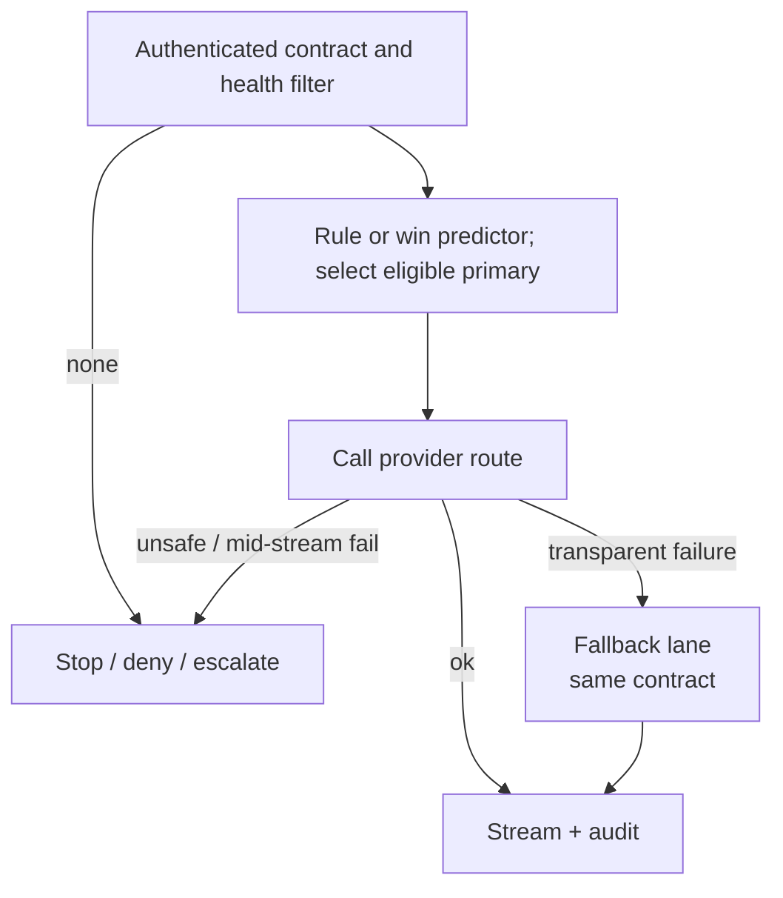

A **routing policy** is versioned product logic that, for each request (or task class), selects which execution path should run: model, provider, tool set, plan tier, context budget, and safety posture. It changes cost, latency, quality, and risk **without rewriting the user's prompt**. The policy sits in the [control plane](glossary://control-plane); the chosen [provider route](glossary://provider-route) is what the data plane actually calls.

A routing policy is a *decision layer* that can combine hard rules (tenant, plan, data residency), soft scores (difficulty, intent), live health signals, and explicit overrides. Infrastructure load balancing across identical deployments of the same model is a narrower concern. Token-level [mixture-of-experts](glossary://mixture-of-experts) routing selects subnetworks within a model; product routing selects the execution path.

## Intuition

Request complexity, privacy, latency, and risk determine the appropriate model and tool surface. A short FAQ can hit a small, cache-friendly model with read-only tools. A risky production migration needs a stronger model, a larger context window, tighter allowlists, and human approval. Encoding those choices as buried prompt conditionals ("if hard, think carefully...") is opaque, untestable, and hard to A/B. A routing policy makes the same decisions as **named, versioned rules or classifiers** with logs you can replay.

The policy selects the model lane, tool scope, provider, and fallback contract. A wrong route can raise cost, violate data policy, or reduce quality even when generation on the selected route works as designed.

## How it works

A production routing policy usually runs as a short pipeline before generation:

1. **Compile inputs.** Plan, tenant, task type / intent, data sensitivity, estimated context length, latency budget, spend budget, tool needs, feature flags, provider health, and any override.
2. **Filter legal paths.** Drop routes that violate residency, privacy, schema, tool allowlists, or plan entitlements. This contract filter determines which routes are eligible before quality ranking.
3. **Score or classify remaining paths.** Rules (`task=autocomplete → small-local`), heuristics (token length thresholds), or a learned router that estimates which model will win on quality for this query.
4. **Pick primary route.** Apply cost, latency, and quality thresholds. Optionally attach canary weights via a [traffic split](glossary://traffic-split).
5. **Attach fallback and limits.** Declare [fallback lanes](glossary://fallback-lane), [rate limits](glossary://rate-limit), and circuit health. Failover must preserve the contract; a cheaper public model is eligible only when data policy permits it.
6. **Stamp the decision.** Log policy id/version, inputs, chosen route, score, override reason, and estimated cost delta so a bad answer is traceable to the route that selected it.

Two common **quality-vs-cost** shapes:

| Pattern | When it runs extra models | Typical use |
|---|---|---|
| **Single-shot router** | Never: one model per request | Lowest latency; RouteLLM-style win predictors |
| **Cascade** | Only if the cheap model fails a quality / confidence check | FrugalGPT / AutoMix-style savings when latency allows a second call |

Single-shot routing avoids a second generator call, but router overhead and the chosen model still determine p95 latency. Cascades can recover quality on hard items while paying for the initial weak answer and subsequent calls.

## Formula

Learned routers (for example RouteLLM) treat binary strong/weak selection as a win-prediction problem. From preference data $\mathcal{D}_{\text{pref}} = \{(q, \ell_{s,w})\}$, fit $P_{\bm{\theta}}(\text{win}_s \mid q)$, the probability that the strong model beats the weak model on query $q$. Route with threshold $\alpha \in [0, 1]$:

$$
R^{\alpha}(q) =
\begin{cases}
\mathcal{M}_{\text{weak}} & \text{if } P(\text{win}_s \mid q) < \alpha \\
\mathcal{M}_{\text{strong}} & \text{if } P(\text{win}_s \mid q) \ge \alpha
\end{cases}
$$

Lower $\alpha$ sends more traffic to the strong model (higher quality, higher cost). Higher $\alpha$ saves money and accepts more weak-model answers. Cost is often summarized by the strong-call rate:

$$
c(R^{\alpha}) = \frac{1}{|\mathcal{Q}|} \sum_{q \in \mathcal{Q}} \mathbb{I}\{R^{\alpha}(q) = \mathcal{M}_{\text{strong}}\}
$$

RouteLLM also reports **performance gap recovered** (PGR: how much of the strong-minus-weak quality gap the router closes) and **call-performance threshold** $\mathrm{CPT}(x\%)$ (minimum strong-call share needed to recover fraction $x$ of that gap). On MT Bench, their matrix-factorization router trained on Arena + LLM-judge labels reached about **95% of GPT-4 absolute score with roughly 14% strong-model calls** at $\mathrm{CPT}(50\%)$ (large savings vs always-GPT-4 and vs random routing at the same quality). Those numbers are benchmark-specific; your product needs its own labeled slices.

## Diagram



## Example

A hypothetical coding assistant has three declared lanes and policy version `route-v12`. Costs below are illustrative assumptions, not current provider prices:

| Lane | Model | Tools | Typical answer cost | Role |
|---|---|---|---|---|
| `sub-local` | small local 7B | read-only symbol lookup | ~\$0.0002 | Autocomplete, trivial FAQ |
| `sub-api` | mid API model | repo search + read | ~\$0.004 | Routine edits, explain code |
| `premium` | frontier model | search + write + CI | ~\$0.04 | Multi-file refactors, incidents |

Policy (simplified). Hard contract rules run first; then either fixed task rules or a RouteLLM-style win threshold between mid and premium:

```python title="route_policy.py"
from dataclasses import dataclass

@dataclass(frozen=True)
class RouteDecision:
    lane: str
    policy_version: str
    reason: str
    p_strong: float | None = None

def route(
    *,
    plan: str,
    task: str,
    context_tokens: int,
    private_data: bool,
    p_strong: float | None,
    provider_a_healthy: bool,
    eligible_lanes: frozenset[str],  # trusted contract/health/capacity filter
    alpha: float = 0.55,
) -> RouteDecision:
    v = "route-v12"
    if not 0 <= alpha <= 1 or (p_strong is not None and not 0 <= p_strong <= 1):
        raise ValueError("routing probabilities must be in [0, 1]")
    def choose(lane: str, reason: str) -> RouteDecision:
        if lane not in eligible_lanes:
            return RouteDecision("deny", v, "preferred_lane_ineligible", p_strong)
        return RouteDecision(lane, v, reason, p_strong)
    if private_data and not provider_a_healthy:
        return choose("sub-local", "private_and_primary_unhealthy")
    if task in {"autocomplete", "docstring"} and context_tokens < 2_000:
        return choose("sub-local", "easy_local")
    if plan == "free" or task == "faq":
        return choose("sub-api", "plan_or_faq")
    if task in {"multi_file_refactor", "incident_debug"} or context_tokens > 24_000:
        return choose("premium", "hard_or_long_context")
    # Learned difficulty: P(strong wins) promotes only when above alpha
    if p_strong is not None:
        if p_strong >= alpha:
            return choose("premium", f"p_strong={p_strong:.2f}>={alpha}")
        return choose("sub-api", f"p_strong={p_strong:.2f}<{alpha}")
    return choose("sub-api", "default")
```

The caller computes `eligible_lanes` from authenticated entitlements, privacy/residency, context capacity, tool permissions, and health. This conservative sketch denies when the preferred lane is ineligible; a real fallback must be selected from the same filtered set. Example requests assume the listed lane is eligible:

| Request | Decision | Why |
|---|---|---|
| Tab-complete one function, 400 tokens | `sub-local` | `easy_local` |
| "Why does this test fail?" 6k tokens, team plan, no score | `sub-api` | default mid tier |
| "Explain this API," $P(\text{win}_s)=0.81$, team plan | `premium` | win score $\ge \alpha$ |
| "Refactor auth across 40 files," any $P$ | `premium` | hard task rule |
| Same hard task, provider A open-circuited, private tenant code | stay private: `sub-local` or regional private lane, not a public cheap model | contract preserved |

Each decision writes: policy version, lane id, $P(\text{win}_s)$ if used, override, estimated cost delta, and feature-flag snapshot.

## Worked numbers

Suppose 10,000 support chats per day. Always-frontier costs \$0.03 per answer $\Rightarrow$ \$300/day. A conservative policy sends 70% to mid (\$0.004), 25% to frontier (\$0.03), 5% to local (\$0.0002):

$$
\begin{align*}
C &= 10000 \times (0.70 \cdot 0.004 + 0.25 \cdot 0.03 + 0.05 \cdot 0.0002) \\
  &= 10000 \times (0.0028 + 0.0075 + 0.00001) \\
  &= \$103.1\text{/day}
\end{align*}
$$

Roughly a **3×** spend cut versus always-frontier *before* counting secondary effects (less premium rate-limit pressure, more room under quotas). Quality holds when the 70% mid-tier slice matches actual request difficulty. Measure quality on **slices that match production mix** alongside hard benchmarks: a router that looks great on MT Bench can still dump billing disputes onto a weak model.

If a cascade retries 15% of mid-tier answers on the frontier model, add that cost and latency:

$$
C_{\text{cascade}} \approx C + 10000 \times 0.70 \times 0.15 \times 0.03 = C + \$31.50
$$

Cascades buy quality on ambiguous items; they also change p95 latency and spend. Here 15% of the 7,000 mid-tier calls are retried. Choose the design using measured router overhead, quality, and end-to-end latency budgets.

## Trade-offs

| Choice | Upside | Downside |
|---|---|---|
| Rule tables only | Auditable, cheap, deterministic | Miss soft difficulty; thrash on edge cases |
| Learned win predictor | Captures "this query needs GPT-class" | Needs preference labels; drifts when models change |
| Cascade / self-verify | Recovers weak-model failures | Extra latency and dual spend |
| Aggressive cheap default | Lowest bill | Silent quality regressions, support load |
| Aggressive premium default | Highest quality | Budget and rate-limit blowups |

Also separate **path selection** from **deployment selection**. LiteLLM-style strategies (weighted shuffle, least-busy, latency-based, cost-based) choose among *healthy copies of a named model group*. Your routing policy first decides *which group* (or capability tier) is legal; the gateway then load-balances inside that group.

## Debug path

When answers look wrong, inspect route before model weights:

1. Pull `policy_version`, lane, and reason codes for the request id.
2. Recompute eligibility: would a private-data request still pass the same filters?
3. Check override and [feature flag](glossary://feature-flag) snapshot (canary weights, kill switches).
4. Compare offline: same input on the path that *should* have won; measure quality and cost delta.
5. Watch distribution drift: share of traffic per lane, strong-call rate $c(R)$, fallback rate, and quality by task slice.
6. Confirm fallbacks preserve contract (schema, tools, residency); a "successful" fallback to a weaker public model can be a safety incident.

Common production failures: hidden heuristics inside prompts, routes that ignore plan entitlements, fallbacks that skip review gates, stale policy versions across regions, and routers trained on chat arena data applied unchanged to code or math without in-domain labels.

## Why it matters here

Routing policy is where product intent becomes concrete model and tool selection at request time. Curriculum work on gateways, agents, test-time compute, and cost control all assume you can send easy work cheap and hard work expensive, with an [audit trail](glossary://audit-trail). Without an explicit policy, cost and safety are accidental properties of whichever model string was hardcoded last.

## Related terms

- [Provider route](glossary://provider-route)
- [Fallback lane](glossary://fallback-lane)
- [Control plane](glossary://control-plane)
- [Traffic split](glossary://traffic-split)
- [Feature flag](glossary://feature-flag)
