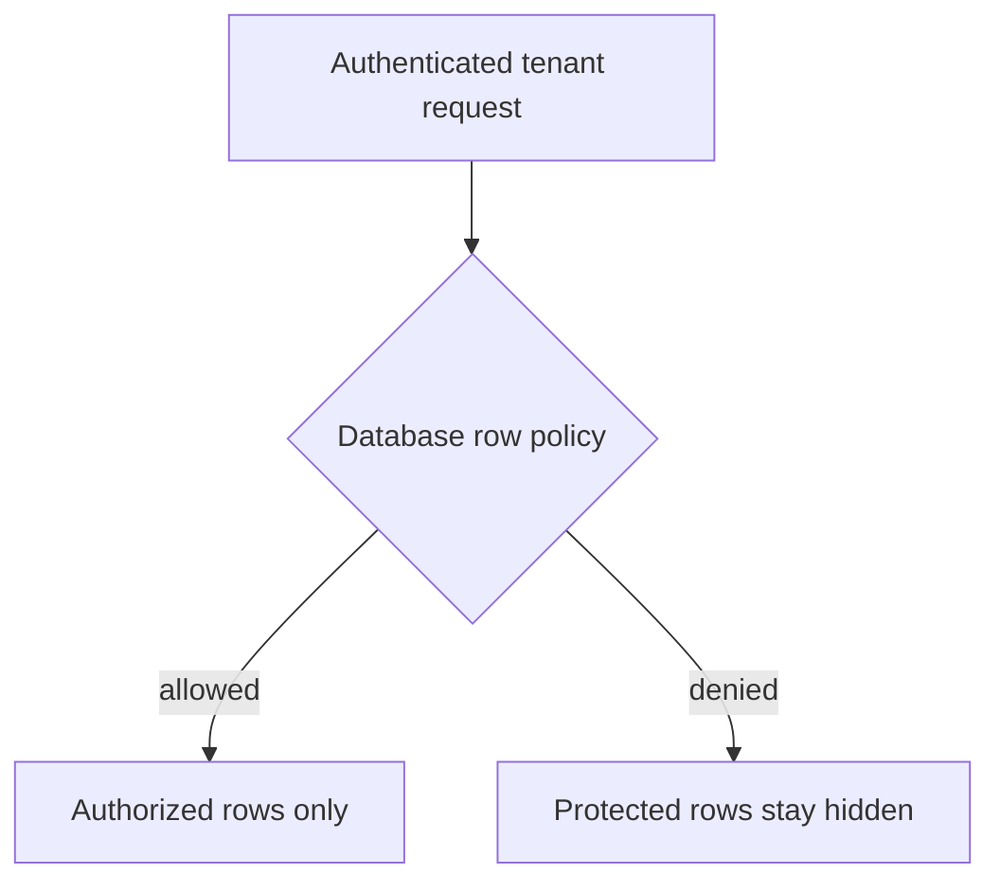

**Row-level security (RLS)** lets a database enforce authorization policies on individual rows inside query execution. PostgreSQL evaluates a policy against the active database identity and statement, restricting rows before results enter application memory.

RLS safety also depends on connection roles and ordinary SQL privileges. The [PostgreSQL row-security documentation](https://www.postgresql.org/docs/current/ddl-rowsecurity.html) explains that superusers and roles with `BYPASSRLS` always bypass it. Table owners normally bypass it but can be subject to `FORCE ROW LEVEL SECURITY`. Once RLS is enabled, absent policies default to deny; ordinary SQL privileges still apply. `USING` controls existing-row access, while `WITH CHECK` constrains inserted or updated row values.

## Keep the decision inside the database

## Example

A document table stores `tenant_id`, `classification`, and an owner or approved group for each chunk. A trusted application establishes authenticated tenant `acme` in transaction-local state on a nonprivileged pooled connection. An RLS policy requiring `tenant_id = current_setting('app.tenant_id')` hides tenant `beta` rows. This assumes users cannot submit arbitrary SQL or choose that setting; a caller-controlled tenant variable is not authentication. Add separate classification/group conditions for finer document grants, and clear request context when returning the connection.

Approximate vector indexes can still return fewer eligible results when a selective SQL predicate removes candidates after the index scan. Iterative scanning or a different execution plan can repair recall, but that performance issue must never be solved by bypassing the authorization policy.

## Why it matters here

LeetLLM's enterprise RAG and Supabase lessons depend on keeping document grants and tenant boundaries below retrieval, ranking, traces, and generated answers. Test both allowed and denied identities, policy freshness, pooled-connection isolation, and privileged-role configuration.

## Related terms

- [PostgreSQL](glossary://postgresql)
- [Tenant isolation](glossary://tenant-isolation)
- [Access control list](glossary://acl)
- [pgvector](glossary://pgvector)
