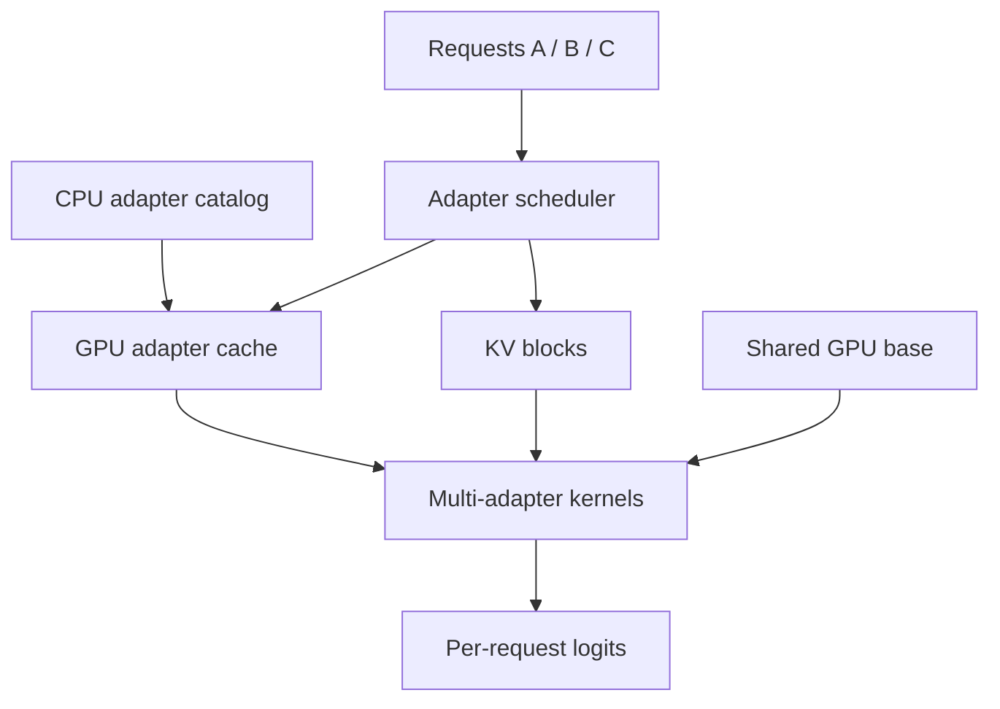

**S-LoRA** is a serving system for batching requests that share one base language model but use many different [LoRA](glossary://lora) adapters. Sheng et al. presented [*S-LoRA: Serving Thousands of Concurrent LoRA Adapters*](https://proceedings.mlsys.org/paper_files/paper/2024/hash/906419cd502575b617cc489a1a696a67-Abstract-Conference.html) at MLSys 2024. The system keeps the large base weights resident, stores a much larger adapter collection in CPU memory, fetches active adapters into GPU memory, and runs heterogeneous-adapter batches with specialized kernels.

S-LoRA is a specific research system, not a generic name for every multi-LoRA server. Engines such as vLLM, LoRAX, Punica, and later systems expose related capabilities with different caches, kernels, scheduling, security boundaries, and adapter-loading APIs.

## Shared base, request-specific delta

For base layer weight $W$ and adapter $i$ with rank $r_i$, LoRA applies:

$$
y = W x + \frac{\alpha_i}{r_i} B_i A_i x
$$

Every request in a batch uses the same expensive $W x$ path but may select different $(A_i,B_i)$. Loading a full merged model per adapter destroys that sharing. Applying many small deltas naively can also produce tiny, irregular matrix operations. Multi-LoRA serving therefore has two coupled problems:

1. place active adapter tensors without wasting GPU memory;
2. execute different ranks and adapter IDs efficiently inside one batch.

## S-LoRA architecture

The paper combines:

- **CPU adapter storage:** host memory holds the large adapter catalog.
- **GPU adapter cache:** only adapters needed by active requests occupy device memory.
- **Unified paging:** one paging design manages variable-rank adapter weights and variable-length KV cache tensors to reduce fragmentation.
- **Heterogeneous batching kernels:** custom CUDA kernels apply different adapters within the same serving batch.
- **Adapter-aware tensor parallelism:** distributed execution accounts for base and adapter computation separately.

The paper reports serving thousands of adapters with small overhead in its evaluated configurations. Those results apply to the tested models, ranks, hardware, and request distributions; benchmark the target runtime before sizing capacity.

## Diagram



## Example

**Serving contract.**

```python
def admit(request, principal):
    adapter = adapter_registry.get(request.adapter_id)
    if adapter is None:
        return reject("unknown_adapter")
    if adapter.tenant_id != principal.tenant_id:
        return reject("adapter_not_allowed")
    if adapter.base_model_digest != worker.base_model_digest:
        return reject("base_model_mismatch")

    return scheduler.enqueue({
        "prompt": request.prompt,
        "adapter_id": adapter.id,
        "adapter_digest": adapter.digest,
        "rank": adapter.rank,
        "max_tokens": min(request.max_tokens, adapter.token_limit),
    })
```

Adapter ID isn't enough. A production registry should pin base-model digest, target modules, rank, scaling, dtype, tokenizer/chat-template compatibility, tenant ownership, approval status, and content digest. Two adapters with the same display name can represent different bytes or incompatible bases.

## Memory accounting

For $N$ adapters, storing all adapter weights on GPU scales roughly as:

$$
M_{\text{adapters}} = \sum_{i=1}^{N} M_i
$$

An active-set cache instead needs device memory for resident base weights, active adapters, KV cache, and workspace:

$$
M_{\text{GPU}}
\approx M_{\text{base}}
+ \sum_{i \in \mathcal{A}_{\text{active}}} M_i
+ M_{\text{KV}}
+ M_{\text{workspace}}
$$

CPU capacity may let the catalog grow, but cold-adapter transfers affect latency. Popularity skew improves cache hit rate; a uniform stream of one-off adapters can thrash PCIe/NVLink transfers and erase batching gains.

## What to benchmark

Use production-shaped adapter traffic:

- number of registered versus concurrently active adapters;
- popularity distribution and adapter-cache hit rate;
- cold-load bytes and latency;
- rank distribution and target modules;
- requests/tokens per second by adapter;
- TTFT and TPOT for hot and cold adapters;
- base, adapter, KV, and workspace memory;
- batch composition and tenant fairness;
- output parity against one-adapter reference execution.

Test mixed-rank and mixed-length batches. A benchmark that repeatedly hits one adapter measures ordinary LoRA serving, not the multi-adapter problem.

## Failure modes

- **Wrong base:** adapter loads but targets incompatible layer names or dimensions.
- **Cross-tenant routing:** caller selects another tenant's adapter.
- **Cache thrash:** low reuse causes constant host-to-device transfers.
- **Hot-adapter starvation:** fairness logic or cold loads delay popular traffic.
- **Silent fallback:** runtime executes adapters serially or outside optimized kernels.
- **Mutable identity:** an adapter ID points to new bytes while caches keep old tensors.
- **Unsafe dynamic loading:** untrusted callers can cause arbitrary adapter downloads or memory exhaustion.

Authorize runtime adapter loading before load and execution. Treat it as a privileged control-plane action with trusted inputs and bounded permissions.

## Why it matters here

LoRA lowers training and storage cost, but serving thousands of customized adapters is a scheduling and memory problem. S-LoRA shows the full systems boundary: shared base compute, adapter placement, paged KV memory, heterogeneous kernels, tensor parallelism, and tenant-safe routing must agree before per-customer fine-tunes become an efficient service.

## Related terms

- [LoRA](glossary://lora)
- [Adapter cache](glossary://adapter-cache)
- [Continuous batching](glossary://continuous-batching)
- [KV cache](glossary://kv-cache)
- [PagedAttention](glossary://pagedattention)
- [Tensor parallelism](glossary://tensor-parallelism)
- [Tenant isolation](glossary://tenant-isolation)
