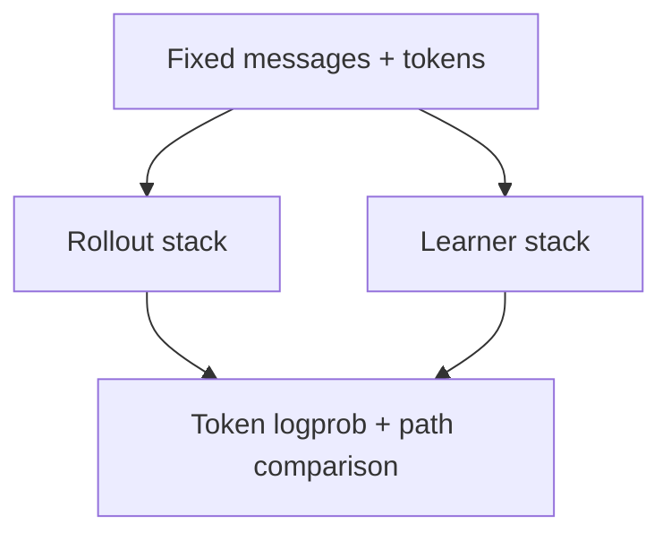

A **same-policy replay** scores a fixed token sequence in rollout and learner stacks using the same checkpoint ancestry, with no optimizer update between them. It creates an execution-parity baseline before policy age or learning drift enters investigation. **R0 replay** labels the diagnostic no-update case, where matching distributions give policy ratio one; the term has no standardized algorithm meaning.

Replay must pin more than a checkpoint name. Record exact artifact digests and quantization ancestry; disable dropout and other training-only stochasticity. Preserve serialized messages, tokenizer/chat template, token IDs, masks, positions, stop handling, and relevant cache state. Pin or replay DSA selections and MoE routes when those paths exist. Compare like distributions: raw next-token log-probabilities and probabilities after temperature/top-k/top-p processing are different quantities.

## Reading result

- Narrow finite delta envelope can be expected from documented precision differences.
- First divergence at tool boundary points toward serialization, template, or loss-mask alignment.
- Divergence only when expert or DSA replay fails points toward discrete execution path.
- Broad mismatch before any update rules out learning rate and rollout staleness as primary cause.

## Example

Load one checkpoint into FP8 rollout engine and BF16 learner, then score same assistant tokens while forcing recorded DSA positions and expert routes. If first delta jump appears immediately after tool observation despite matching routes, inspect serialized messages, token boundaries, and masks before touching optimizer.

## Why it matters here

Live asynchronous traffic moves weights, tasks, queues, and routes at same time. Same-policy replay removes those moving parts so operator can establish whether two engines represent same action distribution at all.

## Related terms

- [Policy mismatch](glossary://policy-mismatch)
- [Policy ratio](glossary://policy-ratio)
- [Router replay](glossary://router-replay)
- [Sampling support](glossary://sampling-support)
