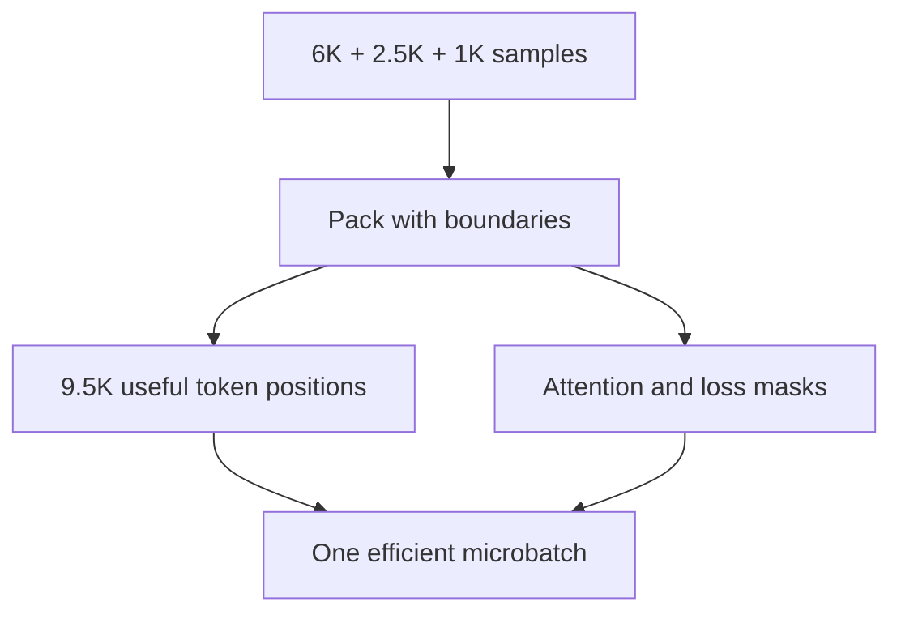

**Sample packing** combines several variable-length training examples into one longer token container so padding doesn't consume most of the compute. Boundaries, positions, labels, and attention masks preserve each sample's independence inside the packed sequence.

For independent-example training, packing needs block-diagonal causal attention (or equivalent variable-length kernel metadata), appropriate position IDs, and loss masks that suppress next-token targets crossing a boundary. An EOS token alone does not block attention. Plain document concatenation used in some pretraining recipes is a different objective that permits cross-document context.

## Utilization gain

Suppose a 10,000-token container receives examples of 6,000, 2,500, and 1,000 tokens. Packing can use 9,500 positions with 500 padding tokens. Separate max-length padding could spend far more positions on zeros, especially when trajectories vary by many turns.

## Diagram

## Example

Two agent trajectories may end after 3 turns while another uses all 27. Packing lets short trajectories share a sequence allocation instead of padding each one to the longest trajectory in the batch.

## Why it matters here

A candidate training run might request a 100K packed container. Treat that as a run-specific setting and validate capacity for GLM-5.3 and the selected sparse-attention and MTP implementations, including segment-local future-token targets. Packing must carry MoE routes and attention-selection metadata through the same token reorderings. Tool observations need careful loss masks because an allocation can contain tokens that are not trainable policy actions. Preserve the intended per-token or per-example loss weighting too.

## Related terms

- [Microbatch](glossary://microbatch)
- [Loss mask](glossary://loss-mask)
- [Causal mask](glossary://causal-mask)
- [Gradient accumulation](glossary://gradient-accumulation)
- [Context window](glossary://context-window)
