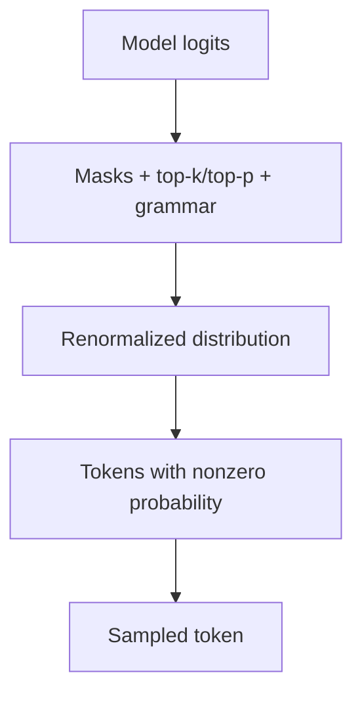

**Sampling support** is the set of tokens with nonzero probability under the sampler's distribution at one decoding step. The base model may score almost the entire vocabulary, then masks and processors remove tokens or renormalize survivors. A finite, strictly positive temperature preserves mathematical support by itself; greedy decoding at zero temperature and numerical underflow are exceptions. Top-k, top-p, minimum-probability filters, grammar constraints, banned tokens, and forced tokens can change support.

For processed distribution $q_t$ over vocabulary $V$:

$$
S_t = \{v \in V : q_t(v) > 0\},
\qquad
|S_t| = \text{support size}.
$$

Support size counts eligible tokens; entropy measures how probability mass is distributed among them. Two distributions can retain the same number of tokens while placing mass very differently. Shrinking top-p support can also lower exploration while model weights stay fixed.

## Replay contract

Rollout logprob must be computed under distribution that sampled token. If generator reports processed logprobs after top-k or top-p, learner must reproduce same processors and normalization, or treat recorded rollout distribution as behavior-policy denominator. An accepted token outside recorded support indicates a correctness failure that requires separate treatment from numeric drift.

A metric called `replay_support_size` still needs producer contract. It might count full processed candidate set, truncated candidates serialized for replay, or another branch-specific object.

## Example

Model assigns finite logits to full vocabulary. Top-k retains highest-scoring candidates, then top-p may keep smaller prefix whose cumulative probability crosses threshold. Sampler draws from final renormalized set. Raw model logprob and processed sampler logprob for same token differ because their denominators differ.

## Why it matters here

Falling support beside falling entropy and lower completion diversity strengthens policy-narrowing diagnosis. Support changes alone may come from sampler configuration, grammar, or telemetry truncation, so compare fixed weights and fixed logits before blaming training.

## Related terms

- [Top-k](glossary://top-k)
- [Top-p](glossary://top-p)
- [Temperature](glossary://temperature)
- [Logprob](glossary://logprob)
- [Policy mismatch](glossary://policy-mismatch)
