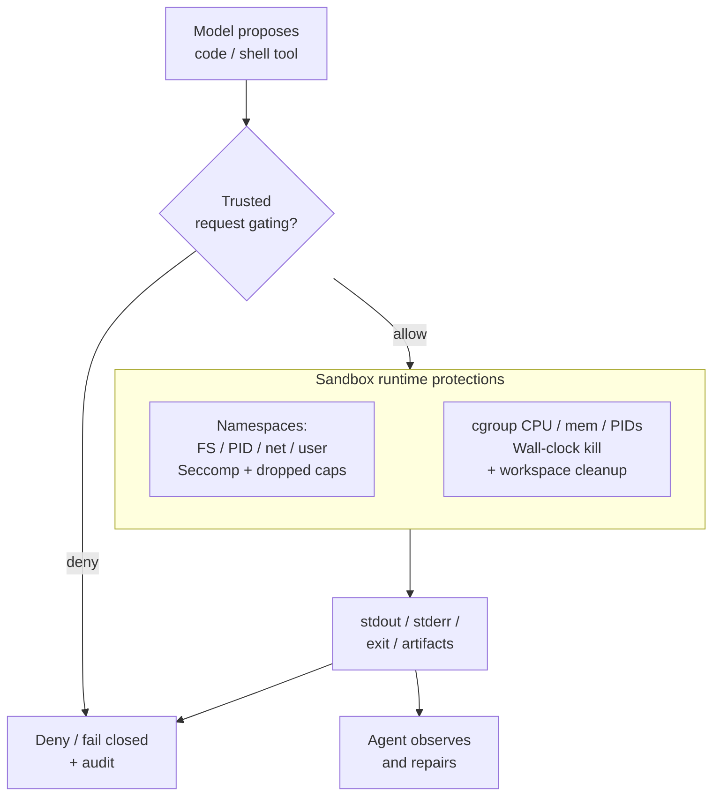

A **sandbox** is an isolated runtime that executes untrusted or high-risk code under a deliberate perimeter: filesystem views, network peers, credentials, processes, and host resources it can touch. Enforcement lives in the OS, hypervisor, or application kernel, not in the model prompt. Its guarantees depend on the threat model and configuration. Shared-kernel sandboxes still invoke the host kernel through a restricted interface; exposing production keys or sibling tenants defeats the intended isolation.

A sandbox is the *place* code runs under isolation. A [bounded execution environment](glossary://bounded-execution-environment) is the *inventory of hard limits* that place must enforce (mounts, egress, cgroups, wall-clock kill, secret stripping). In agent stacks the two travel together: the sandbox is the isolation technology; the bounds are the policy that makes isolation useful.

## Intuition

Treat model-written code the way you treat an unreviewed pull request from a stranger: it may fix the test, or it may `rm -rf /`, open a reverse shell, or dump `os.environ`. You still want to run it for evidence (pass/fail, stdout, stack traces). The sandbox is the temporary workstation that makes that safe:

| Question | Sandbox answer |
| --- | --- |
| Can it see the host root? | No: private mount namespace, read-only root, scratch dir only |
| Can it call out? | Only if policy says so; default often `network_mode=none` |
| Does it hold prod credentials? | No: stripped env; short-lived tokens minted outside if needed |
| Can it starve the host? | Resource caps reduce the risk; also bound disk space, output, and aggregate request gating |
| How long can it run? | Supervisor wall-clock deadline, then process-tree kill |
| What do you get back? | Exit code, stdout/stderr, maybe artifacts under the scratch path |

Prompts can *ask* for good behavior. Sandboxes *deny* bad behavior even when the model is wrong, injected, or adversarial.

## How it works

Isolation is layered. Application policy allows the job; the runtime confines it; the supervisor times it out and cleans up.

1. **allow in trusted code.** Tool name, args, image, mounts, network mode, and environment must pass policy before launch. Unknown tools and ambient secrets fail closed.
2. **Isolate the process.** Give the job a private view of the machine (namespaces: mount, PID, network, user, IPC), map it to an unprivileged host UID, and drop Linux capabilities so it has no host-root privileges.
3. **Filter the syscall surface.** Seccomp-bpf allows only the syscalls the workload needs. This shrinks the kernel attack surface shared with other containers on the same host.
4. **Cap resources.** Cgroups bound CPU, memory, PIDs, and sometimes disk I/O so a fork bomb or infinite loop cannot take down neighbors.
5. **Time-box and destroy.** A wall-clock deadline kills the tree; the workspace is deleted or never reused for another tenant without reimaging.
6. **Return evidence.** Stdout, stderr, exit code, duration, and denial events feed the agent loop and the [audit trail](glossary://audit-trail).

Different runtimes draw the security perimeter in different places:

| Runtime | perimeter | Typical use |
| --- | --- | --- |
| Process + Landlock/seccomp | Same kernel; restricted paths and syscalls | Lightweight local tools |
| Hardened container (namespaces + cgroups + seccomp + no-new-privileges) | Shared host kernel; visibility and resource walls | CI, trusted-team agent workers |
| **gVisor** (`runsc`) | Userspace application kernel (Sentry) intercepts syscalls; does not pass them straight to the host | Multi-tenant containers needing a stronger kernel perimeter |
| **Firecracker** microVM | Guest kernel + KVM; jailer adds host-side chroot/namespaces/seccomp | Hostile multi-tenant code execution at density |
| WASM/WASI | Explicit capability grants only | Constrained plugins; not full Linux |

Official Firecracker material reports userspace start in as little as ~125 ms and under 5 MiB overhead per microVM in minimal configs. Official gVisor docs stress that the Sentry *implements* syscalls rather than filtering a passthrough to the host. Shared-kernel containers remain useful when the threat model is "buggy generated code from your own pipeline," not "arbitrary hostile multi-tenant guests."

Defense in depth means one failed layer leaves other controls in place. A read-only root with `/var/run/docker.sock` mounted still exposes host container control, allowing the guest to start privileged containers. A strong microVM with `AWS_SECRET_ACCESS_KEY` in the environment still has cloud source of truth.

## Diagram



## Example

A coding agent must implement `failed_tests(report_path)` against a JUnit XML test case. Each attempt runs in a disposable sandbox:

- **Image:** pinned `python:3.11-slim` (deps baked at build time; no `pip install` at run time)
- **Writable:** only `/scratch/job-42` (checkout + test case); root filesystem read-only
- **Network:** none (no package mirrors, no reverse shells, no metadata service)
- **Resources:** `memory.max = 256 MiB`, CPU quota half a core, `pids.max = 64`
- **Time:** supervisor deadline $T = 30$ s; on expiry kill the container and mark the attempt timed out
- **Secrets:** no cloud keys; env limited to `TASK_ID`, `FIXTURE_PATH`
- **Return:** full stdout/stderr and exit code to the agent scaffold

The following is orchestration pseudocode: `write_file` and `docker_run` are trusted helpers, not Docker SDK calls. They must validate `job_id`, mount only the prepared workspace, run with restricted privileges, and enforce cleanup and output limits.

```python
def run_attempt(code: str, job_id: str) -> dict:
    """Launch one sandboxed attempt; policy lives outside the model."""
    workspace = f"/scratch/{job_id}"
    write_file(f"{workspace}/solution.py", code)
    result = docker_run(
        image="python:3.11-slim@sha256:…",
        cmd=["python", "-m", "pytest", "-q", "tests/"],
        workdir=workspace,
        read_only_root=True,
        network_mode="none",
        mem_limit_mb=256,
        pids_limit=64,
        cpu_quota=50_000,   # with period 100_000 => 50% of one core
        env={"TASK_ID": job_id, "FIXTURE_PATH": f"{workspace}/junit.xml"},
        timeout_s=30,
    )
    return {
        "exit_code": result.exit_code,
        "stdout": result.stdout,
        "stderr": result.stderr,
        "timed_out": result.timed_out,
    }
```

The host's `/etc/shadow` must not be mounted into the sandbox; a read-only mount would still allow disclosure. Network isolation blocks external connections. A CPU quota throttles a busy loop, while the supervisor deadline terminates it. If tests fail, bounded stderr returns as repair evidence. The same loop without isolation (agent `exec` on the host with a long-lived cloud token) exposes ambient source of truth to prompt injection.

**Escape theater to reject in review:** mounting the Docker socket, running `--privileged`, sharing the host network namespace, baking secrets into the image, or reusing a warm container across tenants without a full wipe.

## Trade-offs

| Choice | You gain | You pay |
| --- | --- | --- |
| Shared-kernel container | Fast start, native Linux, simple ops | Kernel CVEs and misconfig are shared fate |
| gVisor | Stronger syscall isolation, OCI tooling | Syscall-heavy workloads slower; some API gaps |
| Firecracker microVM | Hardware-backed tenant isolation, high density | More moving parts; guest kernel to maintain |
| Network entirely off | Blocks exfil and SSRF | Needs offline test cases; no live API tests |
| Warm pool of sandboxes | Lower p50 latency for agent loops | Reuse bugs, residual state, cross-tenant risk if cleanup fails |

Pick isolation strength from the threat model: internal CI on first-party code can use hardened containers; multi-tenant "run arbitrary user or model code" usually needs microVMs or an equivalent hard perimeter plus per-session wipe.

## Why it matters here

Code agents, tool-using LLMs, synthetic data pipelines that execute candidates, and eval harnesses that score generated programs all need a place to run untrusted logic. The generate-execute-debug loop only stays product-safe when each execute step runs in a sandbox whose isolation the model cannot negotiate away. OWASP's excessive-agency class (LLM06) is largely about giving agents too much reach; sandboxes shrink that reach at the infrastructure layer so prompt injection cannot equal host compromise.

## Related terms

- [Bounded execution environment](glossary://bounded-execution-environment)
- [Secrets management](glossary://secrets-management)
- [Least privilege](glossary://least-privilege)
- [Action allowlist](glossary://action-allowlist)
- [Fail closed](glossary://fail-closed)
