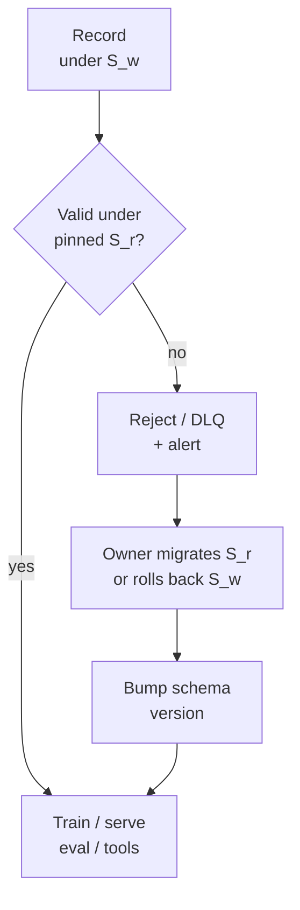

**Schema drift** is an unexpected change in the *structure* of data relative to The schema a consumer already depends on: field names, types, nesting, nullability, enums, required keys, or allowed extra keys. The producer still emits something that looks like a record, but the shape no longer matches what training jobs, feature stores, parsers, eval harnesses, or agent runtimes were built for.

Planned **schema evolution** uses versioned, compatibility-checked changes (for example Avro/Protobuf under Confluent Schema Registry rules: BACKWARD, FORWARD, or FULL). Drift appears when that process is skipped or partial. Schema drift changes structure; [data drift](glossary://data-drift) changes value distributions while columns stay the same; [concept drift](glossary://concept-drift) changes the label mapping $P(y \mid X)$. Structural breakage can *look* like distribution shift once missing fields become nulls or strings get coerced to defaults.

## Intuition

A pipeline has two silent failure modes: it can crash on a missing column, or it can keep running while rewriting meaning. Schema drift is most dangerous in the second mode. A renamed field becomes an always-null feature. An int that becomes a string fails open into `0`. A new enum value falls into an `"other"` bucket that never existed in training. A tool payload that nested one object deeper still deserializes somewhere with `dict.get` defaults, so the agent "works" while arguments are wrong.

Think of every perimeter as a reader schema $S_r$ and a writer schema $S_w$. Production is healthy only while instances written under $S_w$ remain valid under $S_r$ (or under an explicit migration). A writer change can be compatible with an unchanged reader; unexpected or incompatible changes need investigation rather than an automatic consumer version bump.

## How it works

Typical surfaces where schema drift shows up in AI systems:

| Surface | What changes | Downstream effect |
| --- | --- | --- |
| Event / table columns | rename, type widen/narrow, drop, null policy | feature null storms, broken joins |
| Feature vectors | key order, dtype, missing indicators | [training-serving skew](glossary://training-serving-skew) |
| API / tool JSON | required keys, nesting, enums | parse errors or silent defaults |
| Structured LLM output | model schema vs consumer schema | invalid actions, bad eval rows |
| RAG document metadata | ACL fields, source ids, chunk keys | wrong filters, permission leaks or empty retrieval |
| eval test cases | label fields, slice tags | green CI on obsolete schemas |

Common change classes (structure, not content):

1. **Add field** the consumer never declared (harmless if `additionalProperties` allowed; dangerous if vector order or auto-features swallow it).
2. **Remove or rename field** a consumer still requires (hard fail, or soft fail to null).
3. **Type change** (`string` $\leftrightarrow$ `object`, `int` $\leftrightarrow$ `string`, scalar $\leftrightarrow$ array).
4. **Constraint change** (required becomes optional, enum grows/shrinks, nulls newly allowed).
5. **Semantic change with the same accepted representation** (`status: "ok"` still passes validation, but its meaning changed). Detect meaning changes with domain checks alongside structural validation. New codes can be caught when the schema declares an enum or value domain; otherwise pair structural validation with domain monitors.

Industry tooling treats this as a first-class concern: Azure Data Factory defines schema drift as sources whose metadata (fields, columns, types) changes on the fly; TensorFlow Data Validation flags schema anomalies such as missing features, wrong types, and values outside declared domains; Kafka/Avro ecosystems gate *planned* evolution with compatibility modes so producers cannot register an incompatible $S_w$.

## Example

Yesterday's intake event for a GPU job router:

```json
{
  "job_id": "J-204",
  "runner_pool": "gpu-a100",
  "queue_depth": 18
}
```

A producer "improvement" ships without a consumer version bump. Today's event:

```json
{
  "job_id": "J-204",
  "runner_pool": {"name": "gpu-a100", "zone": "us-central1"},
  "queue_depth": "18"
}
```

What failed:

| Field | Before | After | Silent path if unchecked |
| --- | --- | --- | --- |
| `runner_pool` | string categorical | object | `str(obj)` becomes a garbage category, or cast fails to `null` |
| `queue_depth` | int | string | digit strings often coerce (`int("18")` → 18) and hide the type change; non-digits become null/`NaN` or crash; train and serve may disagree |

A minimal perimeter that fails closed:

```python
from typing import Any

REQUIRED = {
    "job_id": str,
    "runner_pool": str,
    "queue_depth": int,
}

def validate_intake(row: dict[str, Any]) -> dict[str, Any]:
    missing = [k for k in REQUIRED if k not in row]
    if missing:
        raise ValueError(f"missing fields: {missing}")
    for key, typ in REQUIRED.items():
        # Require an exact int; bool inherits from int in Python.
        if type(row[key]) is not typ:
            raise TypeError(
                f"{key}: expected {typ.__name__}, got {type(row[key]).__name__}"
            )
    # Reject unknown keys so new producer fields cannot enter feature code by accident.
    extra = sorted(set(row) - set(REQUIRED))
    if extra:
        raise ValueError(f"unexpected fields: {extra}")
    return row
```

With this gate, the object/`"18"` payload is a **schema-drift incident** at ingestion. Without it, the training table fills with null `runner_pool` and string `queue_depth`; the model looks like it suffers [data drift](glossary://data-drift) or a bad deploy, while the root cause is a schema break one hop upstream.

For LLM tool calling, the same pattern applies to argument schemas. If the model or an upstream agent starts emitting `{"action":"deploy","args":{"canary_percent":5}}` while the runtime still expects `{"action":"deploy","canary_percent":5}`, every silent default is a production bug, not flexibility.

## Diagram



## Debug path

1. **Capture the raw payload** and the schema or schema ID the consumer believed was current.
2. **Diff structure only**: keys present/absent, types, null rates, enum sets. Do this before debating PSI or model quality.
3. **Find the first perimeter that accepted the new shape** (parser, ETL, feature job, gateway). That is where fail-closed should have run.
4. **Classify the change**: additive optional field vs breaking rename/type/required. Compatibility depends on the format, defaults, and direction of reading; adding a field is not automatically safe. An incompatible migration needs explicit versioning and a rollout strategy such as dual-read or dual-write.
5. **Repair deliberately**: backfill or reprocess only after $S_r$ and consumers agree; per-pipeline coercions can diverge between train and serve, so use a shared migration rule.
6. **Lock the gate**: schema validation tests in CI, Schema Registry compatibility checks when registering schemas, producer serialization under registered schemas, [JSON Schema](glossary://json-schema) / Pydantic at HTTP and tool edges, and a single owner for the [feature schemas](glossary://feature-contract) or [API schemas](glossary://api-contract). A registry alone does not validate arbitrary payloads sent outside that serialization path.

## Trade-offs

| Strategy | Upside | Cost |
| --- | --- | --- |
| Fail closed on mismatch | Stops silent corruption | Needs on-call ownership and a dead-letter path |
| Allow additive fields only | Faster producer iteration | Still breaks if consumers assume closed sets or fixed vector order |
| Auto-evolve warehouse tables | Pipelines keep loading | Downstream SQL/ML still drift; you moved the failure later |
| Per-consumer local coercions | Unblocks one team quickly | Five private interpretations of the same event; train/serve skew |

Prefer one validated schema version over many local patches. Evolution belongs in a registry or versioned package; improvisation at each consumer is how drift multiplies.

## Why it matters here

AI systems chain many typed interfaces: logs to features, features to models, models to structured outputs, outputs to tools, documents to retrieval metadata, test cases to eval gates. Schema drift is how an upstream rename becomes a null feature, a null feature becomes a distribution alarm, and a distribution alarm becomes a pointless retrain. Catch structure first, then interpret statistics. Curriculum lessons on feature stores, RAG ingestion, tool schemas, and eval harnesses all assume pinned specifications; without them, every other reliability practice measures the wrong failure.

## Related terms

- [feature schemas](glossary://feature-contract)
- [JSON Schema](glossary://json-schema)
- [Data drift](glossary://data-drift)
- [Training-serving skew](glossary://training-serving-skew)
- [API schemas](glossary://api-contract)
