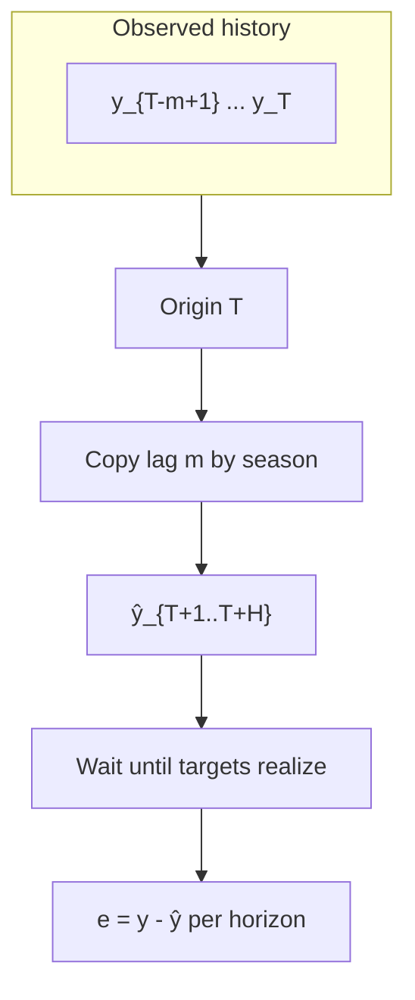

A **seasonal naive forecast** (also *seasonal naïve method*) predicts a future value by copying the last observed value from the **same season**. For weekly seasonality on daily data, next Friday is last Friday's count. For monthly data, next February is last February. There are no estimated parameters: the only design choice is the seasonal period $m$ (or $s$). Complex forecasters (ARIMA, gradient boosting, transformers) earn their keep only when they beat this copy under the same [forecast horizon](glossary://forecast-horizon) and cutoffs.

The method is the seasonal counterpart of the plain **naive** (random-walk) forecast. Plain naive sets every future value to the most recent observation $y_T$. Seasonal naive instead sets every future value to the most recent observation from the matching season. Hyndman & Athanasopoulos (*Forecasting: Principles and Practice*) treat it as a standard baseline for highly seasonal series; for non-seasonal series the plain naive is the usual yardstick.

## Formula

With last observed time $T$, seasonal period $m$, and horizon $h \ge 1$, the $h$-step-ahead seasonal naive forecast is

$$
\hat{y}_{T+h \mid T} = y_{T+h - m\,k},
\qquad
k = \left\lfloor \frac{h-1}{m} \right\rfloor + 1.
$$

Here $k$ is how many full seasons you step back so that $T+h-mk$ lands on the most recent past index with the same season as $T+h$. For any horizon that stays inside the next season ($1 \le h \le m$), $k=1$ and the formula collapses to the lag copy

$$
\hat{y}_{T+h \mid T} = y_{T+h-m}.
$$

**Common periods** (pick $m$ from the calendar rhythm you care about):

| Data grain | Seasonal pattern | Typical $m$ |
| --- | --- | ---: |
| Hourly | Daily cycle | $24$ |
| Daily | Weekly cycle | $7$ |
| Daily | Yearly cycle | $365$ or $364$ (52 weeks) |
| Monthly | Yearly cycle | $12$ |
| Quarterly | Yearly cycle | $4$ |

**Underlying model.** Seasonal naive is optimal for a **seasonal random walk**

$$
y_t = y_{t-m} + \varepsilon_t,
$$

with innovations $\varepsilon_t$ whose conditional mean given the observed past is zero. Under squared-error loss, the conditional-mean point forecast is the last same-season level; it does not add trend, level shift, or holiday adjustment unless you extend the method (for example STL + non-seasonal naive, or a separate calendar model). Fixed daily yearly lags also need care around leap years and shifting calendar dates.

## Intuition

If traffic, batch volume, or queue depth repeats every week or every day, the matching lag is often a strong guess. You get a forecast with almost no parameters and a clear story: "same weekday last week." That story is also the right **null hypothesis** for model selection. If a neural or gradient-boosted forecaster cannot beat the lag under honest [rolling-origin evaluation](glossary://rolling-origin-evaluation), the extra complexity has not earned production cost.

Seasonal naive also defines a natural **scale** for accuracy. Hyndman & Koehler's **mean absolute scaled error (MASE)** divides absolute [forecast errors](glossary://forecast-error) by the in-sample mean absolute one-step error of a naive baseline. For seasonal series the usual denominator is seasonal naive:

$$
\mathrm{MASE} = \frac{\mathrm{MAE}_{\text{forecast}}}{\frac{1}{T-m}\sum_{t=m+1}^{T}\lvert y_t - y_{t-m}\rvert}.
$$

$\mathrm{MASE} < 1$ means the model's mean absolute error is smaller than the training-period one-step seasonal-lag error (the scale factor). MASE scales accuracy against an in-sample baseline; multi-step errors can exceed that one-step scale even when the model beats seasonal naive on the same test origins. For ship/no-ship decisions, compare both methods' MAE on identical rolling origins and horizons.

## Example

Daily batch-job volume on a model-serving cluster with weekly seasonality ($m = 7$). Origin is end of Sunday 2026-01-25. You know counts through that Sunday and must forecast the next week ($h = 1,\ldots,7$).

Last week's observed daily counts (Mon-Sun):

| Weekday | Lag used | Last week's $y$ | Seasonal naive $\hat{y}$ for next week |
| --- | --- | ---: | ---: |
| Mon | $y_{T-6}$ | $98$ | $98$ |
| Tue | $y_{T-5}$ | $110$ | $110$ |
| Wed | $y_{T-4}$ | $105$ | $105$ |
| Thu | $y_{T-3}$ | $112$ | $112$ |
| Fri | $y_{T-2}$ | $132$ | $132$ |
| Sat | $y_{T-1}$ | $40$ | $40$ |
| Sun | $y_{T}$ | $35$ | $35$ |

Next Friday is $h=5$. Then $k=\lfloor 4/7\rfloor+1=1$, so

$$
\hat{y}_{T+5 \mid T} = y_{T+5-7} = y_{T-2} = 132.
$$

Suppose Friday actual is $y = 160$ after a model launch. The signed [forecast error](glossary://forecast-error) is

$$
e = 160 - 132 = +28
$$

jobs (underforecast). On an ordinary Tuesday with actual $113$, $e = 113 - 110 = +3$. Same method, different weeks: the baseline is useful on stable weeks and exposes structural change on launch weeks.

Hourly API calls with daily seasonality ($m = 24$): with observations through Monday 15:00, forecast Tuesday 15:00 by copying Monday 15:00's volume (for example $12{,}400$ requests). The multi-day path is the last full day of hourly values, repeated for each future day. A weekday-specific hourly baseline instead needs $m = 168$.

```python
import numpy as np

def seasonal_naive(y: np.ndarray, h: int, m: int) -> np.ndarray:
    """Hyndman-style seasonal naive for horizons 1..h from the end of y."""
    if not isinstance(h, int) or not isinstance(m, int) or h < 0 or m <= 0:
        raise ValueError("h must be a nonnegative integer and m a positive integer")
    if y.ndim != 1 or len(y) < m:
        raise ValueError("y must be one-dimensional with at least m observations")
    T = len(y)
    out = np.empty(h)
    for step in range(1, h + 1):
        k = (step - 1) // m + 1
        out[step - 1] = y[T + step - m * k - 1]  # 0-based index
    return out

# Last 7 daily counts ending Sunday; forecast next 7 days
history = np.array([98.0, 110.0, 105.0, 112.0, 132.0, 40.0, 35.0])
yhat = seasonal_naive(history, h=7, m=7)
# array([98., 110., 105., 112., 132., 40., 35.])
```

## Worked numbers

Three consecutive Fridays under weekly lag ($m=7$), evaluated only on the Friday slice ($h$ lands on Friday each week):

| Origin week | Lag Friday $\hat{y}$ | Actual $y$ | $e = y-\hat{y}$ | $\|e\|$ |
| --- | ---: | ---: | ---: | ---: |
| W1 | $128$ | $130$ | $+2$ | $2$ |
| W2 | $130$ | $132$ | $+2$ | $2$ |
| W3 (launch) | $132$ | $160$ | $+28$ | $28$ |

Seasonal naive [mean absolute error](glossary://mean-absolute-error) on these three Fridays:

$$
\mathrm{MAE} = \frac{2+2+28}{3} \approx 10.7 \text{ jobs}.
$$

Pooled MAE hides the story: two ordinary weeks are nearly perfect; the launch week dominates. Report MAE by weekday, horizon, and slice (launch vs non-launch). Include a seasonal baseline alongside any non-seasonal null in every comparison table so candidates are evaluated against the pattern in the data.

## Diagram



For $1 \le h \le m$, each forecast is a direct pointer: $\hat{y}_{T+h} \leftarrow y_{T+h-m}$. No recursion through intermediate predictions is required (unlike multi-step AR models that feed their own forecasts forward).

## Where it breaks in production

Seasonal naive fails when the "same season last period" assumption is false. Those failures are diagnostic: they show what a better model (or a better calendar) must capture.

| Failure mode | What happens | What to do next |
| --- | --- | --- |
| **Trend or level shift** | Series drifts up or down; lag is systematically biased | Prefer drift, Holt-Winters, or trend + seasonal methods |
| **Holidays and calendar effects** | Thanksgiving and Monday holidays shift workdays within the week | Add explicit holiday features or event flags alongside the $m=7$ lag |
| **Promotions / launches / incidents** | One-off spikes get copied into next season | Detect outliers; use robust lags or event-aware models |
| **Wrong $m$** | Daily data modeled with $m=7$ when the real cycle is hourly or yearly | Inspect ACF / seasonal plots; try candidate periods |
| **Multiple seasonalities** | Hour-of-day *and* day-of-week *and* month | Seasonal naive uses one lag; use multi-seasonal methods (for example MSTL) or features for each cycle |
| **Missing or late data** | Lag index points at NaN or a partial day | Impute carefully, or refuse to forecast that season until the lag is complete |
| **New series / cold start** | Fewer than $m$ observations | No seasonal lag exists yet; fall back to global models or hierarchical pools |
| **Capacity caps** | Demand is truncated by throttling; lag copies the cap, not latent demand | Model censored demand or unconstrained proxies |

Also watch evaluation hygiene: score only with data that was unknown at the origin, match production horizons, and use the same $m$ in training and serving. A future-corrected backfill leaks information unavailable to the live seasonal-naive forecast.

## Why it matters here

Forecasting and capacity lessons need an honest opponent. Seasonal naive is the minimum bar for any series with a clear cycle: autoscaling signals, batch volume, token demand by hour, support tickets by weekday. It is cheap to implement, easy to explain in an incident review, and strong enough that many "ML upgrades" lose to it on stable weeks. Curriculum labs pair it with rolling origins and error-by-horizon tables so learners measure real multi-step skill, not in-sample residual fit. Before shipping a complex forecaster, require a win over seasonal naive on the slices that matter (peak hours, launch weeks, long horizons). If you cannot beat the lag, ship the lag and spend the modeling budget elsewhere.

## Related terms

- [Seasonality](glossary://seasonality)
- [Forecast horizon](glossary://forecast-horizon)
- [Forecast error](glossary://forecast-error)
- [Rolling-origin evaluation](glossary://rolling-origin-evaluation)
- [Mean absolute error](glossary://mean-absolute-error)
