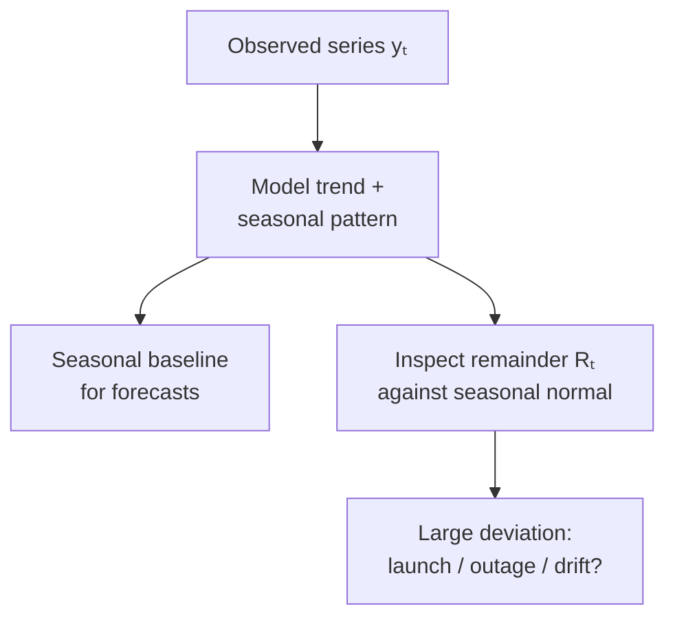

**Seasonality** is a repeating pattern in a time series whose period is fixed and known in advance: day of week, hour of day, month of year, billing cycle, or another calendar-tied rhythm. Hyndman and Athanasopoulos (FPP) put the core test this way: if the frequency is unchanging and tied to the calendar (or another known schedule), the pattern is seasonal; if rises and falls have irregular length, they are cyclic, not seasonal. One series can carry several seasonal periods at once (for example hourly traffic with daily and weekly cycles).

Trend describes long-run level change, while noise describes irregular remainder. A one-off spike is an isolated event; [concept drift](glossary://concept-drift) permanently remaps inputs to targets. Recurring holiday and weekday effects are often modelable once you name the period, while a permanent policy change calls for concept-drift analysis.

## Intuition

Think in three layers of "things that move over time":

| Pattern | Period | Typical cause |
| --- | --- | --- |
| **Seasonal** | Fixed, known ($s$ steps) | Calendar, schedule, business rhythm |
| **Cyclic** | Variable length | Business cycle, multi-year market waves |
| **Trend / level** | Not periodic | Growth, decay, step after a launch |

If Mondays look like Mondays and 09:00 looks like 09:00 across many weeks, you have seasonality with period $s$ in the sampling frequency of the series. If peaks arrive every 6–10 years with no fixed length, that is cyclic. Capacity, anomaly, and forecast systems that ignore $s$ treat normal Friday load as "weird" and quiet Sundays as "healthy," then page or scale at the wrong times.

## Formula

For discrete observations $y_t$ with seasonal period $s$ (number of observations in one full cycle), classical decomposition writes either an **additive** or **multiplicative** model.

Additive (seasonal swing roughly constant in absolute units):

$$
y_t = T_t + S_t + R_t
$$

Multiplicative (seasonal swing scales with the level of the series):

$$
y_t = T_t \cdot S_t \cdot R_t
$$

Here $T_t$ is the trend-cycle, $S_t$ the seasonal component, and $R_t$ the remainder. For additive seasonality the seasonal indices over one period usually sum near zero after centering; for multiplicative they average near one. Prefer additive when Friday is about $+40$ jobs above the weekly mean whether volume is 100 or 1000; prefer multiplicative when Friday is about $1.3\times$ the level. Conventional multiplicative and log-based decompositions require positive observations; zeros or negative values need another treatment.

Common periods by sampling rate:

| Series grain | Common $s$ | Meaning |
| --- | ---: | --- |
| Hourly | $24$ | Daily pattern |
| Hourly | $168$ | Weekly pattern ($24 \times 7$) |
| Daily | $7$ | Weekly pattern |
| Daily | $\approx 365$ | Annual pattern |
| Monthly | $12$ | Annual pattern |
| Quarterly | $4$ | Annual pattern |

Multiple seasonality means several $s$ values act together (daily + weekly + yearly on fine-grained ops metrics). Fourier / harmonic terms, STL-style multi-seasonal decompositions, and seasonal naive with the right lag are standard tools; the first job is still to name each $s$.

Seasonally adjusted data remove $S_t$ so trend and remainder are easier to read. Additive form: $y_t - \hat{S}_t$. Multiplicative form: $y_t / \hat{S}_t$.

## Example

Daily batch-job completions for a model-serving cluster (same curriculum-style series used with seasonal naive and forecast horizon). Grain is one day, so weekly seasonality has period $s = 7$.

Typical week without a launch (jobs completed):

| Day | Mon | Tue | Wed | Thu | Fri | Sat | Sun |
| --- | ---: | ---: | ---: | ---: | ---: | ---: | ---: |
| Count | $140$ | $135$ | $130$ | $128$ | $132$ | $70$ | $55$ |

Weekend trough and weekday plateau are the seasonal shape. A [seasonal naive forecast](glossary://seasonal-naive-forecast) with lag $s=7$ predicts next Friday as last Friday ($132$). Observed Friday after a product launch is $160$, so residual $e = 160 - 132 = +28$ is large relative to ordinary weekday noise and is a candidate [anomaly](glossary://anomaly) against a seasonal baseline, not against a flat weekly mean.

If you only monitored the global mean $\bar{y} \approx 113$, both a normal Friday ($132$) and a quiet Saturday ($70$) look "off." Seasonality-aware baselines compare like-for-like: this Friday vs recent Fridays, this 15:00 vs recent 15:00s.

## Worked numbers

Illustrative additive seasonal indices from the table, after subtracting the weekly mean $\bar{y} = (140+135+130+128+132+70+55)/7 \approx 112.9$. One week cannot distinguish stable seasonality from noise; estimating a production pattern needs repeated cycles and an allowance for trend:

| Day | $y$ | $\hat{S} \approx y - \bar{y}$ |
| --- | ---: | ---: |
| Mon | $140$ | $+27.1$ |
| Tue | $135$ | $+22.1$ |
| Wed | $130$ | $+17.1$ |
| Thu | $128$ | $+15.1$ |
| Fri | $132$ | $+19.1$ |
| Sat | $70$ | $-42.9$ |
| Sun | $55$ | $-57.9$ |

Next week's "normal Friday" under pure seasonal level (no trend update) is about $\bar{y} + 19.1 \approx 132$, matching the seasonal-naive copy of last Friday. Multiplicative indices would instead be $y / \bar{y}$ (Friday $\approx 1.17$, Sunday $\approx 0.49$).

```python
# Seasonal lag for weekly pattern on daily data
s = 7
history = [140, 135, 130, 128, 132, 70, 55]  # Mon..Sun
# Forecast next Mon..Sun by copying the previous season
seasonal_naive = history[-s:]  # [140, 135, 130, 128, 132, 70, 55]
# Residual vs observed next Friday after a launch
y_fri, y_hat_fri = 160, seasonal_naive[4]
e = y_fri - y_hat_fri  # +28
```

## Diagram



## How it works in practice

1. **Name the period(s).** Plot by hour, weekday, month, and known business calendar. Confirm $s$ using sampling rate, domain knowledge, and automated search.
2. **Separate seasonal from cyclic and one-offs.** Fixed calendar rhythm is seasonal. Irregular multi-year waves are cyclic. Mark single launches, outages, and backfills separately to protect seasonal indices.
3. **Choose additive vs multiplicative.** Constant absolute swings → additive. Swings that grow with volume → multiplicative (or log then additive).
4. **Baseline before complexity.** Compare every model against seasonal naive at the same [forecast horizon](glossary://forecast-horizon) and cutoffs.
5. **Evaluate over full cycles.** [Rolling-origin evaluation](glossary://rolling-origin-evaluation) windows should cover whole weeks (or days) when $s=7$ (or $s=24$). Measuring only weekdays or only a holiday week warps error and coverage.
6. **Wire ops to seasonal normals.** Use same-hour / same-weekday peers as baselines for autoscaling, anomaly thresholds, and capacity tests.

## Why it matters here

AI systems emit strongly calendar-shaped signals: token and request demand by business hour, support volume after releases, batch job depth on weekdays, eval traffic on workdays, and cost spikes at month end. A model or alert that ignores seasonality confuses normal Friday load with failure, under-provisions Monday morning, and overfits a quiet Sunday into "success." Forecasting and capacity lessons depend on naming $s$ first, beating a seasonal naive baseline, and scoring across full cycles so weekend troughs and weekday peaks both appear in the evidence.

## Related terms

- [Seasonal naive forecast](glossary://seasonal-naive-forecast)
- [Rolling-origin evaluation](glossary://rolling-origin-evaluation)
- [Anomaly](glossary://anomaly)
- [Forecast horizon](glossary://forecast-horizon)
- [Concept drift](glossary://concept-drift)
