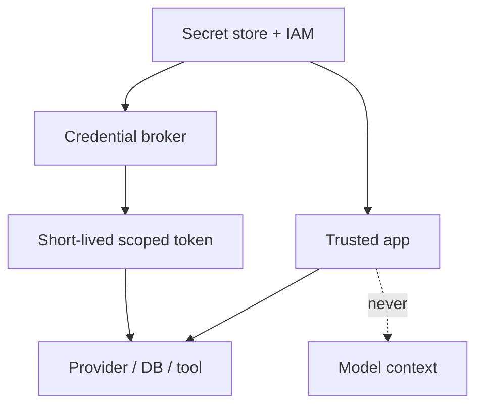

**Secrets management** is the discipline of creating, storing, distributing, rotating, revoking, and auditing credentials that grant source of truth: API keys, database passwords, OAuth client secrets, TLS private keys, signing material, service-account keys, and short-lived tokens. A secret grants source of truth as a capability. Whoever holds it can act as the principal that secret represents.

Standards and practice guides frame the same lifecycle. OWASP's *Secrets Management Cheat Sheet* lists creation, rotation, revocation, and expiration as the core stages, with centralization, least-privilege access, automation, and tamper-resistant audit as supporting controls. NIST SP 800-57 covers cryptographic *key* management (generation, protection, usage period, destruction); application secrets management reuses those ideas for machine credentials: minimize who can see the secret, minimize how long it works, and record every access that matters.

In AI systems the blast radius is large. A provider key pays for inference. A database password reads training or customer corpora. A tool token opens email, git, or cloud APIs. A signing key forges tokens. The goal is short-lived, narrowly scoped credentials that never land in git, container images, prompts, unrestricted traces, eval dumps, or fine-tune corpora.

## Intuition

Treat every secret as a temporary capability ticket, not as a string you "configure once."

| Dimension | Weak practice | Strong practice |
| --- | --- | --- |
| Storage | Hardcoded in source, `.env` committed, baked into image layers | Central secret store (cloud Secret Manager, Vault, Key Vault) with IAM |
| Lifetime | Static key valid for years | Dynamic or short TTL; rotate on schedule and on suspicion |
| Scope | One shared `agent-prod` key for all tenants and tools | Per-workload, per-environment, per-purpose credentials |
| Delivery | Pasted into chat, email, or CI logs | Runtime injection (env, volume, sidecar) or workload identity |
| Consumers | Engineers, CI, and the model all see the same value | Humans rarely see plaintext; agents get minted, scoped tokens |
| Evidence | No record of who fetched the secret | Audit: principal, secret id, time, success/deny |

The twelve-factor app rule still holds for *config that varies by deploy*: keep it out of the codebase and inject at runtime. Secrets are a stricter subset. They may surface as process environment variables after injection, but they should not live as plaintext literals in git, Dockerfiles, or public frontend bundles (`NEXT_PUBLIC_*` and similar are never server secrets).

Prefer **workload identity** (OIDC federation, cloud service accounts, Kubernetes service-account tokens) over long-lived static keys when the platform supports it. The workload proves who it is; the secret store or cloud API issues a short-lived credential. If nothing static exists, there is nothing long-lived to leak from a disk dump.

## How it works

1. **Inventory and classify.** Name each secret, its purpose, owners, consumers (human, CI, service, agent session), environments (dev / staging / prod), and impact if leaked. Separate non-secret config (model route, log level) from true secrets.
2. **Create with minimum privilege.** Generate cryptographically strong values. Assign only the API scopes or DB roles the job needs ([least privilege](glossary://least-privilege)). Prefer one secret per purpose so rotation and attribution stay clear.
3. **Store centrally under IAM.** Put plaintext only in an approved store (for example Google Secret Manager, AWS Secrets Manager, Azure Key Vault, HashiCorp Vault). Encrypt at rest. Grant Secret Accessor (or equivalent) roles to specific service identities, not to every engineer. Store metadata: purpose, owner, rotation policy, consumer list.
4. **Inject at runtime.** Platforms mount secrets as files or environment variables, or the app fetches them with its workload identity. Never bake secrets into image layers. On Google Cloud Run, Secret Manager can inject a secret as an env var (pin a version for env injection) or as a volume mount (better for rotating `latest` without rebuilds).
5. **Use in trusted code only.** Application code reads the credential and calls the dependency. The model proposes tool names and args; it must not be the channel that carries long-lived keys into prompts or tool results.
6. **Rotate without outage.** For static secrets, create a new credential at the dependency, allow an overlap if supported, store it, update consumers, verify, and revoke the old credential at its issuer. Disabling a secret-store version prevents future fetches; it does not invalidate copies already held by callers. For dynamic secrets (Vault-style DB leases, cloud temporary credentials), mint per session and expire automatically with TTL $T$.
7. **Revoke and expire.** On staff offboarding, suspected leak, or end of job, revoke immediately. Prefer credentials that self-expire so a forgotten key dies even if nobody remembers to delete it.
8. **Audit and detect.** Log secret *access* (who/what, which secret, when, allow/deny) in a durable [audit trail](glossary://audit-trail). Run secret scanners in pre-commit and CI (pattern + entropy detectors). Assume anything that hits a public git history is burned.

### Static vs dynamic secrets

| Kind | What it is | When it fits |
| --- | --- | --- |
| Static | Stored value, rotated on a schedule or event | Third-party APIs that only issue long-lived keys |
| Dynamic | Generated on demand with a lease / TTL | Databases, cloud IAM assume-role, internal services with a broker |
| Identity-bound | No stored secret; workload OIDC / SA token exchanged for access | Cloud-native services calling cloud APIs |

Dynamic and identity-bound credentials shrink the reuse window. If a leaked credential expires in minutes, the incident is smaller even before you finish rotation.

### Secret vs config vs model context

- **Config:** non-secret deploy knobs (`MODEL_ROUTE`, `LOG_LEVEL`, cache paths). Safe to show in redacted deploy diffs.
- **Secret:** grants source of truth. Lives in a store; injected; audited.
- **Model context:** prompts, retrieved chunks, tool I/O, traces. Treat as an **untrusted sink**. Never place production secrets into context. Redact before logging. Filter training and eval corpora for accidental keys.

## Example

An LLM gateway on Cloud Run calls OpenAI and a tenant Postgres. Product requirements:

- The container image is identical in staging and prod.
- The gateway service account can read only two production secret resources: `openai-api-key` and `pg-app-dsn`. Deployments pin the intended versions; secret-level IAM access is not itself a version-specific grant.
- Agents that run code tools never inherit those env vars; tool sandboxes start with an allowlisted environment ([bounded execution environment](glossary://bounded-execution-environment)).
- A support agent that needs a single-repo git read gets a **minted** token with TTL $900$ seconds and path scope `repos/acme/docs`, not the org-wide deploy key.

Deploy (conceptually):

```bash
# Pin versions for env injection so rotation is intentional
gcloud run deploy llm-gateway \
  --image="$IMAGE" \
  --service-account=llm-gateway@PROJECT.iam.gserviceaccount.com \
  --update-secrets=OPENAI_API_KEY=openai-api-key:3,DATABASE_URL=pg-app-dsn:7
```

Trusted startup code fails closed if secrets are missing:

```python
import os
from dataclasses import dataclass

@dataclass(frozen=True)
class RuntimeSecrets:
    openai_api_key: str
    database_url: str

def load_secrets() -> RuntimeSecrets:
    key = os.environ.get("OPENAI_API_KEY", "").strip()
    dsn = os.environ.get("DATABASE_URL", "").strip()
    if not key or not dsn:
        raise SystemExit("required secrets missing; refusing to start")
    return RuntimeSecrets(openai_api_key=key, database_url=dsn)

secrets = load_secrets()
# Pass secrets only into HTTP/DB clients. Never into prompt templates,
# OpenTelemetry span attributes, or eval JSONL dumps.
```

When a user session needs a temporary git capability, the control plane mints outside the model. This broker pseudocode checks the authenticated principal's access to the requested repository, then enforces the TTL and read-only scope before minting a capability:

```python
def mint_repo_read_token(principal, repo: str, ttl_s: int = 900) -> str:
    # Issues a short-lived token; model never sees a long-lived org key.
    return secret_broker.issue(
        principal=principal.id,
        scope=f"repo:{repo}:read",
        ttl_s=ttl_s,
        uses=None,  # time-bound only
    )
```

What fails in production when secrets management is skipped:

- A key committed to git (even once) remains in history; scanners and attackers both find it.
- One shared provider key in every worker means one leak exposes that key's entire permission and spend scope; that scope may cover many workloads.
- Prompt injection that tricks an agent into `print(os.environ)` discloses inherited secrets. Files, mounted sockets, and available identity endpoints are other possible credential paths.
- Traces and LLM-as-judge logs that record full prompts plus tool results become a second copy of every credential that ever entered context.
- Moving the secret-store `latest` version does not revoke the old key at the provider or database. Revoke it there after verifying the cutover, then disable obsolete store versions.

## Diagram

This view shows credential delivery. Rotation, revocation, TTLs and access audits govern the surrounding lifecycle.



The solid path carries runtime source of truth. Keep credentials outside model context. Audit and ops feed the revoke loop when people leave, tokens leak, or CI dumps a value.

## Trade-offs

Central stores and short-lived credentials add moving parts: IAM grants, rotation jobs, startup dependency on the secret service, and careful handling of dual-version cutovers. Static keys in env feel simpler until the first leak, the first ex-employee, or the first agent that dumps process environment.

Practical balance for AI stacks:

- **Static + versioned** for third-party APIs that only give long-lived keys; rotate on a calendar and on incident.
- **Dynamic or workload identity** for databases and cloud APIs when available.
- **Minted session tokens** for agent tools; never a standing admin key "for the bot."
- **Volume mount or runtime fetch** when you need faster rotation; **pinned env versions** when you want deploy-time determinism (Cloud Run env secrets resolve at instance start).
- **Separate secrets by environment and tenant** so staging keys cannot open production data.

High-availability matters: if the secret store is down and cold-start workers cannot start, inference is down. Design break-glass and caching carefully; never trade HA for "put the key back in the repo."

## Why it matters here

LLM products concentrate source of truth into a few strings: provider keys, vector-DB passwords, tool OAuth tokens, webhook signing secrets. Agents and RAG cross many trust perimeters (retrieval, tools, logs, human review). Secrets management is how those partitions stay real under [prompt injection](glossary://prompt-injection), buggy plans, and ordinary ops mistakes. For AI/ML engineers it shows up as: Secret Manager (or Vault) instead of committed `.env`, Cloud Run or K8s injection instead of image bake-in, redaction before traces and training dumps, per-tool short-lived credentials instead of ambient env, and audit of who fetched what. Design secrets as time-bounded source of truth; assume every unrestricted sink will eventually see whatever the process can read.

## Related terms

- [Least privilege](glossary://least-privilege)
- [Environment variable](glossary://environment-variable)
- [Audit trail](glossary://audit-trail)
- [Bounded execution environment](glossary://bounded-execution-environment)
- [RBAC](glossary://rbac)
