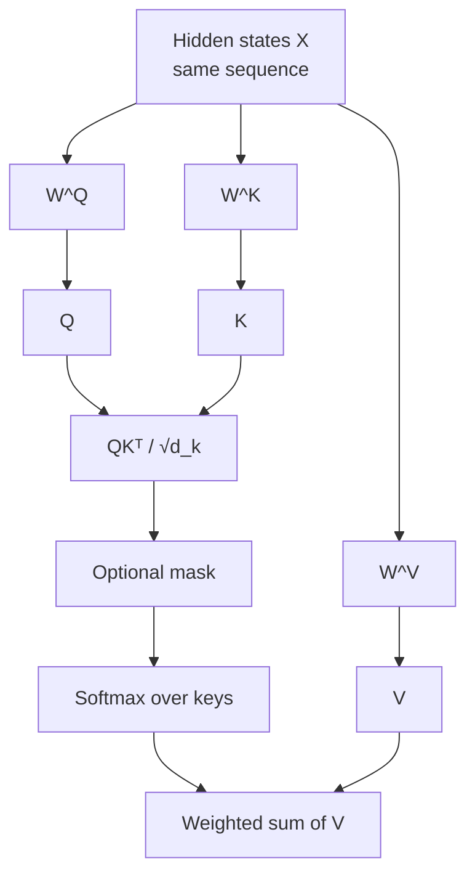

**Self-attention** (also called *intra-attention*) draws queries, keys, and values from the **same** sequence. Transformers commonly implement it with scaled dot-product attention. Each position builds a context vector as a weighted sum of value vectors from positions it is allowed to see. The weights come from how well that position's query matches each position's key.

That is the mechanism that lets a transformer mix information across tokens without recurrence or convolution. Vaswani et al. (2017) define self-attention this way: in a self-attention layer, keys, values, and queries come from the same place (the previous layer's outputs), so every position can attend over other positions in that sequence.

## Diagram



Self-attention vs [cross-attention](glossary://cross-attention): self-attention draws Q, K, and V from one stream (score shape $n \times n$). Cross-attention draws Q from a target stream and K, V from a source stream (score shape $T \times S$).

## Intuition

Treat each token state as three learned views of the same residual vector:

| View | Role | Question it answers |
| --- | --- | --- |
| Query $q_i$ | What position $i$ is looking for | "What do I need right now?" |
| Key $k_j$ | What position $j$ advertises | "What do I offer?" |
| Value $v_j$ | Payload copied if selected | "What content should travel if I match?" |

Dot products $q_i \cdot k_j$ score compatibility. Softmax turns a row of scores into a distribution over positions. The output at $i$ is that distribution times the values: a soft lookup table over the sequence, with learned addresses (keys) and learned content (values).

Unlike an RNN, every allowed pair $(i, j)$ can interact in one parallel step. Path length between any two positions is $O(1)$ layers of attention, which is why long-range dependencies are cheap in graph distance even when sequence length is large (Vaswani et al., Table 1).

Unmasked self-attention without positional information is permutation equivariant: permuting its input positions permutes its outputs. Position can enter through embeddings, relative biases, or methods such as [RoPE](glossary://rope). A causal mask also supplies order information by restricting each position to its prefix, so the unmasked symmetry claim does not apply unchanged to a causal decoder.

## Formula

Scaled dot-product attention (Vaswani et al., 2017, Eq. 1):

$$
\mathrm{Attention}(Q, K, V) = \mathrm{softmax}\!\left(\frac{QK^{\top}}{\sqrt{d_k}}\right)V
$$

For self-attention on hidden states $X \in \mathbb{R}^{n \times d_{\mathrm{model}}}$:

$$
Q = X W^Q,\quad K = X W^K,\quad V = X W^V
$$

with $W^Q, W^K \in \mathbb{R}^{d_{\mathrm{model}} \times d_k}$ and $W^V \in \mathbb{R}^{d_{\mathrm{model}} \times d_v}$. For one query row:

$$
\mathrm{out}_i = \sum_{j=1}^{n} \alpha_{ij}\, v_j,\qquad
\alpha_{ij} = \mathrm{softmax}_j\!\left(\frac{q_i k_j^{\top}}{\sqrt{d_k}}\right)
$$

**Why divide by $\sqrt{d_k}$.** If components of $q$ and $k$ are independent with mean 0 and variance 1, the unscaled dot product has variance $d_k$. Large magnitude scores push softmax into near one-hot regions with tiny gradients. Scaling by $1/\sqrt{d_k}$ keeps the score scale roughly independent of head dimension.

**Masks.** Before softmax, illegal scores are set to $-\infty$ (or handled by a kernel's equivalent exclusion rule). Decoder language models use a [causal mask](glossary://causal-mask) so position $i$ may only attend to $j \le i$. Encoders (BERT-style) often keep full bidirectional self-attention and only mask padding. Additive padding and causal masks combine on the score matrix; boolean API conventions differ. A row with no permitted keys needs explicit handling because ordinary softmax over all $-\infty$ scores is undefined.

**Multi-head.** Production layers run several [attention heads](glossary://attention-head) in parallel on lower-dimensional subspaces, concatenate head outputs, and mix with $W^O$. The core per-head math is the formula above.

## Worked numbers

Three tokens, one head, $d_k = 2$, no mask (bidirectional). Toy Q, K, V already projected:

```python
import math

# rows = positions 0, 1, 2
Q = [[1.0, 0.0], [0.0, 1.0], [1.0, 1.0]]
K = [[1.0, 0.0], [0.0, 1.0], [0.5, 0.5]]
V = [[1.0, 0.0], [0.0, 1.0], [1.0, 1.0]]

def softmax(row):
    m = max(row)
    exps = [math.exp(x - m) for x in row]
    s = sum(exps)
    return [e / s for e in exps]

scale = math.sqrt(2)  # √d_k
scores = [
    [sum(qi * kj for qi, kj in zip(q, k)) / scale for k in K]
    for q in Q
]
weights = [softmax(row) for row in scores]
out = [
    [
        sum(w * V[j][d] for j, w in enumerate(alpha))
        for d in range(2)
    ]
    for alpha in weights
]
# Each weights[i] sums to 1.0; out[i] is the context for position i
```

Scaled scores $QK^{\top}/\sqrt{2}$ (rounded):

| query $\backslash$ key | 0 | 1 | 2 |
| ---: | ---: | ---: | ---: |
| 0 | 0.71 | 0.00 | 0.35 |
| 1 | 0.00 | 0.71 | 0.35 |
| 2 | 0.71 | 0.71 | 0.71 |

After softmax, row 0 puts most mass on key 0, row 1 on key 1, and row 2 spreads more evenly. The output at each position is the corresponding mix of value vectors. Under a causal mask, the upper triangle of the score table would be $-\infty$ before softmax, so position 0 could not read keys 1 or 2.

## How it works (one layer step)

1. **Project** residual states $X$ into $Q$, $K$, $V$ (per head).
2. **Score** all query-key pairs: $S = QK^{\top} / \sqrt{d_k}$ (shape $n \times n$ per head).
3. **Mask** pad and/or future positions.
4. **Softmax** over the key axis so each query row is a distribution.
5. **Mix** values: $O = PV$ with $P = \mathrm{softmax}(S)$.
6. **Merge heads** (concat + $W^O$), then residual add and normalization as the block defines.

During **training** of a causal LM, the full sequence is scored in parallel under the causal mask (teacher forcing). During **inference**, prefill runs the prompt once and writes $K$ and $V$ into a [KV cache](glossary://kv-cache); each decode step adds one new $(k_t, v_t)$ and scores only the new query against the cache.

## Example

Sentence: *"The parser rejected the patch because it was malformed."*

Focus on the token **it**. In early layers, self-attention can put high weight on local syntax. In deeper layers, some heads often route **it** toward **patch** (the referent) rather than **parser**, so the residual at **it** carries features useful for predicting *malformed*. That is soft, learned routing: nothing hard-codes coreference. Multiple heads can specialize (syntax vs long-range binding) because each head has its own $W^Q, W^K, W^V$.

In a decoder-only model the same sentence is processed under a causal mask, so when the model is at **because** it cannot attend to **malformed** yet. Encoder-only bidirectional self-attention would allow every token to read every other non-pad token.

## Complexity and sizing

From Vaswani et al. (Table 1), a full self-attention layer costs:

| Quantity | Order |
| --- | --- |
| Compute per layer (one head, dense) | $O(n^{2} d_k)$ for scores + $O(n^{2} d_v)$ for $PV$, often written $O(n^{2} d)$ |
| Sequential depth | $O(1)$ (all pairs in parallel matmuls) |
| Max path length between positions | $O(1)$ |
| Naive activation memory for $S$ or $P$ | $O(n^{2})$ per head |

Doubling context length roughly **quadruples** dense attention FLOPs and naive score memory for that step. Long-context systems must manage both compute and quality:

- **[FlashAttention](glossary://flashattention)** keeps the same math but avoids writing the full $n \times n$ matrix to HBM (IO-aware tiling + online softmax). FLOPs stay $\Theta(n^{2}d)$; peak memory for intermediates drops toward linear in $n$.
- **KV cache** removes repeated $K$/$V$ projection of the past at decode time, but cache bytes still grow as $O(n)$ per layer and request.
- **GQA / MQA** shrink stored KV heads; they do not remove the $n \times n$ (or $1 \times n$ at decode) scoring structure for each query head.

Order-of-magnitude prefill score storage if you materialize FP16 scores for one layer with $h$ heads: $h \cdot n^{2} \cdot 2$ bytes. At $n = 8192$, $h = 32$: about $32 \cdot 8192^{2} \cdot 2 \approx 4.3$ GB for $S$ alone before values, residuals, or other layers. Fused kernels exist precisely so you never allocate that.

## Trade-offs

| Choice | Benefit | Cost / risk |
| --- | --- | --- |
| Full bidirectional self-attention | Full context for encoders, embeddings | Cannot train next-token LM without leakage |
| Causal self-attention | Matches autoregressive generation | No future context; long prompts still $O(n^{2})$ prefill |
| Dense attention | Exact pairwise mixing | Quadratic compute and naive memory |
| FlashAttention-style kernels | Same attention operation, less HBM traffic | Floating-point differences; shape/dtype/mask constraints; fallbacks |
| Shared KV (GQA/MQA) | Smaller cache, higher batch | Slight quality trade-off vs full MHA on some tasks |

**What fails in production** is usually not "attention forgot how to soft-lookup":

- Missing or wrong causal/pad mask: train loss looks fine while free-run generation collapses, or pad tokens steal mass.
- Wrong $d_k$ scaling or head reshape: scores saturate or shapes disagree across heads.
- Materializing $n \times n$ on long context: OOM or multi-second prefill.
- Stale or misaligned KV cache (edit mid-prompt, bad RoPE index): fluent garbage after a branch or tool insert.
- Confusing self-attention with cross-attention when wiring encoder memory or multimodal towers: Q comes from the wrong stream.

## Why it matters here

Self-attention is the core mixing step of every transformer block in the curriculum. Understanding Q/K/V from one sequence, the $\sqrt{d_k}$ scale, masks, $n \times n$ cost, and how cache and kernels implement the same formula is what unlocks heads, causal LM training, long context, FlashAttention, GQA, and serving memory math. When an LLM "uses context," this is the operation doing the routing.

## Related terms

- [Attention head](glossary://attention-head)
- [Causal mask](glossary://causal-mask)
- [Cross-attention](glossary://cross-attention)
- [KV cache](glossary://kv-cache)
- [FlashAttention](glossary://flashattention)
