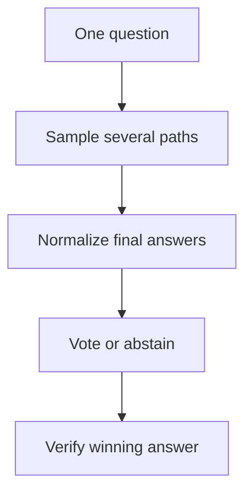

**Self-consistency** generates several independent candidate reasoning paths for the same question, extracts their final answers, and chooses the answer supported by the strongest agreement. It exchanges additional model calls and tokens for a chance to reduce errors caused by committing to one unlucky sample.

## Agreement and verification answer different questions

Sampling multiple paths helps when different attempts make partly independent mistakes and correct answers converge. It helps less when every sample inherits the same misleading context, flawed premise, biased prompt, or unavailable evidence. Five identical hallucinations may share one failure; verify answers against external evidence.

The controller must define how answers are normalized, how ties are resolved, whether confidence justifies abstention, and when further sampling stops. A verifier, executable test, retrieved source, or policy check remains stronger than popularity for decisions with observable ground truth.

## Example

A policy assistant samples five answers about an 18-day-old service-account key. Three conclude that a rotation ticket is required, one wrongly approves continued use, and one requests clarification. The controller groups equivalent answers and selects the ticket-required result.

Before taking action, the application still verifies the actual policy clause, the key's recorded age, and the caller's permissions. If the five samples split across incompatible actions, it escalates instead of presenting a weak plurality as certainty.

## Why it matters here

Applied reasoning lessons compare one-shot responses, majority voting, and bounded search under explicit accuracy, latency, and token budgets. Self-consistency is appropriate only when measured task improvement justifies its extra cost and when agreement is never confused with authorization or factual evidence.

## Related terms

- [Chain of thought](glossary://chain-of-thought)
- [Calibration](glossary://calibration)
- [Abstention](glossary://abstention)
- [Token budget](glossary://token-budget)
