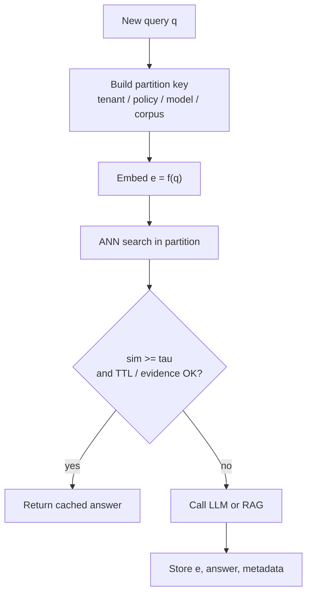

A **semantic cache** reuses a stored LLM answer (or intermediate result) when a new query is *meaningfully similar* to a cached query, including paraphrases with different wording. The system embeds the query, finds a near neighbor in a vector store, and returns the cached value if similarity clears a threshold $\tau$ and every safety partition (tenant, policy, model, evidence version) matches.

Exact caches need identical keys. Semantic caches trade that rigidity for hit rate on paraphrases ("How do I rotate an API key?" vs "steps to replace access credentials"). That gain only helps when the reused answer is still correct for *this* caller under *current* policy and data.

Prefix cache and KV reuse preserve *computation* for an identical token prefix. A semantic cache reuses a *final answer* (or tool output) across differently worded requests. A wrong hit changes product behavior and can return an answer that is stale, unauthorized, or incorrect.

## How it works

Production systems (for example GPTCache and Redis-style semantic caches) follow the same loop:

1. **Pre-process** the request: strip or normalize volatile prompt chrome if needed; keep the intent-bearing text used as the cache key.
2. **Embed** that text with a fixed encoder $f$ so $e = f(q) \in \mathbb{R}^{d}$ (often L2-normalized).
3. **Search** a vector index ([ANN search](glossary://ann-search), HNSW, flat scan for small stores) for nearest cached embeddings *inside the same partition*.
4. **Threshold**: accept the top match only if $\mathrm{sim}(e, e_i) \ge \tau$ (and optional secondary checks: TTL, evidence version, permission hash).
5. **Hit**: return the stored response (and metadata) without calling the LLM.
6. **Miss**: call the LLM (or RAG pipeline), then store $(e, q, \text{response}, \text{partition}, \text{expires\_at})$.

Libraries such as GPTCache (Bang, NLP-OSS 2023) modularize adapter, pre-processor, embedding generator, cache manager, similarity evaluator, and post-processor. MeanCache (Gill et al., 2024) stresses the same geometry on-device and tunes $\tau$ from local data. In-memory stores (Redis) plus HNSW are a common pairing for low-latency lookup.

## Formula

For embeddings $e_q, e_i \in \mathbb{R}^{d}$, the usual decision uses [cosine similarity](glossary://cosine-similarity):

$$
\mathrm{sim}(e_q, e_i) = \frac{e_q \cdot e_i}{\lVert e_q \rVert_2\,\lVert e_i \rVert_2}
$$

After L2 normalization ($\lVert e \rVert_2 = 1$), this collapses to a dot product: $\mathrm{sim} = e_q^\top e_i$. A hit is:

$$
i^\star = \arg\max_i \mathrm{sim}(e_q, e_i)
\quad\text{subject to partition match},
\qquad
\text{hit if }\mathrm{sim}(e_q, e_{i^\star}) \ge \tau
$$

Thresholds vary by model and workload. [GPTCache](https://aclanthology.org/2023.nlposs-1.24.pdf) reported a working balance near $0.7$ on its evaluation set, and [MeanCache](https://arxiv.org/html/2403.02694v1) found validation thresholds near $0.78$ to $0.83$ for Albert/MPNet. [Regmi & Pun (2024)](https://arxiv.org/html/2411.05276v1) used $0.8$ and reported category positive-hit rates ranging from roughly $92.5\%$ to $97.3\%$. Their generated test queries were designed to be similar to cached questions, so those figures describe that test distribution. Fit $\tau$ on *your* labeled paraphrases and non-matches.

**Quality metrics beyond raw hit rate.** Semantic caches create false hits (similar geometry, wrong answer for this query) and false misses (should have reused, did not). Treat hit decisions like a binary classifier:

$$
\text{Precision} = \frac{TP}{TP + FP},
\quad
\text{Recall} = \frac{TP}{TP + FN},
\quad
F_\beta = (1+\beta^2)\frac{\text{Precision}\cdot\text{Recall}}{\beta^2\,\text{Precision}+\text{Recall}}
$$

where $TP$ is a true hit (reused answer is acceptable), $FP$ a false hit, $FN$ a false miss. MeanCache emphasizes maximizing $F$ (or $F_{0.5}$ when wrong hits are more costly than missed savings). Overall [cache hit rate](glossary://cache-hit-rate) alone can look healthy while $FP$ poisons UX.

**Expected infrastructure cost** with the actual returned-hit rate $HR$:

$$
\mathbb{E}[\text{cost}] \approx HR \cdot C_{\text{hit}} + (1-HR)\cdot C_{\text{miss}}
$$

$C_{\text{hit}}$ includes embedding, search, and fetching; $C_{\text{miss}}$ includes that lookup overhead plus generation or RAG and cache insertion. False hits still avoid generation costs, but introduce errors and possible remediation costs that this infrastructure formula omits. Measure reuse precision separately instead of substituting true-hit rate into this two-branch accounting.

## Diagram



## Example

Support FAQ for one product and one policy version. Cache already holds:

| Cached query | Answer id | Embedding (toy 2-D, approximately unit) |
|---|---|---|
| "How do I rotate an API key?" | A17 | $(0.98, 0.20)$ |
| "How do I delete my account?" | A44 | $(0.20, 0.98)$ |

New query $q$: "steps to replace access credentials", embedding $e_q = (0.96, 0.28)$ (unit length). Cosines:

$$
\mathrm{sim}(e_q, A17) = \frac{0.96\cdot 0.98 + 0.28\cdot 0.20}{\sqrt{0.98^2+0.20^2}} \approx 0.9966
$$
$$
\mathrm{sim}(e_q, A44) = \frac{0.96\cdot 0.20 + 0.28\cdot 0.98}{\sqrt{0.20^2+0.98^2}} \approx 0.4663
$$

With $\tau = 0.90$ and matching `(tenant, policy_ver, corpus_ver, model)`, you hit **A17** and skip the LLM. Lowering $\tau$ alone does not change that nearest neighbor. If only **A44** is available, however, a $0.45$ threshold accepts account-deletion guidance for a key-rotation question: a false hit.

```python
def cache_partition(tenant, policy_ver, corpus_ver, model):
    # Similarity search runs only inside this partition.
    return (tenant, policy_ver, corpus_ver, model)

def semantic_lookup(index, e_q, partition, tau, now):
    # index returns candidates already filtered by partition
    best_id, best_sim, meta = index.nearest(e_q, partition)
    if best_id is None or best_sim < tau:
        return None
    if meta["expires_at"] <= now:
        return None
    if meta["evidence_ver"] != partition[2]:  # corpus_ver
        return None
    return meta["answer"]
```

**Published results in their evaluated setups:** GPTCache reported cache-hit latencies on the order of $\sim 0.2\,\mathrm{s}$ vs multi-second LLM calls; Regmi & Pun reported API-call reductions up to $\sim 68.8\%$ on repetitive category tests with $\tau=0.8$. Your hit rate depends on paraphrase rate, $\tau$, embedding quality, and partition granularity.

## Partition key and freshness

Similarity alone is never enough. The vector only says "these strings are near in embedding space." The answer also depends on:

| Dimension | Why it must be in the key or gate |
|---|---|
| Tenant / principal | Prevent cross-tenant answer leakage ([tenant isolation](glossary://tenant-isolation), [permission boundary](glossary://permission-boundary)) |
| Policy / prompt version | New safety or tone rules invalidate old text |
| Model family / version | Different generators produce different answers |
| Embedding model / index version | $\tau$ and ANN neighbors are invalid after $f$ or the index rebuild changes; stored answers may still be fine while scores are not |
| Evidence / corpus version | RAG answers go stale when docs change |
| Locale / channel | Same intent, different legal or product surface |
| [TTL](glossary://ttl-deadline) | Bounds staleness when invalidation is incomplete |

On a candidate hit, still validate that cached evidence is current enough for the product SLO. A 24-hour semantic cache is wrong for a policy that must update within 15 minutes.

## Trade-offs

| Choice | Upside | Cost / risk |
|---|---|---|
| Lower $\tau$ | Higher $HR$, lower spend | More false hits |
| Higher $\tau$ | Safer reuse | More misses, less savings |
| Larger / domain-tuned embedder | Better geometry | Latency and ops cost on every request |
| Shared global cache | Max reuse | Privacy, personalization, and tenancy bugs |
| Per-tenant (or per-user) index | Safer isolation | Lower $HR$, more storage |
| Aggressive TTL | Fresher answers | Fewer hits |
| Exact string layer *then* semantic | Cheap true duplicates | Two code paths to monitor |

Use semantic caching for FAQ, support, internal docs, and other workloads where paraphrases can share a valid answer. Route open-ended creative tasks, unkeyed multi-turn state, and answers requiring fresh live-tool retrieval through a cache bypass.

## Debug path

When users report "wrong answer but fast":

1. Log partition, $\mathrm{sim}$, $\tau$, cached query text, evidence version, model id, and TTL remaining for every hit.
2. Sample hits and score them as $TP$ vs $FP$ (human or judge with a fixed rubric). Track precision alongside $HR$.
3. Plot the score distribution for known paraphrase pairs vs known non-matches; place $\tau$ where false hits stay under your error budget.
4. After any embedder ($f$) upgrade or index rebuild, bump the partition (or `embedding_model_id` / `embedding_index_version`), re-embed or isolate old vectors, and re-fit $\tau$ on labeled paraphrases before counting hits as valid.
5. Confirm ANN filters apply *before* or with the vector probe so another tenant never appears as a neighbor.
6. After a corpus or policy deploy, trigger version-based invalidation and measure its effect. Waiting for TTL can leave stale entries available.

## Why it matters here

Semantic caching is a practical RAG and chatbot cost tool, but it forces a clean split between *similarity*, *authorization*, and *freshness*. Engineers who only chase hit rate ship plausible wrong answers; engineers who only chase exact keys leave easy savings on the table. The useful skill is building a partitioned, thresholded, instrumented reuse path and measuring false-hit rate on paraphrases that must *not* share answers.

## Related terms

- [Embedding](glossary://embedding)
- [Cosine similarity](glossary://cosine-similarity)
- [Cache hit rate](glossary://cache-hit-rate)
- [ANN search](glossary://ann-search)
- [Tenant isolation](glossary://tenant-isolation)
