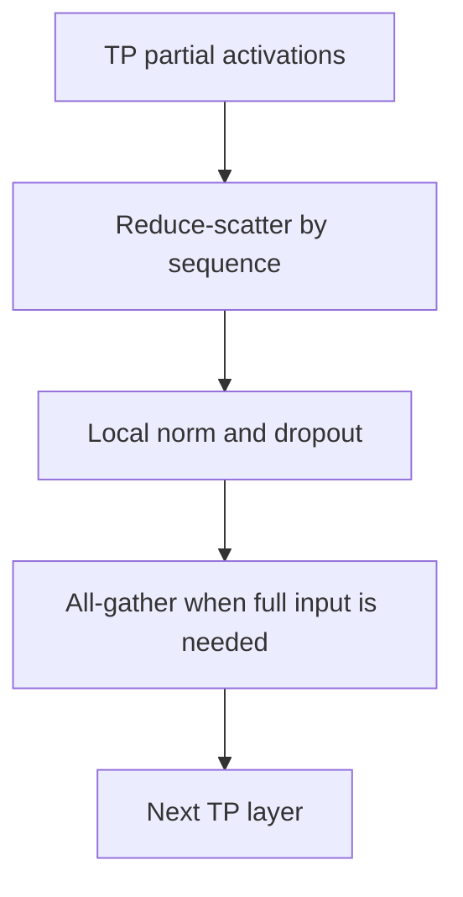

**Sequence parallelism (SP)** is a Megatron optimization that shards the sequence dimension for operations that tensor parallelism would otherwise replicate, such as normalization and dropout regions. It reduces activation memory while pairing naturally with TP collectives.

SP is easy to confuse with [context parallelism](glossary://context-parallelism). SP targets specific activation regions around tensor-parallel layers. CP partitions the full sequence across the network and must solve cross-token attention communication. A configuration can use both because they address different replicated state.

## Communication rewrite

Tensor-parallel layers often use an all-reduce to rebuild replicated outputs. SP can express that path as reduce-scatter followed later by all-gather, leaving each rank responsible for a sequence shard between the two collectives. Communication volume can stay similar while resident activation memory falls.

## Diagram

## Example

For TP=8, each rank can keep one-eighth of selected sequence activations. Attention still follows its TP or CP algorithm and sees the context that algorithm defines.

## Why it matters here

The name is framework-dependent: other systems also call attention-distribution methods such as Ulysses "sequence parallelism." Confirm Megatron SP in the backend's actual configuration; orchestration-level settings alone cannot determine whether it is enabled. Distinguish Megatron SP from CP before attributing memory savings to a knob.

## Related terms

- [Context parallelism](glossary://context-parallelism)
- [Tensor parallelism](glossary://tensor-parallelism)
- [Reduce-scatter](glossary://reduce-scatter)
- [All-gather](glossary://all-gather)
- [NVIDIA Megatron](glossary://nvidia-megatron)
