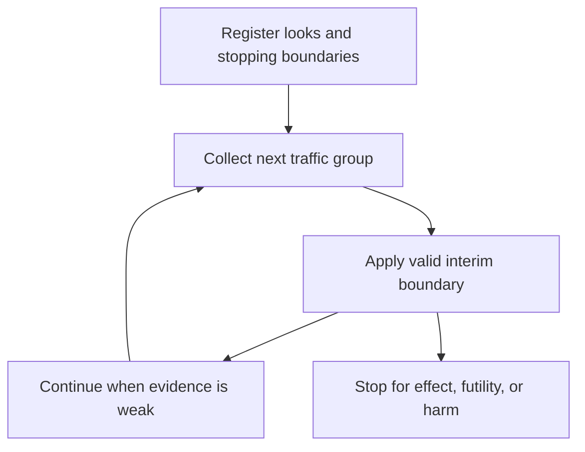

**Sequential testing** evaluates accumulating experiment data using a statistical procedure that explicitly accounts for multiple interim looks. A valid frequentist sequential design controls the stated false-positive rate under its assumptions while allowing early stopping across repeated looks. Specify the primary metric and inference procedure before inspecting outcomes. Group-sequential designs use planned looks and boundaries; always-valid methods can permit adaptively chosen decision times without fixing every look in advance.

## Why repeated ordinary p-values are misleading

A fixed-horizon test assumes one planned decision after the target sample size arrives. Looking every day and stopping as soon as $p<0.05$ creates many chances for random variation to cross that threshold. The experiment's overall false-positive probability can then exceed 5%. Group-sequential designs allocate an error budget across planned looks; other approaches use always-valid inference or explicitly Bayesian decision criteria. Each method has distinct assumptions and decision guarantees.

## Example

An LLM product plans a two-week comparison of grounded-answer acceptance and defines three interim analyses after 25%, 50%, and 75% of the required traffic, followed by a final analysis. It allocates the experiment-wide error budget across those four looks and keeps a separate immediate safety stop for harmful responses. At the first look, a nominal $p=0.04$ counts as evidence for improvement only if it crosses the prespecified early boundary. If the safety rate crosses its predeclared limit, disable the new variant and report the safety stop separately from any statistically established product improvement.

## Why it matters here

The online-evaluation lesson handles release safety and treatment-effect estimation as separate decisions. Sequential testing lets teams monitor expensive or risky model experiments while keeping repeated dashboard refreshes within a valid inference procedure.

## Related terms

- [A/B testing](glossary://ab-testing)
- [Statistical power](glossary://statistical-power)
- [Minimum detectable effect](glossary://minimum-detectable-effect)
- [Sample ratio mismatch](glossary://sample-ratio-mismatch)
