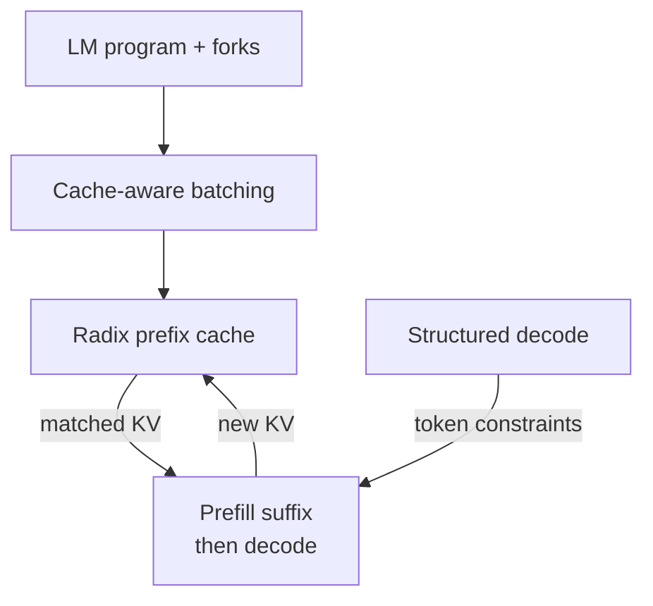

**SGLang** (Structured Generation Language) is an open-source system for programming and serving multi-call LLM workloads. It pairs a Python-embedded frontend for generation programs with a co-designed runtime that accelerates those programs, notably via [RadixAttention](glossary://radixattention) for automatic [KV-cache](glossary://kv-cache) reuse and compressed finite-state machines for faster [structured output](glossary://structured-output). The research system is described by Zheng, Yin, Xie, Sun, Huang, Yu, Cao, Kozyrakis, Stoica, Gonzalez, Barrett, and Sheng (NeurIPS 2024; arXiv:2312.07104). The production project is hosted under LMSYS at [sgl-project/sglang](https://github.com/sgl-project/sglang) with docs at [docs.sglang.io](https://docs.sglang.io/).

Today "SGLang" usually means the full serving stack (SGLang Runtime / SRT): [continuous batching](glossary://continuous-batching), paged KV, tensor/pipeline/expert parallelism, OpenAI-compatible HTTP APIs, constrained decoding backends, and large-scale multi-GPU deployment. The original paper's contribution is the co-design of language primitives with those runtime optimizations.

## Intuition

Agent and extraction code is a **program**: shared system prompts, few-shot blocks, tool schemas, multi-turn history, fork-and-merge judges, retries, and schema-constrained JSON. Those programs create exact token-prefix overlap. An engine that discards KV after each call recomputes those prefixes; SGLang is one of several contemporary serving engines that provide prefix caching.

SGLang treats the multi-call shape as first-class:

| Layer | Job |
| --- | --- |
| **Frontend** | Express `gen`, `select`, `fork`/`join`, regex/schema constraints, multimodal inputs in Python |
| **Runtime** | Reuse KV across calls and sessions, batch continuously, jump over forced structured tokens |
| **Co-design** | Frontend sends full prompts (and fork hints); runtime matches prefixes in a radix tree |

If every request is a unique one-shot chat with no shared prefix, you still get a solid high-throughput engine. The distinctive wins appear when programs and fleets share long exact prefixes.

## How it works

### Frontend: LM programs as Python

SGLang embeds a low-level DSL in Python (inspired by Guidance/LMQL-style control). Core ideas from the paper:

- **`extend` / `+=`**: append text (or image/video) to the prompt state
- **`gen(name, ...)`**: non-blocking generation into a named variable; optional `regex` for grammar constraints
- **`select`**: pick the highest-probability option from a closed list
- **`fork` / `join`**: branch prompt state for parallel sub-calls (branch-solve-merge, tree-of-thought, self-consistency)
- **Interpreter mode**: prompt state is an async stream; generation runs in the background like a CUDA kernel launch; reading a variable synchronizes
- **Compiler mode** (optional): trace a dataflow graph for further optimization

The same program can target the local SRT backend or API-only models (OpenAI-class endpoints). For black-box APIs the paper describes **API speculative execution**: over-generate past a stop and reuse the extra tokens for later primitives to cut repeated input charges.

### Runtime: RadixAttention

Instead of discarding KV when a request finishes, the runtime keeps prompt and output KV in a **radix tree** keyed by token sequences:

1. Incoming requests present their full tokenized prompt.
2. The tree finds the longest matching prefix already cached.
3. Only the unmatched suffix is prefilled; matched KV is reused.
4. New tokens (prompt + generation) are inserted; shared ancestors stay shared.
5. Under memory pressure, **LRU leaf eviction** drops cold private branches first so hot shared roots (system prompts, few-shot packs) survive longer.
6. Nodes in the current batch have reference counts and are not evicted while live.

Cached tokens and running requests share one memory pool: when the queue is deep, cache can yield to larger batches. The paper defines the [prefix-cache](glossary://prefix-cache) hit rate as

$$
\text{hit rate}
=
\frac{\text{number of cached prompt tokens}}{\text{number of prompt tokens}}.
$$

**Cache-aware scheduling** prioritizes waiting requests with longer matched prefixes (longest-shared-prefix-first, approximating DFS over the request tree) instead of pure FCFS, which raises hit rate but can starve cold, unique prompts if left unchecked.

Reuse requires **token-exact** overlap. A chat-template or tokenizer change that alters the shared prefix silently zeros the hit rate even when the text "looks the same."

### Runtime: compressed FSM structured decoding

For regex constraints and supported JSON forms, the original system builds an FSM and masks illegal next tokens **one token per step**. General recursive JSON-schema constraints require more than a finite-state representation; current grammar backends have their own supported subsets. Long forced fragments such as `{"summary": "` can form paths with no real choice.

SGLang's **compressed FSM** (LMSYS blog, Feb 2024) collapses adjacent singular-transition edges so the engine can **jump-forward**: prefill or emit several forced tokens in one step when the grammar admits only one path. Ablations in the paper report about $1.6\times$ higher throughput on JSON decoding from compression alone; production stacks now also use backends such as XGrammar for schema/regex/EBNF enforcement.

### What the production runtime also does

The current open-source server adds continuous batching, paged attention, chunked prefill, speculative decoding, prefill-decode disaggregation, multi-LoRA, quantization, and OpenAI-compatible `/v1/chat/completions` plus native `/generate`. Availability and combinations depend on the model, hardware, backend, and installed release. Launch pattern:

```bash
python3 -m sglang.launch_server \
  --model-path Qwen/Qwen2.5-7B-Instruct \
  --host 0.0.0.0 --port 30000
```

Clients can use the OpenAI Python SDK against `http://127.0.0.1:30000/v1` or the native generate API.

## Diagram



## Example

A document extraction service runs the same long instruction + JSON schema for every ticket, then a short unique body:

| Segment | Tokens (approx.) | Shared across requests? |
| --- | ---: | --- |
| System + schema + few-shot | $1\,800$ | Yes |
| Ticket body | $400$ | No |
| Constrained JSON fields | $120$ decode | Schema-forced paths |

**Without prefix reuse:** every request prefills roughly $2\,200$ tokens.

**With RadixAttention after the first warm request:** prefill cost approaches the $400$-token body when the $1\,800$-token prefix stays resident. Hit rate for the prompt alone is

$$
\frac{1800}{2200} \approx 0.82
$$

on subsequent requests that share that prefix. Time-to-first-token drops because [prefill](glossary://prefill) work shrinks; batch capacity rises because shared KV is stored once.

A minimal frontend-shaped sketch (illustrative, not a pinned API version):

```python
@sgl.function
def extract_ticket(s, body: str):
    s += SYSTEM_AND_SCHEMA  # long shared prefix
    s += "Ticket:\n" + body + "\nJSON:\n"
    s += sgl.gen(
        "record",
        max_tokens=256,
        regex=TICKET_JSON_REGEX,  # compressed-FSM / grammar path
    )
```

Parallel branches (multi-criterion judge) use `fork` so several `gen` calls share the essay/image prefix in the radix tree instead of recomputing it three times.

The papers report up to about **$6.4\times$** higher program throughput than contemporary Guidance/vLLM/LMQL baselines on agent, few-shot, JSON, RAG, and multi-turn workloads; the LMSYS blog reported up to about **$5\times$** on Llama-7B/Mixtral setups. These results came from the evaluated configurations. Gains track cache hit rate (often $50\%{-}99\%$ on those workloads) and structured-decoding jump-forwards; unique long prompts offer less reuse. Benchmark the target workload and fleet before using these figures for capacity planning.

## Trade-offs

| Fit | Why |
| --- | --- |
| **Strong** | Multi-turn chat with sticky system prompts, agents, few-shot packs, RAG with repeated context templates, schema JSON / tool args, multi-sample self-consistency |
| **Neutral** | OpenAI-compatible single-shot chat; still a competitive engine, but RadixAttention is less special |
| **Weak / careful** | Near-zero prefix overlap; adversarial or highly diverse prompts; fairness-sensitive queues if pure longest-prefix scheduling starves cold traffic |

**What fails in production**

- **Silent cache misses:** template or tokenizer drift changes token IDs; hit rate collapses while logs still look "healthy."
- **Cache thrashing:** HBM full + many unique long prefixes → leaf eviction churn; TTFT variance spikes.
- **Starvation:** cache-aware ordering can delay requests with no shared prefix under load.
- **Constraint bugs:** overly tight regex/schema, tokenization boundary quirks, or jump-forward edge cases produce loops, truncated fields, or empty legal sets; always validate parsed output and measure constraint latency.
- **Wrong comparison:** toy single-request latency without a realistic shared-prefix mix understates SGLang (and any radix/[prefix cache](glossary://prefix-cache) engine).

**What to measure:** prefix-cache hit rate, [TTFT](glossary://ttft), TPOT / inter-token latency, throughput (req/s and tokens/s), KV HBM occupancy, eviction rate, schema parse success rate, and p95 under your real prefix distribution. Benchmark against [vLLM](glossary://vllm) or another baseline on the **same** traffic mix before committing.

## Why it matters here

SGLang is a clear teaching example of how **serving optimizes the shape of the LM program alongside model weights**. RadixAttention, continuous batching, and grammar-constrained decoding show how agents, structured extraction, and multi-turn systems can use reuse and contracts at the token layer.

## Related terms

- [RadixAttention](glossary://radixattention)
- [Prefix cache](glossary://prefix-cache)
- [Structured output](glossary://structured-output)
- [Continuous batching](glossary://continuous-batching)
- [vLLM](glossary://vllm)
