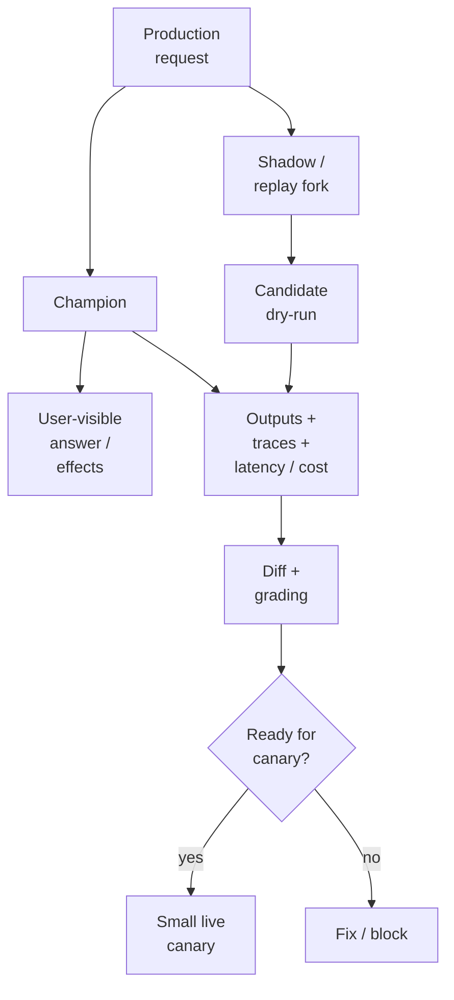

**Shadow evaluation** (also called shadow mode, shadow deployment, or dark launch when traffic is forked live) runs a candidate model, prompt, retriever, agent, or full pipeline on **realistic production inputs** while keeping **authority** on the current system. Users and downstream side effects only see the production path. The candidate's outputs, traces, latency, cost, and tool plans are logged for comparison and human or automated grading. The candidate must not deploy, send, write, delete, or answer users.

Shadow sits between [offline evaluation](glossary://offline-evaluation) and user-visible release steps such as [canary rollout](glossary://canary-rollout) or [A/B testing](glossary://ab-testing). Offline fixtures are clean and repeatable but miss live mix, feature freshness, and long-tail prompts. Canaries and A/B tests measure real user outcomes but put customers in the blast radius. Shadow evaluation answers a narrower question: *does the candidate behave sanely on production-shaped traffic without granting it authority?*

The idea is standard SRE and MLOps practice. Google SRE describes **dark launches** as forking real traffic to a new backend and discarding its response before it reaches the user, so you can check correctness and load before go-live. Amazon SageMaker and similar platforms call the same pattern **shadow deployment**: a challenger endpoint receives forked or replayed requests; only the champion answers. Istio and other meshes implement the infrastructure form as **traffic mirroring**. For LLM agents, the same contract applies with a harder safety rule: the shadow path is read-only for tools and writes.

## Intuition

Think **deploy without release**. The candidate runs on production infrastructure and production-shaped inputs. It does not own the customer-visible decision.

| Mode | Inputs | Candidate authority | What you learn |
| --- | --- | --- | --- |
| Offline eval | Fixed gold / logs | None | Pass rates on known cases |
| Shadow evaluation | Live or replayed production | None (log only) | Realistic behavior, load, skew, disagreement |
| Canary / A/B | Live traffic | Partial or full on a share | User and business outcomes |

Shadow evaluation compares a candidate with production and provides a **regression signal**. Use human labels or offline grades to assess quality, and a canary or A/B test to measure user outcomes. If production is wrong and the candidate is right, a naive "match champion" metric will punish the improvement. Pair agreement with human review, offline grades on logged cases, and [trajectory evaluation](glossary://trajectory-evaluation) for agents.

## How it works

1. **Pin the candidate.** Model id, prompt version, retriever/index, tool schema, decoding settings, agent scaffold, policy pack. Shadow logs are useless if you cannot reconstruct which binary produced them.
2. **Choose a traffic source.** Live fork ([shadow traffic](glossary://shadow-traffic)), asynchronous queue of request payloads, or offline **replay** of retained production logs with the same auth and tenant context. Replay is safer for destructive tools; live fork is better for load and freshness.
3. **Fork without blocking users.** Prefer async shadow calls so champion latency is not gated on the candidate. Cap shadow concurrency and sample rate so cost and dependency load stay inside a budget.
4. **Strip side effects.** Read tools and retrieval may run if allowed. Writes, sends, deployments, tickets, memory updates, and user-visible answers must be mocked, dry-run, or blocked by a [policy gate](glossary://policy-gate). Log *would-have* actions, not *did* actions.
5. **Log a joinable record.** Request id, tenant, input hash, champion output, candidate output, latencies, token cost, tool traces, grader scores, errors. Same id must join both paths.
6. **Score and decide.** Diff outputs, grade slices, check latency and cost, review high-risk disagreements. Promote eligibility for canary only after predeclared floors and human review of scary diffs. Shadow green means "safe enough to risk a small user-visible share," not "proven better for the business."

### Two implementation shapes

**Application-level:** the serving handler (or agent runtime) invokes the candidate in a background task after or alongside the champion, with a shadow flag that forces dry-run tools. Simple to control per-request sampling and redaction.

**Infrastructure-level:** a mesh or gateway mirrors HTTP to a second endpoint (for example Istio mirroring). Good for load tests of stateless predictors. Dangerous for LLM agents unless the mirrored service cannot reach write APIs; mirrored requests can double feature-store and provider spend and can accidentally mutate if the candidate is a full agent.

For agents, application-level shadow with an explicit **dry-run executor** is usually safer than blind request mirroring.

## Diagram

## Example

You have production agent `access_agent_v1` that drafts access-restore replies after reading policy and account state. Writes require human approval. Candidate `access_agent_v2` passed a six-episode offline gate and is eligible only for shadow, not live autonomy.

For two business days you **replay** 2,000 retained intake tickets (stratified by region, missing-account cases, and policy version) and also **live-fork** 10% of new tickets asynchronously:

- Champion answers the user as today.
- Candidate runs with the same intake bundle, auth context, and read tools.
- `restore_access` and any write tools are dry-run: the candidate may *propose* a restore, but the executor records `would_call` and does not create tickets.
- Each run logs: restore proposal, tool sequence, citation set, step durations, token cost, and whether a [policy gate](glossary://policy-gate) would have blocked. Compute p95 latency across the collected runs, not as a single-run measurement.

Results on the 2,000 replay tickets (illustrative):

| Metric | Champion | Candidate | Notes |
| --- | --- | --- | --- |
| Exact decision match | n/a | 91.4% | Same restore vs escalate vs refuse |
| High-risk disagreement | n/a | 38 cases | Human review queue |
| Would-call write without approval | 0 | 2 | Hard fail; block canary |
| p95 end-to-end (shadow path) | 1.9s | 3.4s | Over latency budget |
| Mean tokens / ticket | 1.1k | 1.8k | Cost spike |

Decision: **do not canary**. Fix the two unauthorized write proposals and the latency regression. Shadow paid for those finds with zero customer-visible writes. After a fix, re-run the same 2,000-id suite so the comparison is fair, then re-open a live shadow sample before any user-visible share.

## Worked comparison metrics

For $N$ paired requests with champion output $y_i$ and candidate output $\hat{y}_i$, a simple **agreement rate** is

$$
\mathrm{Agree} = \frac{1}{N}\sum_{i=1}^{N} \mathbf{1}[y_i = \hat{y}_i]
$$

for discrete decisions (class, route, restore/refuse). For free text, replace exact match with a task metric: citation F1, rubric score, or a pinned [model judge](glossary://model-judge) under fixed temperature. Always report **support** $N$ and **invalid/timeout** counts; dropping hard rows inflates agreement.

**Disagreement rate** on a risk slice $S$ (for example privileged access requests) is more useful than global agree:

$$
\mathrm{Disagree}_S = \frac{1}{|S|}\sum_{i \in S} \mathbf{1}[y_i \neq \hat{y}_i].
$$

If $\mathrm{Disagree}_S$ is high, sample those rows for human labels rather than auto-promoting. Latency and cost are first-class shadow metrics: a candidate that matches answers but doubles p95 or token spend can still fail the gate.

## Safety boundary

Log what the candidate would have done. Block what would change the world:

- No user-visible answers from the candidate path
- No emails, deployments, account writes, ticket creates, memory updates, or external side-effecting tools
- Preserve authorized tenant and caller context through trusted scoped access, rather than blindly copying production credentials. For replay, pin historical tool results or point-in-time data where required; a current account lookup may not reproduce what the champion saw.
- Redact or scope PII in shadow logs; a new code path that dumps full prompts into a shared bucket is still an incident
- Separate shadow budgets: QPS caps, max concurrent model calls, max daily token spend, and a kill switch that sets sample rate to 0 without redeploying

When candidate outputs can trigger production effects, the run has become a canary. Shadow evaluation suppresses side effects and records candidate outputs for comparison.

## What still fails in production

Shadow evaluation keeps candidate decisions out of customer-facing actions. The run still uses infrastructure, can expose private data, and incurs cost, so budget and protect those paths. Measure outcome lift with a canary or A/B after shadow evaluation is clean.

Common failure modes:

1. **Hidden side effects.** A "read" tool that mutates caches, rate-limit counters, or third-party audit logs can still disturb production. Dry-run must be complete.
2. **Load doubling.** 100% live mirror can need nearly 2$\times$ model, retrieval, and logging capacity. Sample, async, and backpressure the shadow path.
3. **Cache and feature pollution.** Shadow reads that warm shared caches or write online features change champion behavior. Isolate caches and feature writes.
4. **Non-comparable pairing.** Different auth, different index version, or champion fallbacks not logged make diffs meaningless.
5. **Agreement worship.** Matching a bad champion hides a better candidate; diverging from a good champion can be a real regression. Use humans and offline labels on disagreement sets.
6. **No ground truth on causal outcomes.** Shadow cannot measure whether users would accept the new draft more often. That needs a canary or A/B after shadow is clean.
7. **Stochastic mismatch.** Temperature $> 0$ and non-deterministic tools inflate disagreement noise. Pin decoding for diff-heavy runs when the product allows it.

## Trade-offs

| Benefit | Cost |
| --- | --- |
| Realistic mix and load without user blast radius | Extra compute, tokens, and engineering for dry-run |
| Catches skew offline fixtures miss | Privacy review for production data in a new path |
| Strong pre-canary evidence for agents and high-stakes decisions | Does not estimate CTR, retention, or revenue lift |
| Easy rollback: set sample rate to 0 | Analysis load: diffs and review queues need owners |

Use shadow when the change is high impact (money, access, safety, legal) or when production inputs are hard to fake. Skip long shadow runs for tiny copy edits that already pass a tight offline suite and a small canary is cheaper.

## Why it matters here

LeetLLM treats shadow evaluation as the bridge between a green offline or trajectory gate and live autonomy. Six teaching episodes or a fixed golden suite can make a candidate **eligible** for shadow; they do not make it **authoritative**. Production LLM systems fail on long-tail accounts, missing records, policy versions, tool errors, and latency cliffs that fixtures under-represent. Shadow evaluation is how teams observe those failures with production-shaped inputs while [policy gates](glossary://policy-gate) and dry-run executors keep side effects off. The next step after a clean shadow is a small [canary rollout](glossary://canary-rollout), not a silent full [rollout](glossary://rollout).

## Related terms

- [Shadow traffic](glossary://shadow-traffic)
- [Offline evaluation](glossary://offline-evaluation)
- [Canary rollout](glossary://canary-rollout)
- [Trajectory evaluation](glossary://trajectory-evaluation)
- [Policy gate](glossary://policy-gate)
