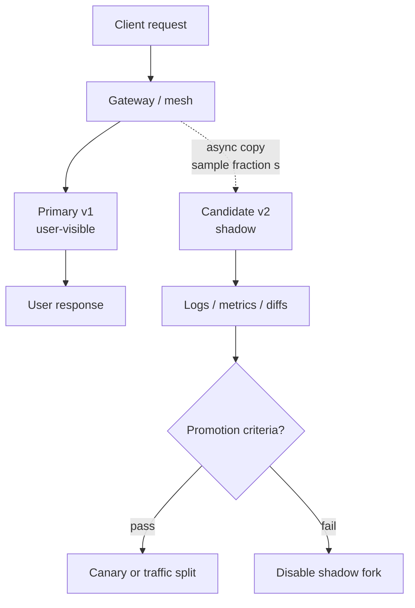

**Shadow traffic** (also called **traffic mirroring**, **traffic shadowing**, or Google CRE's **dark launch**) copies live production requests to a candidate system while only the primary path answers the user. The candidate's responses are discarded for serving and kept only for metrics, logs, and diffs. Users never see the shadow output, and a well-built shadow path must not mutate shared state.

Mesh and proxy systems implement the same idea as a fire-and-forget fork: Istio's `mirror` / `mirrorPercentage` and Envoy's request mirror policy send a duplicate request to a second backend, often marking the host with a `-shadow` suffix, and drop the mirrored response. Amazon SageMaker and other ML platforms expose the pattern as *shadow testing*: production (champion) serves; a shadow variant scores the same inputs in parallel.

A [canary rollout](glossary://canary-rollout) sends candidate traffic to users, while shadow traffic keeps the primary response user-visible and discards the candidate response. [Offline evaluation](glossary://offline-evaluation) runs against frozen fixtures; shadow traffic uses today's live mix, load shape, and long tail. [Shadow evaluation](glossary://shadow-evaluation) is the broader practice of scoring a candidate without authority; shadow *traffic* is the live-fork transport that often powers that practice.

## Intuition

The primary still owns the user reply, tools with side effects, and billing. A sampled copy of the same request goes asynchronously to the candidate so you can measure:

- **Correctness under real inputs:** ranking diffs, refusal rate, schema validity, tool-call plans
- **Capacity under real load:** p95 latency, queue depth, GPU util, provider rate limits
- **Cost under real usage shape:** tokens per request, cache hit rate, retriever fan-out

Offline gold sets miss production-only failure modes (new tenants, holiday spikes, multi-turn sessions, rare locales). Canaries catch those but spend real user impact. Shadow sits in between: realistic inputs, no user-facing authority.

## Diagram

## How it works

1. **Deploy the candidate beside production.** Same API shape when possible: model route, prompt version, retriever index, reranker, safety policy, or agent scaffold. The candidate must be independently scalable and killable.
2. **Fork at a controlled point.** Best place is usually the application gateway or service mesh after auth and tenant context are known, so the shadow request carries the same identity, headers, and payload the primary saw. Client-side double-calls are harder to kill and can double mobile data use (Google CRE's dark-launch guidance).
3. **Sample a fraction $s \in (0,1]$.** Mirror rate is independent of the primary route weight. Start small ($s = 0.01$ to $0.10$), ramp toward $1.0$ once capacity holds, or stay sampled forever if shadow cost is high (LLM tokens, GPU seconds).
4. **Keep the shadow path asynchronous.** Do not wait on the candidate before returning to the user. Google CRE recommends async fork plus a short timeout on the shadow leg so a slow challenger cannot inflate primary latency.
5. **Log both sides and diff.** Join on `request_id`. Record status, latency, tokens, retrieval ids, ranked doc ids, tool plans, safety outcomes, and (when useful) response digests. Prefer structured field diffs over free-text equality for LLM outputs.
6. **Decide, then promote or kill.** Green shadow evidence unlocks a [canary](glossary://canary-rollout) or [traffic split](glossary://traffic-split). It does not by itself prove business metrics that need user-visible outcomes.

If fraction $s$ of primary QPS $q$ is mirrored, shadow load is about:

$$
q_{\text{shadow}} \approx s \cdot q
$$

and total backend demand is $q + q_{\text{shadow}} \approx (1 + s)\,q$ when both paths hit similar resources. At $s = 1$ you roughly **double** inference, retrieval, and logging cost on the forked subsystems. Budget and rate-limit the shadow path separately.

## Example

A support RAG stack serves $200$ QPS at peak. You want to ship a new cross-encoder reranker (`rerank-v2`) without showing its ranking to users yet.

| Setting | Value |
| --- | --- |
| Primary | `retriever-v3` + `rerank-v1` + `prompt-17` |
| Shadow | same retriever and prompt, `rerank-v2` |
| Mirror rate $s$ | $0.10$ for $24\,\mathrm{h}$, then $0.50$ if capacity holds |
| Shadow timeout | $800\,\mathrm{ms}$, async, never on the critical path |
| Side effects | shadow path has tools disabled; no ticket writes, no emails |

Over an hour sustained at peak QPS, you shadow about $0.10 \times 200 \times 3600 = 72{,}000$ requests. Log per request: top-$10$ doc ids, citation-present flag from an offline-style judge on a $5\%$ sample, rerank duration, tokens, and whether the candidate would have refused. Aggregate durations to compute p95, including timeout/error counts so slow failures cannot disappear from the comparison.

Suppose after $24\,\mathrm{h}$:

- Ranking agreement (same top-1 doc): $81\%$
- Citation-present rate: primary $0.74$, shadow $0.79$
- p95 rerank latency: primary $120\,\mathrm{ms}$, shadow $340\,\mathrm{ms}$
- Shadow 5xx rate: $0.3\%$ (primary $0.05\%$)
- Extra provider spend: about $10\%$ of primary inference cost at $s = 0.10$

**Decision:** do not canary yet. Latency and errors fail the predeclared gate even though citation rate looks better. Fix timeout handling and batch size on `rerank-v2`, re-shadow at $s = 0.10$, then canary at $1\%$ only after p95 and error rate clear floors.

## Safety boundary

Keep candidate side effects disabled so the shadow path remains read-only with respect to shared systems:

- No emails, deployments, ticket updates, memory writes, or tool calls with external side effects
- No cache poisoning of shared production caches (use a separate cache namespace or disable writes)
- No dual-write of user-visible state; mutations cannot be safely applied twice in parallel (Google CRE notes this as a hard limit on pure request/response diffing)
- Same auth and tenant isolation as primary so you do not under-test multi-tenant ACL bugs, and so you do not over-expose PII to a half-finished code path without review

Logging still carries privacy and retention risk. Treat shadow logs like production logs: redaction, retention TTL, and access control.

## Sampling design

Include representative traffic, especially difficult, long-tail, and policy-sensitive cases.

| Goal | What to include |
| --- | --- |
| Quality parity | Languages, tenants, long prompts, multi-turn sessions, tool-use paths |
| Capacity | Peak hours, cold cache windows, large fan-out retrievals |
| Safety | Policy-sensitive intents, jailbreak probes already present in live mix |
| Cost | High-token routes, streaming, multi-agent scaffolds |

Uniform random sampling at rate $s$ is the default. Stratified sampling (always include rare high-risk tenants, cap easy FAQ traffic) improves signal when cost forces $s \ll 1$. Happy-path-only traffic produces comforting numbers and weak evidence.

Report slices or apply sampling weights when estimating population-wide rates from a stratified sample. Oversampling a difficult slice intentionally changes the observed traffic mix.

## What to compare

| Signal class | Examples for LLM / RAG systems |
| --- | --- |
| Agreement | Top-$k$ retrieval overlap, rank correlation, answer digest match, tool-plan match |
| Quality proxies | Citation present, judge score on sampled turns, refusal agreement with primary |
| Reliability | HTTP/RPC errors, timeouts, empty retrieval rate |
| Latency | End-to-end on shadow, TTFT, rerank/prefill/decode components |
| Cost | Tokens, $/1k requests, vector-store QPS, GPU seconds |
| Safety | Policy failures, PII leakage flags, disallowed tool plans |

LLM free-text equality is noisy. Prefer structured diffs (doc ids, schema fields, tool names, refusal codes) plus sampled human or judge review. Give the candidate a **diff budget** (for example, accept up to $2\%$ structured disagreement on non-critical fields) rather than demanding bit-identical text.

## Trade-offs

| Strength | Cost / limit |
| --- | --- |
| Real traffic mix and load without user-visible risk | Extra capacity, tokens, and log volume proportional to $s$ |
| Catches serving bugs offline suites miss | Does not measure user outcomes that need visible answers (CTR, CSAT, task success) |
| Safe place to load-test a new model or index | Side-effecting systems need stubs; pure mirror of write APIs is unsafe |
| Killable by dropping $s$ to $0$ | A hung shadow that blocks the primary path becomes a production incident |

Shadow measures how the candidate behaves under today's traffic while the primary owns replies. Measure user preference with a canary, A/B test, or other user-visible experiment after the shadow gate passes.

## Why it matters here

LLM systems change often: prompts, model routes, retrievers, rerankers, safety policies, agent tools. Offline eval blocks known regressions; shadow traffic is the next rung on the [rollout](glossary://rollout) ladder, where production-shaped load and long-tail queries hit the candidate while user-visible behavior stays on the primary path. Teams that skip shadow and jump from a golden set to a live canary learn the expensive way that capacity, timeouts, and rare tenants were never in the suite.

## Related terms

- [Shadow evaluation](glossary://shadow-evaluation)
- [Canary rollout](glossary://canary-rollout)
- [Traffic split](glossary://traffic-split)
- [Offline evaluation](glossary://offline-evaluation)
- [Rollout](glossary://rollout)
