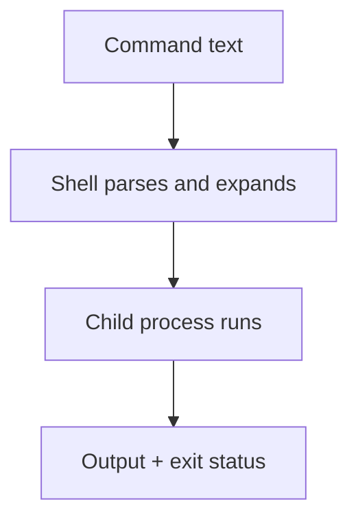

A **shell** is a program that reads command text, expands its syntax, launches other programs, and reports their results. Bash and Zsh are common examples. The terminal is the window displaying the interaction; the shell is the interpreter running inside that window. Python, Git, Docker, and evaluation scripts are separate programs the shell can start.

A command runs relative to the shell's current working directory. Environment variables provide configuration inherited by child processes. A successful command normally exits with status zero; a failing command returns a nonzero status. Quoting protects spaces and other special characters from being interpreted as separate shell syntax.

Quoting has different rules: single quotes preserve literal text, while double quotes still permit variable expansion and command substitution such as `$(...)`. Pass untrusted values to subprocess APIs as argument arrays. Some commands, including `cd`, are shell builtins rather than separate child programs.

## Commands, paths, and exit status

`pwd` prints the current directory, `cd project` changes it, and `./scripts/run_eval.sh` runs an executable relative to it. A pipeline such as `grep pattern data.jsonl | wc -l` sends one command's output into another. Check input existence and earlier command status separately; the script must verify both conditions.



## Example

```bash
cd access-rag || exit 1
./scripts/run_eval.sh
```

The directory check keeps evaluation in the expected location. A tracked script makes the command available to teammates and automated checks; a personal alias in `~/.zshrc` stays in the local shell configuration.

## Why it matters here

Training launches, data inspection, dependency setup, container builds, and reproducibility checks all cross a shell boundary. Understanding paths, quoting, process exit codes, and inherited configuration makes failures diagnosable instead of mysterious.

## Related terms

- [Environment variable](glossary://environment-variable)
- [Reproducible environment](glossary://reproducible-environment)
- [Pre-commit hook](glossary://pre-commit-hook)
