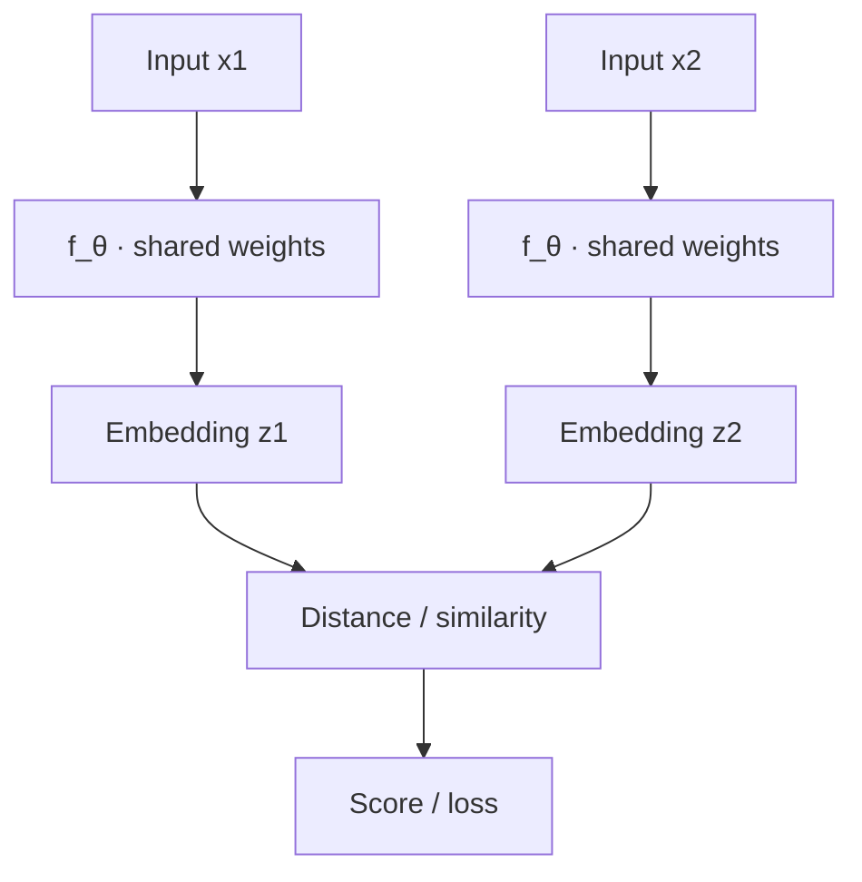

A **Siamese network** is a pair of identical encoder towers that share the same weights and process two inputs independently, then compare the resulting vectors with a distance or similarity. Bromley, Guyon, LeCun, Säckinger, and Shah introduced the name for signature verification (NIPS 1993): two time-delay sub-networks with tied parameters extract features, and a joining layer measures how close the feature vectors are. Because both sides compute the same function $f_\theta$, comparable items land in one embedding space, and at inference you often keep only one tower and store its outputs.

Shared weights are the defining constraint: both inputs pass through the same function. Training determines whether similar inputs land near one another in the learned geometry. A [bi-encoder](glossary://bi-encoder) independently encodes retrieval inputs; when towers share $\theta$ (as in classic Sentence-BERT), it is Siamese. Asymmetric dual encoders (for example DPR-style separate query and passage towers) keep the independent-encode-then-compare pattern but drop weight tying so each side can specialize.

## Intuition

Classification asks "what class is this input?" A Siamese model asks "are these two inputs the same kind of thing?" You train on pairs (or triplets) with a yes/no or ranking signal, not a fixed label set. That fits verification and open-set retrieval: new people, new products, new documents can appear after training, and you still score them by distance to stored vectors.

Think of one encoder as a learned measuring tool. You run it on item A, run the same tool on item B, then read the distance. The tool is calibrated so "same signer," "same face," "same meaning," or "relevant passage" means small distance, depending on the pairs you fed it.

## Diagram

At serve time for retrieval, only one forward is needed per query; document vectors $z = f_\theta(d)$ are precomputed and indexed.

## How it works

1. **Define the encoder** $f_\theta$: TDNN (Bromley), CNN (Chopra, Koch), Transformer with pooling (SBERT), or any differentiable map to a fixed-size vector.
2. **Share weights** across the two (or three) branches so $z_1 = f_\theta(x_1)$ and $z_2 = f_\theta(x_2)$ live in the same space.
3. **Score the pair** with cosine, Euclidean distance, or a small head on $(z_1, z_2, |z_1-z_2|)$.
4. **Train with a pair or triplet objective** so same-class / relevant pairs get small distance and different-class / irrelevant pairs get large distance (or a ranking margin).
5. **Deploy one tower**: encode the corpus offline, store vectors, encode the live query, run ANN or exact nearest neighbor.

With a symmetric metric such as cosine or Euclidean distance, swapping inputs leaves the score unchanged. Weight tying alone does not make an ordered comparison head symmetric: the NLI head below can distinguish premise from hypothesis. Tying also halves encoder parameters versus two equal-sized free towers, excluding any separate comparison head.

## Formula

Let $z_1 = f_\theta(x_1)$, $z_2 = f_\theta(x_2)$, and $D = \|z_1 - z_2\|_2$ (Euclidean distance; energy in the Chopra / Hadsell / LeCun line of work). With label $Y = 0$ for a genuine (similar) pair and $Y = 1$ for an impostor (dissimilar) pair, the standard pair contrastive form (Hadsell, Chopra, and LeCun, CVPR 2006) is:

$$
\mathcal{L}(Y, z_1, z_2) = (1 - Y)\,\frac{1}{2}\,D^{2} + Y\,\frac{1}{2}\,\bigl[\max(0,\; m - D)\bigr]^{2}
$$

where margin $m > 0$ stops pushing already-far impostors. Genuine pairs shrink $D$; impostors are pushed until $D \geq m$. Without the impostor term, the network can collapse to a constant map that makes every $D = 0$.

**Triplet form** (FaceNet; Schroff et al., CVPR 2015). For anchor $a$, positive $p$, negative $n$, and margin $\alpha$, FaceNet uses *squared* Euclidean distances:

$$
\mathcal{L}_{\mathrm{triplet}} = \max\bigl(0,\; \|z_a - z_p\|_2^{2} - \|z_a - z_n\|_2^{2} + \alpha\bigr)
$$

SBERT's triplet objective uses the same ranking idea with *unsquared* Euclidean distance and margin $\varepsilon$ (often $1$). Either way: pull $a$ toward $p$, push $a$ away from $n$, stop when the gap clears the margin.

**SBERT classification head** (Reimers and Gurevych, EMNLP 2019). After mean-pooling BERT outputs to sentence vectors $u$ and $v$, train a 3-way NLI classifier on the concatenation:

$$
o = \mathrm{softmax}\bigl(W_t\,[u;\, v;\, |u - v|]\bigr)
$$

At inference, drop the classifier and compare $u$ and $v$ with cosine similarity. Regression fine-tunes can also minimize MSE between $\mathrm{cos}(u,v)$ and a graded similarity label.

**Inference score** for retrieval or duplicate detection (normalized vectors):

$$
\mathrm{sim}(x_1, x_2) = \frac{f_\theta(x_1)^\top f_\theta(x_2)}{\|f_\theta(x_1)\|\,\|f_\theta(x_2)\|}
$$

## Worked numbers

Duplicate-ticket detector, L2-normalized 384-d embeddings, cosine as the product $z_1^\top z_2$. Threshold $\tau = 0.82$ for "same issue."

| Pair | Cosine | Decision |
|---|---|---|
| "rotate API key" vs "how do I rotate a leaked API key?" | $0.91$ | match |
| "rotate API key" vs "reset my password" | $0.61$ | non-match |
| "production blocked without approval" vs "production allowed after approval" | $0.78$ | non-match (close miss) |

For unit vectors, $D^{2} = 2(1 - \mathrm{cos})$. Under contrastive loss with $Y=0$ and $\mathrm{cos}=0.91$, $D^{2} = 2(1-0.91) = 0.18$, so $\mathcal{L} = \tfrac{1}{2}D^{2} = 0.09$. For the password pair as an impostor with margin $m = 1.0$ and $D = \sqrt{2(1-0.61)} \approx 0.88$, the impostor term is $\tfrac{1}{2}[\max(0, m-D)]^{2} \approx 0.007$; that negative is already near the margin, so the gradient is weak. You need harder near-misses (the 0.78 approval pair, $D \approx 0.66$) to keep learning fine boundaries.

SBERT-scale efficiency (from the paper): all-pairs similarity among $n = 10{,}000$ sentences with a BERT cross-encoder needs $n(n-1)/2 \approx 5 \times 10^7$ joint forwards (~65 hours on a V100). Siamese encoding is $n$ forwards (~5 seconds) plus a cheap cosine matrix (~0.01 seconds). That gap is why shared-encoder embeddings power semantic search and clustering.

## Example

**Deployment-runbook retrieval with a Siamese sentence encoder.**

1. Fine-tune a shared Transformer on in-domain pairs: (engineer question, gold runbook) as positives; BM25 near-misses and in-batch runbooks as negatives. Use contrastive or InfoNCE on cosine.
2. Offline: encode every runbook once with $f_\theta$, write $768$-d vectors into HNSW/FAISS, tag the index with model version `runbook-enc-v3`.
3. Online: encode the live question once, search ANN top-200, and optionally [cross-encoder](glossary://cross-encoder) rerank the shortlist. Measure latency on the actual hardware, query lengths, and index.
4. Updating one runbook means re-embedding that row under the same `runbook-enc-v3` checkpoint; upgrading the encoder means regenerating corpus embeddings and rebuilding the index.

Concrete failure: query "production blocked without approval." The Siamese first stage may return a generic "production approval overview" that is topically close after pooling but states the opposite condition. Full cross-attention often demotes that miss because negation and the approval condition interact token-by-token. Keep the Siamese stage for recall and cost; use a reranker when precision on hard constraints matters.

## Trade-offs

| Dimension | Siamese / bi-encoder | Cross-encoder |
|---|---|---|
| Encoding | Independent, shared $f_\theta$ | Joint over the pair |
| Corpus index | Yes: one vector per item | No |
| Query cost | One encode + ANN | One encode per candidate |
| Interaction | Compressed into $z$ | Full cross-attention |
| Typical role | First-stage retrieval, dedup, clustering | Rerank top tens/hundreds |

**Vs untied dual encoders.** Shared weights enforce one geometry and save parameters; separate query/passage towers can fit asymmetric text better (short query vs long document) but need careful training so the two spaces still align.

**What fails in production**

| Symptom | Likely cause |
|---|---|
| Good offline pairs, bad live ranking | Train/serve metric mismatch (train cosine, index uses unnormalized IP, or vice versa) |
| Sudden global quality drop after deploy | Mixed embedding versions in one index |
| Near-topic wrong docs dominate | Easy negatives only; mine [hard negatives](glossary://hard-negative) |
| Loss low, retrieval flat | Collapsed or anisotropic space; check random-pair cosine |
| Misses that a reranker fixes | Siamese compression limit; expected for negation, entity swaps, multi-clause constraints |
| Jittery scores for identical text | Dropout left on at serve; force eval mode |

Freshness and versioning matter as much as the architecture: every corpus change or $\theta$ change invalidates stored vectors for that item or the whole index.

## Why it matters here

Siamese networks are the architectural reason dense retrieval, sentence embeddings, and scalable semantic search work at all: shared (or dual) encoders turn comparison into vector search instead of $O(N)$ joint forwards. Curriculum topics on bi-encoders, contrastive learning, triplet loss, and RAG candidate generation all assume this twin-tower pattern. When ranking fails, separate "the encoder geometry" from "the index" and from "missing cross-attention," because each breaks in a different place.

## Related terms

- [Bi-encoder](glossary://bi-encoder)
- [Contrastive learning](glossary://contrastive-learning)
- [Triplet loss](glossary://triplet-loss)
- [Cross-encoder](glossary://cross-encoder)
- [Embedding](glossary://embedding)
