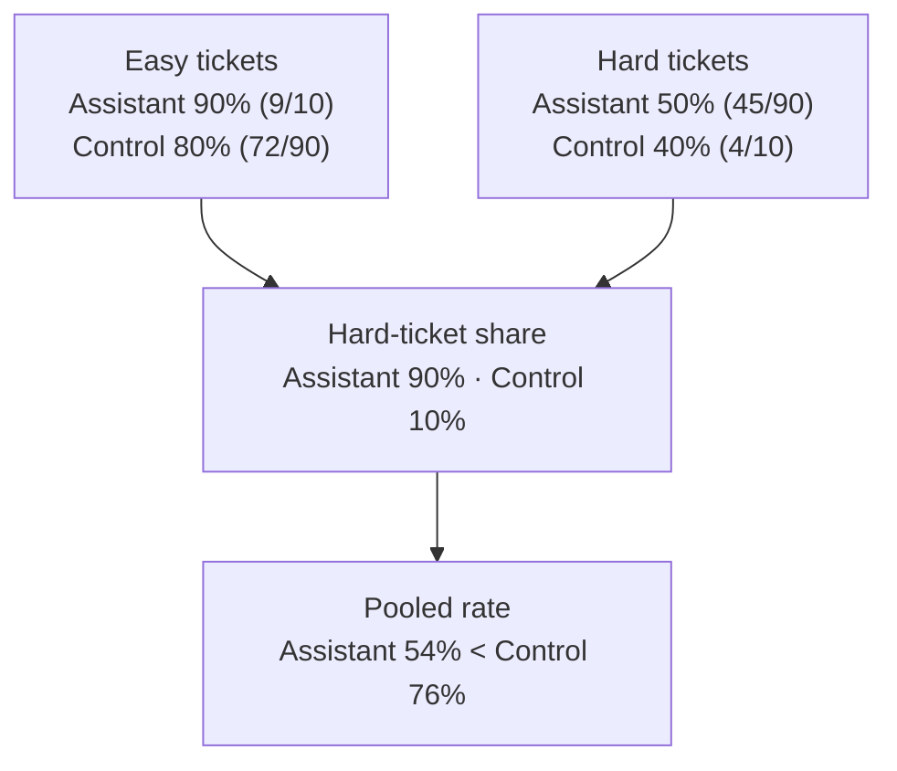

Simpson's paradox occurs when an observed association within several groups reverses or substantially changes after those groups are aggregated. The reversal arises because the groups appear in different proportions across the compared populations. The arithmetic follows from those different group compositions: subgroup rates and aggregate rates answer questions about different populations.

## Compare subgroup evidence before trusting the aggregate

Causal interpretation of a reversal depends on the treatment assignment mechanism, whether the grouping variable occurs before treatment, and whether other common causes remain unmeasured. Adjusting for an inappropriate post-treatment variable can make an analysis worse.

## Example

An assistant resolves 9 of 10 easy tickets and 45 of 90 difficult tickets. Control resolves 72 of 90 easy tickets and 4 of 10 difficult tickets. The observed assistant rate exceeds control by ten percentage points in each risk group. Overall, however, assistant performance is 54% and control performance is 76% because the assistant receives many more difficult tickets.

## Why it matters here

Support agents, ranking experiments, and human-review systems often receive different mixes of cases. Breaking outcomes down by justified pre-treatment groups exposes confounding that a single release-dashboard percentage can otherwise conceal.

## Related terms

- [Confounder](glossary://confounder)
- [Causal inference](glossary://causal-inference)
- [Backdoor adjustment](glossary://backdoor-adjustment)
- [Selection bias](glossary://selection-bias)
