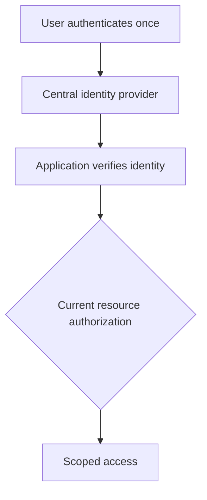

**Single sign-on (SSO)** lets a person authenticate with a central identity provider and use that established identity across approved applications. The applications federate identity through protocols such as SAML or OpenID Connect, avoiding separate password databases. OpenID Connect adds user authentication to OAuth 2.0 authorization. Centralized identity can simplify account lifecycle, multi-factor authentication, session policy, and access review.

SSO establishes who the user is. Each application separately decides which tenant, document, repository, model, tool, or administrative action that user may access, using current role or attribute checks, resource-level authorization, session expiration, and a plan for revoked employees.

## Separate central identity from application policy

## Example

An engineer signs into an organization's identity provider and opens a coding-agent workspace. The workspace validates the identity assertion and binds the user to tenant `acme`. That user may still be forbidden to approve production deployments or expose a second team's repository. Removing the person from the identity provider should eventually revoke access according to the workspace's session and provisioning rules.

When comparing enterprise plans, ask which SSO protocol is supported, whether role and group assignments are synchronized, how quickly revocation applies, and whether audit logs attribute actions to the original user. Check each subscription tier because SSO controls can vary by plan.

## Why it matters here

AI coding-plan comparisons treat SSO as one enterprise purchasing control alongside audit logs, seat management, and data handling. Agent authorization still belongs to the trusted runtime after centralized authentication succeeds.

## Related terms

- [OAuth](glossary://oauth)
- [RBAC](glossary://rbac)
- [Tenant isolation](glossary://tenant-isolation)
- [Audit trail](glossary://audit-trail)
