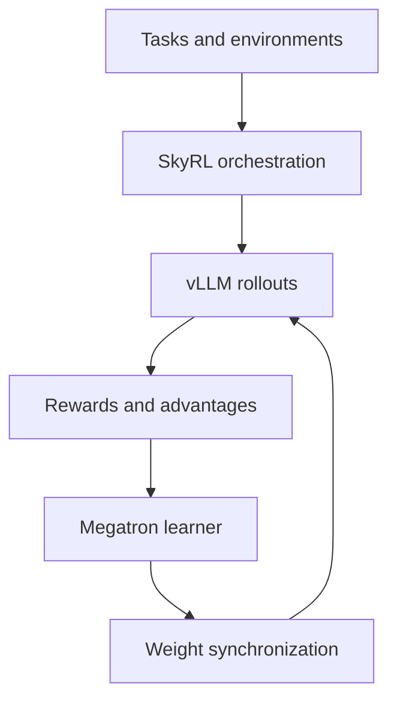

**SkyRL** is an open-source reinforcement-learning stack for language models and agents. It coordinates rollout generation, environments, reward computation, policy training, weight synchronization, checkpointing, and asynchronous execution while delegating model math to backends such as Megatron or FSDP and inference to engines such as vLLM.

SkyRL orchestrates training around transformer models. It turns task prompts and environments into training batches, sends those batches to the learner, and refreshes rollout workers with new policy weights. The project also includes the unified `skyrl` training library with a backend for the Tinker API, `skyrl-agent` for long-horizon agents, and `skyrl-gym` for tool-use environments.

## Ownership boundary

SkyRL owns algorithm and orchestration concepts such as GRPO groups, rollout queues, staleness, generation workers, reward managers, and backend configuration. Ray often provides distributed actors and placement. In a Megatron/vLLM configuration, Megatron computes gradients and vLLM generates tokens and manages KV cache. These are backend choices, not requirements for every SkyRL run.

## Diagram

One possible configuration uses a Megatron learner and vLLM rollout engines:

## Example

A GRPO run asks SkyRL to sample eight trajectories per prompt, call environment tools across multiple turns, score completed trajectories, pack loss-masked tokens, and update the policy. In fully async training, setting `trainer.fully_async.max_staleness_steps=2` controls how far generation can run ahead in aggregate. A long rollout can exceed that budget and still be accepted with a staleness warning, so monitor per-group staleness as well as queue capacity.

## Why it matters here

Most cross-system bugs live at ownership boundaries. Knowing which data SkyRL passes between vLLM and Megatron helps debug missing expert IDs, stale weights, incorrect masks, and reward bottlenecks.

## Related terms

- [GRPO](glossary://grpo)
- [vLLM](glossary://vllm)
- [NVIDIA Megatron](glossary://nvidia-megatron)
- [Ray](glossary://ray)
- [Asynchronous reinforcement learning](glossary://asynchronous-rl)
