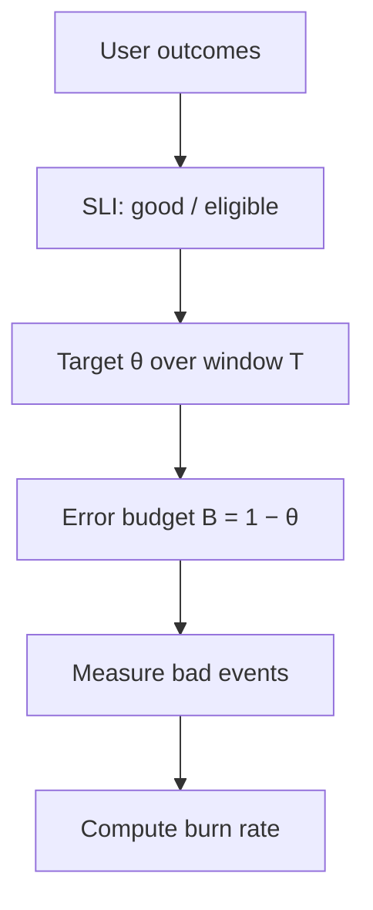
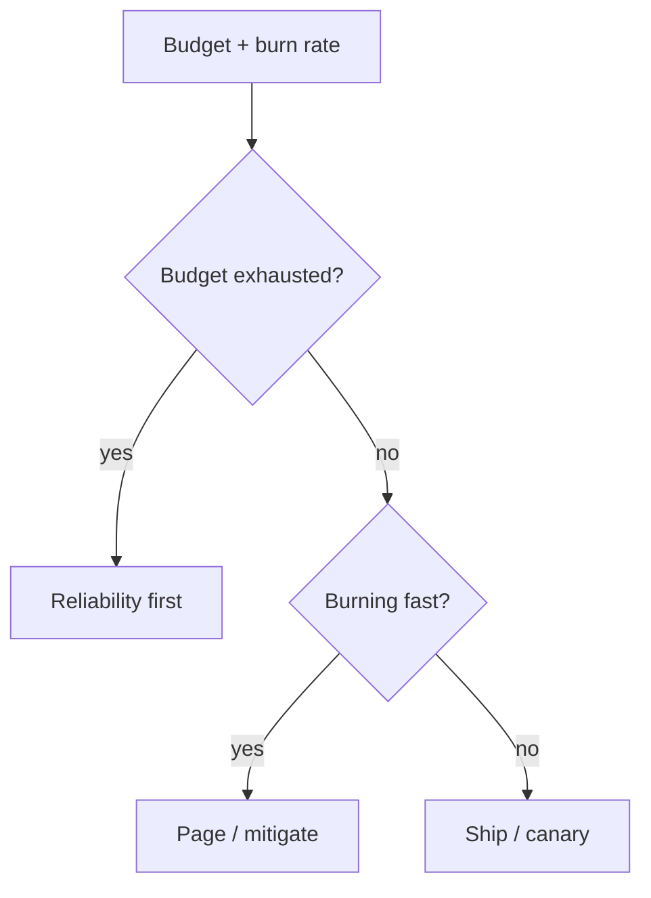

An **SLO** (service level objective) is a target value or range for a service level that users care about, measured by a carefully defined **SLI** (service level indicator). Google's SRE book frames the natural shape as $\mathrm{SLI} \le \mathrm{target}$ or $\mathrm{lower} \le \mathrm{SLI} \le \mathrm{upper}$: for example "at least 99.9% of interactive chat requests are good events (successful and TTFT $\le 900\,\mathrm{ms}$) over a rolling 28-day window," using a success-and-fast **ratio** SLI rather than a bare p95 percentile target.

An SLO defines an **internal operating target**. An SLA or separate contract defines any customer-facing legal commitment. The related terms:

| Term | Meaning | Consequence when missed |
|---|---|---|
| **SLI** | Quantitative measure of one service level (good events / total events, or a latency percentile) | None by itself; it is only the measurement |
| **SLO** | Target for that SLI, plus window and population | Engineering priority shifts (freeze risky deploys, burn reliability backlog) when the error budget is exhausted |
| **SLA** | Contract with users that includes explicit consequences (credits, penalties, exit rights) | Business/legal remedies; usually looser than the internal SLO so you can defend the SLA |

An SLO pairs its target with a response when the target is missed. SRE practice uses SLOs to decide when reliability work outranks features: the remaining **error budget** is the allowed unreliability over a compliance window.

## Intuition

Users do not experience "mean GPU utilization." They experience: Did I get an answer? Was it fast enough to start and finish? Was it grounded and safe? An SLO names those outcomes as numbers the team can measure, alert on, and trade against shipping speed.

100% is almost never the right target. Failures always exist (change, capacity cliffs, dependency outages, long-tail prompts). Each extra nine of reliability costs more than the last, while the marginal gain in user happiness shrinks. A target slightly below perfection creates a budget you can spend on deploys, experiments, and planned maintenance without pretending the system never fails.

For AI products the hard part is the definition of a **good event**. Reliability requires more than an HTTP `200` with a fluent paragraph: retrieval must return useful evidence, the answer must use that evidence, safety gates must run, and streams must deliver responses. Infrastructure SLOs (availability, [p95 latency](glossary://p95-latency), [TTFT](glossary://ttft)) and product SLOs (grounded answer rate, schema-valid tool calls, abstention when unsupported) usually need to live side by side.

## Formula

Prefer SLIs as a ratio of good events to total eligible events over a compliance window of length $T$ (for example 28 or 30 days):

$$
\mathrm{SLI} = \frac{\#\{\text{good events}\}}{\#\{\text{eligible events}\}}.
$$

An availability-style SLO is then $\mathrm{SLI} \ge \theta$ with target $\theta \in (0,1)$, often written as a percentage (99.9% means $\theta = 0.999$).

**Error budget** is the allowed fraction of bad events:

$$
B = 1 - \theta.
$$

Over a window with $N$ eligible events, the absolute budget in events is:

$$
E = B \cdot N = (1 - \theta)\, N.
$$

If $n_{\mathrm{bad}}$ bad events occurred, remaining budget fraction is:

$$
1 - \frac{n_{\mathrm{bad}}}{E}
\quad\text{(or $0$ if $n_{\mathrm{bad}} \ge E$)}.
$$

**Burn rate** is how fast you consume that budget relative to spending it evenly across the window. With instantaneous (or short-window) error rate $r$ (bad / total), burn rate is:

$$
\mathrm{burn} = \frac{r}{B} = \frac{r}{1 - \theta}.
$$

Burn rate $1$ means a constant error rate equal to $B$ would exhaust the budget over the compliance window. With roughly steady request volume, burn rate $2$ exhausts it in half the window; burn rate $14.4$ over a 1-hour window spends about $2\%$ of a 30-day budget (the classic page threshold in the SRE workbook). For a request-based SLO with bursty traffic, the actual fraction consumed is bad requests divided by the event budget, not simply burn rate times elapsed-time fraction.

Latency SLOs often use a success-ratio form that folds both failures and slowness into one budget:

$$
\mathrm{SLI}_{\mathrm{fast+ok}} = \frac{\#\{\text{successful requests with latency} \le L\}}{\#\{\text{eligible requests}\}},
$$

with $\mathrm{SLI}_{\mathrm{fast+ok}} \ge \theta$. This event-based SLI gives a clear budget that scales with request volume.

## Worked numbers

Interactive support chat, 28-day window, $N = 3{,}000{,}000$ eligible requests, availability SLO $\theta = 0.999$ (99.9%):

$$
B = 0.001,\qquad E = 0.001 \times 3{,}000{,}000 = 3{,}000 \text{ bad requests allowed}.
$$

A single incident that fails $1{,}500$ requests burns $50\%$ of the monthly error budget. At a constant $0.1\%$ error rate, burn rate is $1$ and you arrive at day 28 with zero budget left.

For a separate latency SLO with the same $99.9\%$ target, define "fast enough" as end-to-end success with [TTFT](glossary://ttft) $\le 900\,\mathrm{ms}$. Suppose over one hour there are $n = 60{,}000$ requests and $k = 864$ that are either failed or slower than $900\,\mathrm{ms}$:

$$
r = \frac{864}{60{,}000} = 0.0144 = 1.44\%,\qquad
\mathrm{burn} = \frac{0.0144}{0.001} = 14.4.
$$

That is a classic short-window page signal. Under steady volume, its 30-day time-based approximation is $14.4/720=2\%$. If the full window instead has the $3{,}000{,}000$ requests above, these $864$ bad requests consume $864/3{,}000=28.8\%$ of its event budget. A multiwindow policy pairs each longer evaluation window with a shorter confirmation window so resolved spikes stop paging while active failures still do.

## Example

A RAG answer API for product support defines three SLOs on the same request population (authenticated interactive turns, excluding load tests and internal health checks):

| SLO | SLI (good event) | Target $\theta$ | Window |
|---|---|---:|---|
| Availability | HTTP success, non-empty body, not provider-hard-fail | $99.9\%$ | 28 days |
| Latency | Success and TTFT $\le 900\,\mathrm{ms}$ | $99\%$ | 28 days |
| Grounded answer | Success, claims supported by cited evidence when required (or a policy-valid abstention), and no safety-gate bypass | $99.5\%$ | 28 days |

Eligible events exclude requests that fail auth before the product path. **Abstentions** ("I don't have enough policy docs") can be counted as **good** for the grounded-answer SLO if the product treats honest refusal as success, but as **bad** for a separate coverage/utility metric if too many questions yield "I don't know." Document that choice next to the numbers.

During a bad afternoon:

1. Vector index deploy returns empty top-$k$ for $12\%$ of traffic for 40 minutes.
2. Availability SLO still looks green (many paths return $200$ with a non-empty, unsupported answer).
3. Grounded-answer SLI collapses; burn rate on that SLO pages.
4. On-call opens exemplars (request IDs with empty retrieval spans), rolls back the index build, and spends the remaining error budget on a [canary](glossary://canary-rollout) for the next index push.

The product SLO exposed a grounded-answer failure while the availability dashboard still looked "healthy." The error budget kept brief retrieval blips from paging the team while monthly allowance remained available.

```promql
# Conceptual burn-rate alert (Prometheus style; 99.9% SLO => B=0.001)
# Page if ~2% of 30d budget burns in 1h (burn rate 14.4) OR ~5% in 6h (burn rate 6)
(
  job:slo_errors_per_request:ratio_rate1h{route="support_rag"} > 14.4 * 0.001
  and
  job:slo_errors_per_request:ratio_rate5m{route="support_rag"} > 14.4 * 0.001
)
or
(
  job:slo_errors_per_request:ratio_rate6h{route="support_rag"} > 6 * 0.001
  and
  job:slo_errors_per_request:ratio_rate30m{route="support_rag"} > 6 * 0.001
)
```

The short+long window pair (multiwindow multi-burn-rate alerting from the SRE workbook) improves precision: the long window confirms a real budget threat; the short window confirms the fire is still active.

### From outcomes to error budget



### Let budget state guide releases



## How it works

### 1. Choose user journeys and supporting metrics

Start from critical interactive paths (chat turn, autocomplete, agent tool step). A handful of SLIs beats dozens of unused graphs. Map journeys to component types: request-driven serving (availability, latency, quality), pipelines (freshness, throughput), storage (durability).

### 2. Write SLI specs, then implementations

- **Spec:** "Fraction of support turns that return a grounded answer within $900\,\mathrm{ms}$ TTFT."
- **Implementation:** Server-side success counters plus first-token timestamp, joined to an evidence-support assessment; optional client RUM for true user latency. Citation presence alone is only a proxy for grounding and can miss unsupported claims.

Server metrics miss CDN and client stalls; pure client metrics can undercount failed connects. Many teams run both and treat client-visible latency as the product SLI when feasible.

### 3. Choose $\theta$, window, and population

Agree with product owners on $\theta < 1$. Prefer rolling multi-week windows for release decisions. Define eligible traffic (route, region, interactive vs batch). Exclude synthetic probes from user SLOs or give them a separate probe SLO so load tests cannot fake green.

### 4. Attach an error budget policy

When remaining budget is healthy, ship. When burn is high, page and mitigate. When budget is exhausted, freeze non-essential deploys, prioritize reliability, and run a postmortem if the miss was material. Without a written policy, the SLO never changes behavior.

### 5. Pair threshold-crossing alerts with burn-rate alerts

A brief spike above $0.1\%$ error rate may be fine if the monthly budget still holds. A slow $0.15\%$ bleed can exhaust the budget without ever looking like a classic outage. Multiwindow burn-rate alerts balance detection time and false pages (SRE workbook Ch. 5).

### 6. Split infrastructure vs product quality

| Class | Example SLIs for LLM paths |
|---|---|
| Availability | Non-5xx / non-timeout completions; provider hard-fail rate after retries |
| Latency | TTFT, ITL/TPOT, end-to-end; often as success-and-fast ratio |
| Saturation proxies | Queue wait, KV occupancy, admission rejects (pair with [load shedding](glossary://load-shedding)) |
| Correctness / quality | Grounded citation rate, schema-valid structured outputs, judge-fail rate on a fixed slice |
| Safety | Unsafe-serve rate, policy-bypass rate, tool calls outside allowlist |

Quality SLIs need stable definitions (what counts as grounded, which judge, which [evaluation slice](glossary://evaluation-slice)). Unstable definitions make the error budget meaningless.

### 7. Tie releases to the budget

[Canary rollouts](glossary://canary-rollout), model swaps, prompt deploys, and index rebuilds should watch burn rate on the affected routes. A canary that burns budget $10\times$ faster than baseline should auto-stop even if absolute error rate still looks small on low traffic.

## Trade-offs

| Choice | Gain | Cost |
|---|---|---|
| Fewer, user-facing SLOs | Clear priorities, real ownership | Leaves niche paths unmeasured until they hurt |
| Many fine-grained SLOs | Coverage | Alert noise, no one watches all of them |
| Tight $\theta$ (more nines) | Happier on reliability | Slower features, higher infra cost |
| Loose $\theta$ | Velocity | Users leave before dashboards look "red" |
| Infra-only SLOs | Easy metrics | Green boards while answers are wrong or unsafe |
| Quality-only SLOs | Product truth | Harder measurement; judge cost and drift |
| Short windows only | Fast detection | Noisy pages; overreact to blips |
| Long windows only | Stable signal | Slow detection; budget already gone |

## Debug path

When an SLO is burning:

1. **Name which SLI** failed (availability, TTFT, grounded rate) and over which window.
2. **Compute burn rate and remaining budget** so you know if this is a page-now event or a ticket-this-week event.
3. **Slice** by route, model, tenant, region, cache hit/miss, deploy version, prompt template, index build.
4. **Open exemplars** (failing request IDs) via [observability](glossary://observability) traces; find first_failed_stage.
5. **Mitigate** (rollback, reduce concurrency, shed load, fail closed on unsafe paths) before root-causing for hours.
6. **Spend remaining budget deliberately** after recovery: either resume shipping or schedule reliability work if the miss was structural.

Low-traffic routes break pure burn-rate math (one failure is a huge error rate). Use longer windows, synthetic probes, or multi-event thresholds so a single bad request does not page the company.

## Why it matters here

LeetLLM production material treats reliability as an engineering contract. SLOs connect serving metrics (TTFT, error rate, queueing) and product outcomes (grounding, safety, structured tools) to release velocity through an error budget. Learners who can write an SLI, pick $\theta$, compute burn rate, and decide whether to ship or freeze can run LLM systems the way SRE teams run other user-facing services.

## Related terms

- [Observability](glossary://observability)
- [p95 latency](glossary://p95-latency)
- [Latency budget](glossary://latency-budget)
- [TTFT](glossary://ttft)
- [Canary rollout](glossary://canary-rollout)
