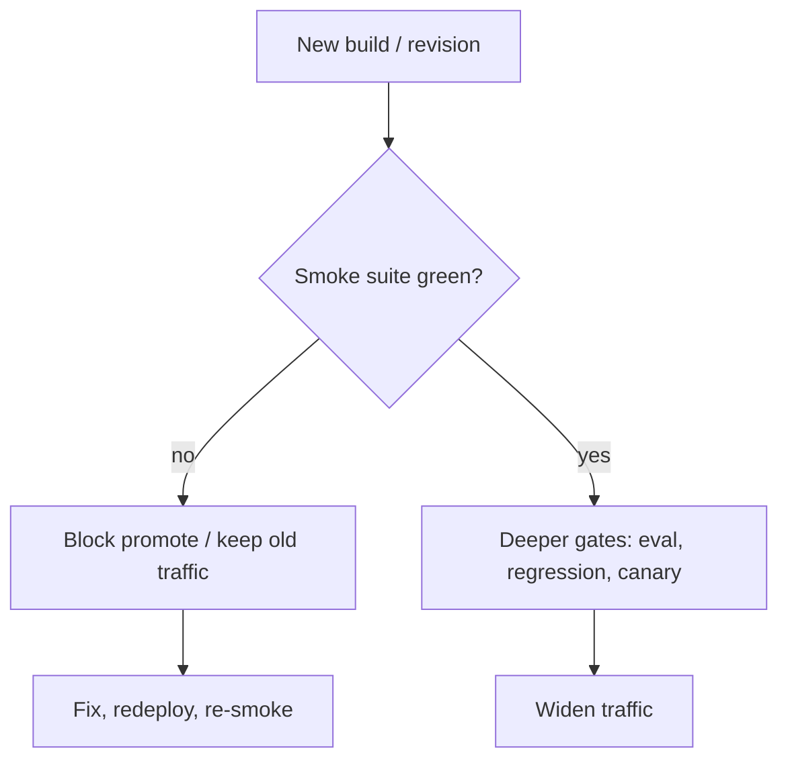

A **smoke test** is a small, fast suite that checks whether the **main paths of a build or deploy still work** before you invest in deeper testing, offline evals, or wider traffic. The ISTQB glossary defines it as a suite covering the main functionality of a component or system to decide whether it works properly before planned testing begins. Teams also call it a **confidence test**, **intake test**, **build verification test (BVT)**, or loosely a **sanity test**.

The name comes from hardware and plumbing: power the board or pump smoke into a pipe; if something is catastrophically wrong, you stop immediately. In software the same idea holds. If the process will not start, the home route returns 500, the model never loads, or the chat endpoint cannot complete one fixed prompt, further [regression](glossary://regression-suite) or [eval](glossary://eval-gate) work is wasted. Google SRE treats smoke tests as the simplest system tests: they exercise critical behavior and short-circuit more expensive suites.

Smoke tests answer a binary releasability question on a known candidate. Health checks report process or service liveness, regression suites cover broad behavior, and [canaries](glossary://canary-rollout) expose a candidate to real users over time. Run smoke tests before or just after traffic moves.

## Intuition

Ask one blunt question: **did the main user-visible path survive this change?** Prefer checks that fail the way users fail (blank lesson, empty answer, tool call never fires) over checks that only prove the container is listening. Keep the suite small enough to run on every deploy and specific enough that a red result stops promotion.

| Layer | Question it answers | Typical cost |
| --- | --- | --- |
| [Unit test](glossary://unit-test) | Does one pure function hold an invariant? | Milliseconds |
| Smoke test | Does the assembled system still serve the critical path? | Seconds to a few minutes |
| [Regression suite](glossary://regression-suite) / [eval gate](glossary://eval-gate) | Did quality, safety, or contracts regress across many cases? | Minutes to hours |
| [Canary rollout](glossary://canary-rollout) | Does live traffic look safe under partial exposure? | Minutes to hours of real users |

Smoke sits at the **cheap, broad-enough** step: deep enough to touch real boundaries (routing, model load, index open, auth callback), shallow enough that you still run it when tired at 2 a.m.

## Diagram



## How it works

1. **Pick a candidate.** A local build, CI artifact, staging deploy, or production revision tagged with no (or tiny) traffic. Record revision id, image digest, model id, and config hash so a failure points at something you can roll back.
2. **Run a fixed critical path.** Prefer deterministic fixtures: one known URL, one known prompt, one known tool schema, one known retrieval doc. Avoid random sampling and live third parties when a stub or pinned fixture still proves the path.
3. **Assert user-visible success alongside liveness.** HTTP 200 on `/health` is necessary but weak. Better: status 200 **and** body contains expected title, non-empty completion, valid JSON schema, or citation field present.
4. **Fail closed on the release.** A red smoke keeps traffic on the previous revision, blocks the [validation gate](glossary://validation-gate), or aborts the promote job. A yellow-and-continue smoke is a dashboard, not a smoke test.
5. **Capture evidence.** URL, status code, latency, response snippet, console/server error, trace id, revision, model route. Name the broken behavior ("glossary dialog missing title") rather than "health check failed."

For LLM and ML services, good smoke paths often cross the seams that unit tests miss:

- Model weights or GGUF path load; one short generation returns tokens before a timeout
- Chat template + tokenizer encode/decode without crash on a fixed string
- RAG: embed query → retrieve at least one chunk → generate a non-empty answer
- Tool path: model or router emits a schema-valid tool call the host accepts
- Agent scaffold starts, one node runs with in-memory adapters, graph returns a terminal state
- GPU/runtime: CUDA device visible, max context and quantization flags match the launch config

## Example

**Inference service.** After shipping a new vLLM image, CI deploys revision `chat-7b-r42` with **0%** user traffic and a smoke tag URL. The smoke suite runs:

```python
import httpx

BASE = "https://smoke-tag.example.com"  # candidate revision, not 100% traffic
PROMPT = "Reply with exactly: pong"

def test_chat_smoke():
    r = httpx.post(
        f"{BASE}/v1/chat/completions",
        json={
            "model": "chat-7b",
            "messages": [{"role": "user", "content": PROMPT}],
            "max_tokens": 8,
            "temperature": 0,
        },
        timeout=30.0,
    )
    assert r.status_code == 200, (r.status_code, r.text[:500])
    text = r.json()["choices"][0]["message"]["content"].strip().lower()
    assert text == "pong", text
    assert r.elapsed.total_seconds() < 15
```

If the model path is wrong, the chat template crashes, or the server OOMs on first request, this fails in seconds and **traffic never moves**. If it passes, a larger offline [eval gate](glossary://eval-gate) and a 1% [canary](glossary://canary-rollout) can still catch quality and tail-latency issues the smoke never claimed to cover.

**Content deploy (LeetLLM-shaped).** `deploy.sh` builds a Cloud Run candidate with a smoke tag, hits known Learn and blog routes on the candidate URL (for example `numpy-and-tensor-shapes`, a few blog slugs), only then routes 100% traffic, purges CDN, and smokes production again. Candidate failure leaves live traffic on the previous revision. Production smoke failure triggers rollback. That is smoke as a [fail-closed](glossary://fail-closed) release gate on the paths users actually open.

## What a good smoke path looks like

Cross one **real** boundary that often breaks under integration:

| Surface | Weak check | Stronger smoke |
| --- | --- | --- |
| Web app | `/health` 200 | Home + one lesson + one glossary dialog title |
| LLM API | TCP connect | Fixed prompt → 200 + non-empty tokens + latency cap |
| RAG | Index process up | Query returns $k \ge 1$ chunks with expected doc id |
| Tools | OpenAPI loads | One tool call parses and hits a sandbox no-op |
| Auth | Login page 200 | Callback completes and a protected route returns 200 |

Keep the set tiny: often 3 to 15 cases. Every case should map to a release-stop decision. If operators ignore red smokes, the suite is too flaky, too vague, or not wired as a hard gate.

## Debug path

When smoke fails after a green unit suite:

1. Confirm you hit the **candidate** (tag URL / revision), not the old production pointer.
2. Diff env, secrets, model path, index mount, feature flags, and chat template between last green and this revision.
3. Replay the single failing request with full response body and server logs; many "smoke flakes" are cold-start timeouts or missing GPU memory, not flaky assertions.
4. If the assertion is timing-only, separate **liveness** (must work) from **performance smoke** (a per-request cap, or a percentile over repeated requests) so cold starts do not train the team to skip the suite. One request cannot prove a useful p95 latency estimate.
5. Promote the failure into a permanent regression case once fixed so the same break cannot return silently.

## Trade-offs

| Choice | Gain | Cost |
| --- | --- | --- |
| Tiny fixed suite every deploy | Fast feedback, high trust | Misses rare and semantic regressions |
| Smoke equals full regression | High coverage | Slow, flaky, skipped under pressure |
| Health checks only | Cheap | Ships blank UIs and empty model responses |
| Live-only smoke after full traffic | "Real" env | Users see the break first |
| Strict fail-closed smoke | Protects production | Needs a break-glass path for true emergencies, with audit |

Smoke gives evidence that the exercised basic paths work and the candidate is worth testing further. Evaluate quality, safety, and long-tail behavior with eval gates, regression suites, shadow traffic, and canaries before release.

## Why it matters here

AI systems fail at seams unit tests never see: model artifacts, GPU runtime, tokenizer versions, retrieval indexes, prompt bundles, and CDN-backed static routes. Smoke tests are the cheapest way to keep those seams from becoming full outages. LeetLLM's deploy path smokes known content routes on the candidate before traffic moves and again on production, rolling back when the main path is broken while the changed revision is still easy to identify. System-design interviews expect the same ladder: unit → smoke → eval/regression → canary → full [rollout](glossary://rollout).

## Related terms

- [Unit test](glossary://unit-test)
- [Validation gate](glossary://validation-gate)
- [Eval gate](glossary://eval-gate)
- [Regression suite](glossary://regression-suite)
- [Canary rollout](glossary://canary-rollout)
