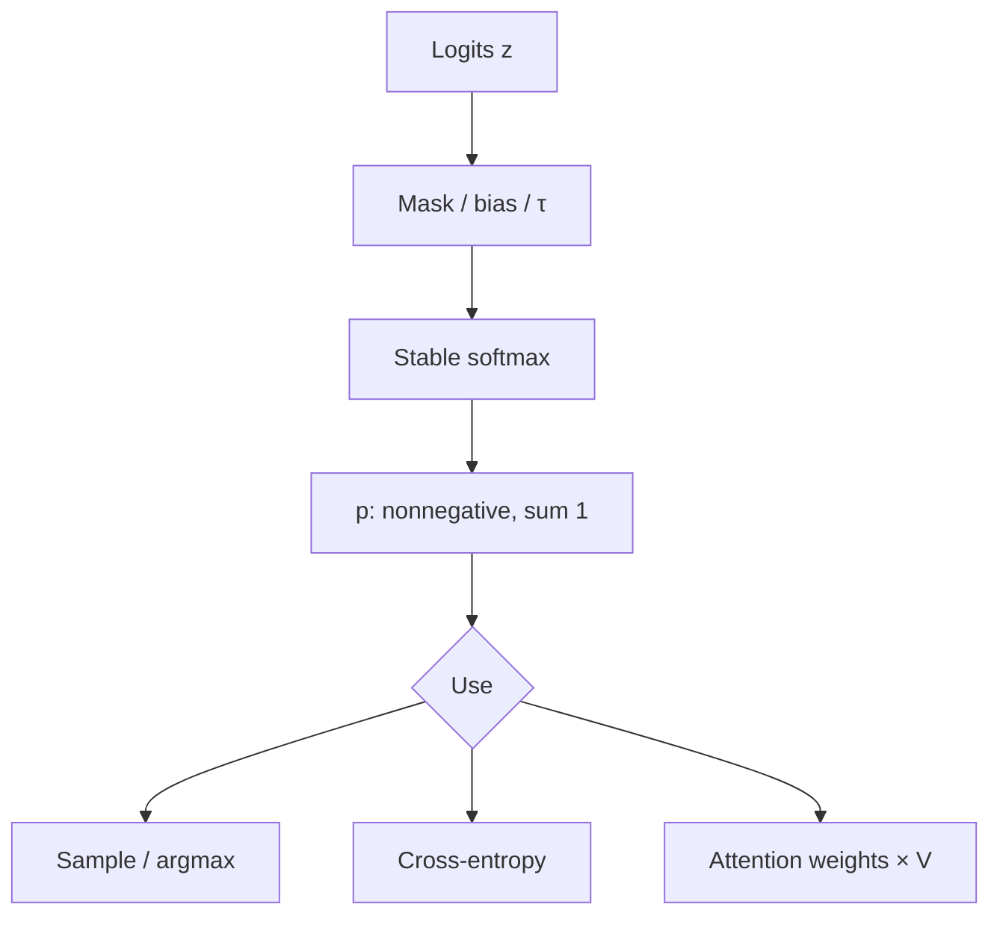

Softmax maps a non-empty vector of finite raw scores (logits) to a probability distribution: mathematically every output is positive, and the outputs sum to 1. In ML the usual form is the *normalized exponential*: exponentiate each score ($e^{z_i}$), then divide by the sum of those exponentials so the vector can be read as class or token probabilities. John Bridle introduced the name in the late 1980s as a multi-class generalization of the logistic unit; modern transformers use the same operator for next-token distributions and for attention weights.

## Intuition

Softmax is a soft competition. Raising one logit raises that candidate's probability and takes mass from every other candidate because the denominator is shared. The distribution depends on *relative* gaps: adding the same constant $c$ to every logit multiplies every $e^{z_i}$ by the same $e^{c}$, which cancels in the ratio. That translation invariance is why you can subtract the maximum logit before `exp` for numerical stability without changing the answer.

Softmax provides a smooth, temperature-sensitive approximation to **argmax** (a soft one-hot over the winners). [Log-sum-exp](glossary://log-sum-exp) is the smooth maximum. As temperature goes to zero, softmax collapses toward a hard winner-take-all choice; as temperature grows, the distribution flattens toward uniform.

## Formula

For logits $z \in \mathbb{R}^{K}$ (classes, tokens, or attention keys):

$$
\mathrm{softmax}(z)_i = \frac{e^{z_i}}{\sum_{j=1}^{K} e^{z_j}}
$$

Each $p_i \ge 0$ and $\sum_i p_i = 1$. For finite logits and $K>1$, mathematically every $p_i$ is in $(0,1)$; for $K=1$ the output is $[1]$. Floating-point exponentials can underflow to zero even for finite logits. After an additive $-\infty$ mask (for example a causal future key), the corresponding $p_i$ is exactly $0$ provided at least one finite unmasked score remains. An all-masked row has no normalizable distribution; handle it explicitly rather than assuming the ordinary formula is safe.

**Stable form (safe softmax).** Subtract $m = \max_j z_j$ first so every exponent is $\le 0$ and `exp` stays in range:

$$
\mathrm{softmax}(z)_i = \frac{e^{z_i - m}}{\sum_{j=1}^{K} e^{z_j - m}}
$$

**Temperature.** Sampling and some training heads use $z / \tau$ with $\tau > 0$:

$$
p_i(\tau) = \frac{e^{z_i / \tau}}{\sum_j e^{z_j / \tau}}
$$

Lower $\tau$ sharpens the distribution; higher $\tau$ flattens it. Argmax is unchanged for any $\tau > 0$. As $\tau \to 0^+$, probability concentrates on the maximum-logit candidates: a unique maximum gets probability one, while exactly tied maxima share mass equally. A greedy decoder may instead break that tie deterministically.

**Log-softmax.** The natural log of a softmax probability is

$$
\log p_i = z_i - \mathrm{LSE}(z) = z_i - \log\sum_j e^{z_j}
$$

Prefer fused `log_softmax` over `log(softmax(z))`. The separate path can underflow tiny $p_i$ to zero and then take $\log 0$.

**Jacobian (for backprop reasoning).** Writing $p = \mathrm{softmax}(z)$:

$$
\frac{\partial p_i}{\partial z_j} = p_i\bigl(\mathbf{1}[i=j] - p_j\bigr)
$$

Fused with hard-label [cross-entropy](glossary://cross-entropy) $\mathcal{L} = -\log p_y$, the gradient on logits collapses to the simple form used everywhere in training stacks:

$$
\frac{\partial \mathcal{L}}{\partial z_i} = p_i - \mathbf{1}[i=y]
$$

**Attention (Transformer).** Vaswani et al. (2017) put softmax on scaled query–key scores:

$$
\mathrm{Attention}(Q,K,V) = \mathrm{softmax}\!\left(\frac{QK^{\top}}{\sqrt{d_k}}\right)V
$$

The $1/\sqrt{d_k}$ scale controls the variance of dot products as head width grows (under the paper's independent, unit-variance component model). Without it, large score gaps can drive softmax into a saturated regime where gradients nearly vanish. Illegal positions (future tokens under a causal mask, padding keys) are set to $-\infty$ *before* softmax to give them zero weight. A finite negative sentinel only approximates this behavior and must be appropriate for the score range and dtype.

## Diagram



## Example

Take three next-token logits $z = [2.0,\ 1.0,\ 0.1]$. Subtract $m = 2.0$, exponentiate, normalize:

| Token slot | $z_i$ | $e^{z_i-2}$ | $p_i$ |
|-----------:|------:|------------:|------:|
| A | $2.0$ | $1.000$ | $0.659$ |
| B | $1.0$ | $0.368$ | $0.242$ |
| C | $0.1$ | $0.150$ | $0.099$ |

```python
import math

logits = [2.0, 1.0, 0.1]
m = max(logits)
exps = [math.exp(z - m) for z in logits]
probs = [e / sum(exps) for e in exps]
# ~[0.659, 0.242, 0.099]
```

Same logits under temperature:

| $\tau$ | $p$ (approx.) | Shape |
|-------:|---------------|-------|
| $0.5$ | $[0.864,\ 0.117,\ 0.019]$ | Sharp: A dominates |
| $1.0$ | $[0.659,\ 0.242,\ 0.099]$ | Default |
| $2.0$ | $[0.502,\ 0.304,\ 0.194]$ | Flatter |

If the true label is A ($y=0$), the CE gradient on logits is $p - e_y \approx [-0.341,\ 0.242,\ 0.099]$: pull probability *up* on A and *down* on B and C.

**Masked attention row.** Scores $[2.0,\ 1.0,\ -\infty]$ (third key illegal) yield weights $\approx [0.731,\ 0.269,\ 0]$ after softmax. The masked slot contributes nothing to the weighted sum of values.

**Why the max shift matters.** Naive `exp(1000)` overflows both float32 and float64 ($e^{1000}$ is far past $\sim 10^{308}$). With $m=1000$, you only ever compute $e^{0}, e^{-1}, \ldots$. Production kernels and frameworks bake this in; hand-rolled `exp` without the shift is a classic `NaN` source.

## How it works in LLM stacks

Two places dominate:

1. **LM head / decoding.** The final linear layer maps the last hidden state to a vocabulary-sized logit vector. Softmax (after temperature, logit bias, and optional top-$k$ / top-$p$ filters) turns that vector into a distribution the sampler draws from, or into logprobs for beam search, perplexity, and API scores. Training can pass logits directly to `cross_entropy(logits, y)` rather than explicitly computing probabilities first; the log-softmax/NLL path keeps loss and gradients stable over large $V$.

2. **Attention.** Each query row produces a distribution over keys; that distribution weights the value vectors. Causal and padding masks reshape the input scores so illegal keys get zero mass. Long-context kernels compute the same math tile-by-tile with [online softmax](glossary://online-softmax) (running max + rescaled sum) so they never write the full $N \times N$ score matrix to HBM, as in FlashAttention-style implementations.

**What fails in production**

| Symptom | Likely cause | Fix direction |
|---------|--------------|---------------|
| `NaN` / `Inf` probs or loss | Overflow in `exp`, or `log(softmax)` underflow | Stable softmax / fused CE; keep reductions in fp32 under mixed precision |
| Dead attention or tiny gradients | Scores too large in magnitude (missing $1/\sqrt{d_k}$, bad scale) | Check head dim scale, LayerNorm placement, dtype |
| Mass on pad or future tokens | Mask not applied, or mask value not negative enough in low precision | Apply mask *before* softmax; use framework causal / padding APIs |
| Double-normalized loss | Softmax then `CrossEntropyLoss` on probabilities | Pass **raw logits** into CE |
| Overconfident, uncalibrated $p$ | Maximum softmax probability may be miscalibrated | Temperature scaling / calibration on hold-out; don't treat max $p$ as risk alone |
| Custom kernel ≠ `torch.softmax` | Tile-local normalize without online rescale | Match full-row stable softmax (online max/sum) |

Softmax probabilities parameterize a distribution; calibrated confidence requires separate validation. A top token at $0.92$ can still be wrong on out-of-distribution prompts, so measure calibration on the slices you ship.

## Why it matters here

Almost every LLM path that turns scores into choices or losses runs through softmax: next-token training, decoding, attention weights, MoE routers, contrastive denominators, and distillation. If you can read relative logits, the stable max-shift, fused CE gradients, temperature, and masks, you can debug `NaN` loss, dead attention, and sampling knobs without treating the head as a black box. The same operator shows up from Bridle-style classifiers through Vaswani attention to memory-efficient kernels; the math does not change, only the axis you reduce over and whether you stream it.

## Related terms

- [Logits](glossary://logits)
- [Temperature](glossary://temperature)
- [Cross-entropy](glossary://cross-entropy)
- [Log-sum-exp](glossary://log-sum-exp)
- [Online softmax](glossary://online-softmax)
