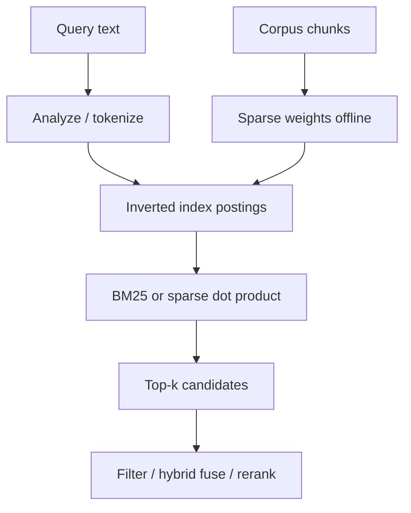

**Sparse retrieval** ranks documents by overlapping **term features** in a very high-dimensional space where almost every coordinate is zero. A document is represented by active dimensions (words, subwords, or learned vocabulary IDs), each with a weight. Queries and documents meet when they share dimensions. This representation supports **inverted indexes** and efficient CPU search, and classical lexical systems can preserve rare identifiers when their analyzers retain those identifiers. Exact-string behavior and latency depend on the analyzer, index, and corpus scale.

The classical members of this family are TF-IDF and [BM25](glossary://bm25). Modern **learned sparse retrieval** (for example SPLADE; Formal, Piwowarski, and Clinchant, SIGIR 2021) still produces sparse vectors over a vocabulary, but a transformer chooses which terms fire and how heavily, including terms that never appeared in the surface text (query/document expansion). Both score with sparse linear algebra; dense retrieval uses nearest-neighbor geometry.

## Intuition

Dense retrieval asks: "which passages live near this meaning?" Sparse retrieval asks: "which passages contain these tokens (or expanded tokens), weighted by rarity and importance?"

That second question is deliberately literal. A support ticket with `P2002`, a policy line with `non-refundable`, or a source file that imports `torch.distributed` activates dimensions that almost no other document shares. The inverted index can jump straight to those postings. Preserve the exact symbol as a lexical feature; semantic-neighbor expansion can supplement it.

The price of that literalness is the **vocabulary gap**: "rotate credentials" may not hit a doc titled "reset API key" unless stemming, synonyms, query rewriting, or a learned sparse expander bridges the wording.

## How it works

1. **Analyze text.** Tokenize, normalize (case, Unicode, stemming or subwords), drop stopwords if configured. The analyzer is part of the model: index-time and query-time features must be compatible. Search-time synonym expansion can deliberately differ from index-time analysis.
2. **Build sparse vectors offline.** For BM25-style systems, store term frequencies and corpus statistics. For learned sparse models, encode each chunk once into a sparse map `{term_id: weight}` with only tens to a few hundred non-zeros per document.
3. **Index with inverted lists.** For each term $t$, keep a posting list of documents that contain $t$ (and their weights or frequencies). An indexed search walks relevant postings rather than always scoring every document, although very common terms can touch most of the corpus. Small demonstration libraries may instead score all documents directly.
4. **Score at query time.** Accumulate a relevance score over shared terms (BM25 sum, or a sparse dot product for learned weights). Return top-$k$, optionally after filters (tenant, ACL, metadata).
5. **Hand off.** Sparse hits are usually candidates for fusion with dense retrieval and/or a cross-encoder [reranker](glossary://reranker), not the final answer list for the LLM.

## Formula

Treat the vocabulary as $V$ dimensions. A document $d$ becomes a sparse vector $w_d \in \mathbb{R}^{|V|}$ with $w_d[t] \neq 0$ only for terms present (or expanded) in $d$. A query $q$ is $w_q$ the same way.

**Generic sparse scoring** is the inner product of those maps (retrieval finds the documents that maximize it):

$$
\mathrm{score}(q,d)=\sum_{t \in V} w_q[t]\,w_d[t]
$$

Only terms active in both vectors contribute. Engines implement this by walking inverted lists for the query terms, not by materializing $|V|$-long arrays.

**BM25** is the production default for statistical sparse ranking (Okapi BM25; Robertson and coauthors). For query $Q=\{q_1,\ldots,q_n\}$:

$$
\mathrm{BM25}(d,Q)=\sum_{q_i \in Q}\mathrm{IDF}(q_i)\cdot\frac{f(q_i,d)\,(k_1+1)}{f(q_i,d)+k_1\bigl(1-b+b\frac{|d|}{\mathrm{avgdl}}\bigr)}
$$

with Lucene-style non-negative IDF

$$
\mathrm{IDF}(q_i)=\ln\left(\frac{N-n(q_i)+0.5}{n(q_i)+0.5}+1\right).
$$

Here $f(q_i,d)$ is term frequency, $|d|$ and $\mathrm{avgdl}$ are length statistics, $n(q_i)$ is document frequency, and typical defaults are $k_1 \approx 1.2$, $b \approx 0.75$. BM25 saturates frequency and normalizes length so rare exact hits dominate common boilerplate. Full parameter notes live under [BM25](glossary://bm25).

**SPLADE term weights** (Formal, Piwowarski, and Clinchant, SIGIR 2021) start from MLM-style logits $w_{ij}$ (importance of vocabulary term $j$ for input token $i$), then apply log-saturation and sum over tokens so weights stay non-negative and less dominated by a few terms:

$$
w_j=\sum_{i \in \text{tokens}}\log\bigl(1+\mathrm{ReLU}(w_{ij})\bigr)
$$

Training adds FLOPS (or $\ell_1$) sparsity regularization so most $w_j$ stay zero. Later SPLADE-max variants swap the sum for a max over tokens; either way the retrieval score is still a sparse dot product over vocabulary indices, so inverted-index machinery still applies.

## Diagram



## Example

Internal docs for a Node/Prisma service. Three chunks:

| Chunk ID | Text (abridged) |
|----------|-----------------|
| `A` | `P2002 unique constraint failed on field email` during signup |
| `B` | How to handle duplicate key errors in Postgres |
| `C` | Rotate leaked API credentials for service accounts |

Query: `P2002 unique constraint failed`.

- Sparse / BM25: term `P2002` appears in only one document ($n(t)=1$). Its Lucene-style IDF in this three-document corpus is $\ln(1+2.5/1.5)\approx0.981$. Chunk `A` matches all four query terms and ranks first. The displayed text of `B` contains none of those terms, so it scores zero under this literal analyzer. In a large corpus a rare code can carry much more IDF, but noisy extra terms can still affect the ranking.
- Dense retrieval alone: may surface `B` ("duplicate key") as the semantic neighbor and bury `A` if the embedder never treated `P2002` as a hard feature.
- Learned sparse (SPLADE-class): may activate related vocabulary dimensions such as `prisma`, `unique`, or `constraint`. A subword vocabulary may split `P2002`, and learned weights need not preserve all its pieces; exact-code retention requires evaluation or a complementary lexical field.

Minimal operational sketch (statistical sparse path):

This small `rank_bm25` example scores every supplied document; it does not demonstrate an inverted-index engine. Its IDF convention also differs from the Lucene-style formula above.

```python
from rank_bm25 import BM25Okapi

docs = [
    "p2002 unique constraint failed on field email during signup".split(),
    "how to handle duplicate key errors in postgres".split(),
    "rotate leaked api credentials for service accounts".split(),
]
bm25 = BM25Okapi(docs)
scores = bm25.get_scores("p2002 unique constraint failed".split())
# argmax -> doc 0 (exact rare token)
```

In a hybrid RAG path you take sparse top-$k$ and dense top-$k$, fuse with [Reciprocal Rank Fusion](glossary://reciprocal-rank-fusion) (do not add raw BM25 to cosine), then rerank a shortlist for the prompt.

## Worked production path

Production failures usually trace to index hygiene and query mix; inspect those before changing the scoring formula.

| Failure | What you see | Fix |
|---------|----------------|-----|
| Analyzer mismatch | Query has `P2002`, index stored `p2002` only under a different split, zero postings | Same analyzer at index and query time; unit-test tokenization on IDs and code |
| Gold doc never indexed | Sparse cannot find a literal string you can grep in source files | Ingestion, ACL filters, chunk boundaries, or stale index |
| Vocabulary gap | Paraphrase queries miss relevant docs | Hybrid dense path, query rewrite, synonyms, or learned sparse expansion |
| Score fusion bug | BM25 always "wins" over dense (or the reverse) | RRF or per-query normalization; never raw score add |
| Boilerplate overweight | Footer/legal text ranks high | Field boosts, better chunking, stop lists, length stats refresh |
| Stale dual indexes | Sparse has new text; dense vectors do not (or reverse) | Co-version inverted + vector indexes on reindex |

Log query text, analyzer version, sparse top IDs with scores, filters applied, and whether a known gold chunk appeared in the sparse list. If a document containing a query term is missing from the candidates, first check ingestion, analysis, and ACL filtering. Term occurrence contributes to the score; top-$k$ placement also depends on its weight and competing documents.

## Trade-offs

| | Sparse retrieval | Dense retrieval |
|--|------------------|-----------------|
| Match type | Exact / expanded terms | Learned semantic neighborhood |
| Index | Inverted postings | ANN vector index (HNSW, IVF, ...) |
| Strengths | Model IDs, error codes, CVEs, code symbols, quoted phrases | Paraphrase, synonymy, intent |
| Weaknesses | Vocabulary gap without expansion | Can blur rare tokens; embedding and vector-index costs |
| Latency profile | Depends on postings lengths, filters, query terms, and $k$ | Encode + vector search; model/index/hardware-dependent |
| Interpretability | High: you can list matching terms | Low: opaque embedding geometry |

Learned sparse sits between classical BM25 and dense: it can improve semantic coverage while remaining inverted-index friendly, with higher encoding cost than BM25. Its index footprint depends on how many nonzero features survive, posting metadata, and the dense representation being compared. Many production systems keep **BM25 + dense hybrid** as the default and add neural sparse when eval shows it pays for the extra encode.

## Why it matters here

RAG and search systems for real products mix natural language with brittle tokens from engineering systems. Sparse retrieval is the path that refuses to lose an exact error code, model ID, CVE, or function name while embeddings chase paraphrase. Curriculum work on BM25, hybrid fusion, recall@k slices, and production RAG all depend on this mental model: term features, inverted indexes, and a candidate list that still contains the document the user named.

## Related terms

- [BM25](glossary://bm25)
- [Dense retrieval](glossary://dense-retrieval)
- [Hybrid search](glossary://hybrid-search)
- [Reciprocal Rank Fusion](glossary://reciprocal-rank-fusion)
- [Reranker](glossary://reranker)
