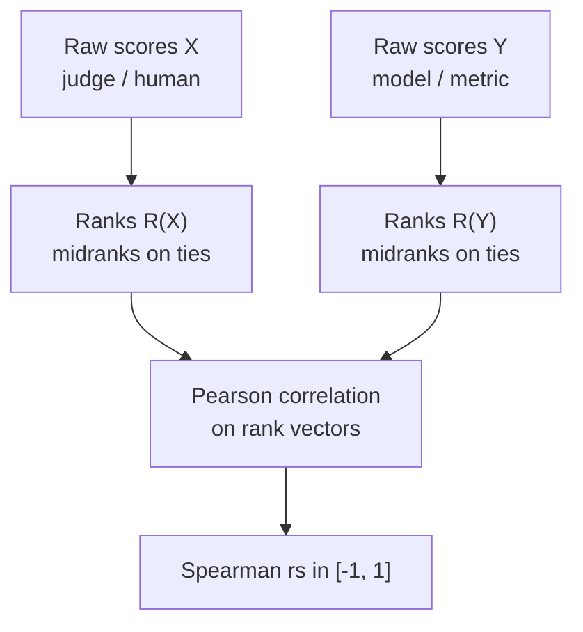

**Spearman rank correlation** (Spearman's $\rho$, also $r_s$) measures how well the relationship between two paired variables can be described by a **monotonic function**. Convert each variable to ranks, then compute Pearson correlation on those ranks. Order agreement matters; absolute score scales and linear spacing do not.

Charles Spearman introduced rank association methods in 1904 ("The Proof and Measurement of Association between Two Things," *American Journal of Psychology*). In AI and LLM work, $\rho$ is the standard way to ask whether a [model judge](glossary://model-judge), automatic metric, or system score **orders items the same way** humans (or a gold ranking) do, even when the two score scales are not linearly related.

## Intuition

Pearson correlation on raw scores rewards linear co-movement. If a judge uses a $1$–$5$ rubric and a model emits continuous scores in $[0,1]$, the mapping is rarely linear. Spearman first replaces each list with ranks ($1$st, $2$nd, $\ldots$), so only relative order survives.

| $\rho$ | Meaning for paired rankings |
| --- | --- |
| Near $+1$ | Same order (or nearly): high human score $\leftrightarrow$ high model score |
| Near $0$ | Little monotonic association; a non-monotonic relationship can still exist |
| Near $-1$ | Orders reverse: high on one side is low on the other |

Perfect $+1$ / $-1$ only needs a **strictly increasing** (or decreasing) relationship, not a straight line. A log-scaled score that still preserves order still yields $\rho = 1$.

Spearman measures order agreement; [calibration](glossary://calibration) measures whether numeric scores match observed outcomes. Two systems can rank every example identically while one is badly overconfident. [NDCG](glossary://ndcg) scores one ranked list against graded relevance, while Spearman compares **two parallel score series** on the same items.

## Formula

**Definition (including ties, for non-constant rank vectors).** For $n\ge2$ paired observations $(X_i, Y_i)$, let $R(X_i)$ and $R(Y_i)$ be ranks (use average ranks for ties). Spearman's sample coefficient is Pearson's correlation of the rank vectors:

$$
r_s = \frac{\operatorname{cov}\big(R(X), R(Y)\big)}{\sigma_{R(X)}\,\sigma_{R(Y)}}
$$

**No-ties shortcut.** When both rank lists are distinct integers $\{1,\ldots,n\}$, this simplifies to the common form:

$$
r_s = 1 - \frac{6\sum_{i=1}^{n} d_i^2}{n(n^2-1)}, \quad d_i = R(X_i) - R(Y_i).
$$

With ties, average ranks (midranks) are correct, but the $d_i$ shortcut is **not**: variance of the ranks is no longer $(n^2-1)/12$. Libraries (`scipy.stats.spearmanr`, R `cor(..., method="spearman")`) implement Pearson-on-ranks with midranks. Prefer that path in production code.

**Range and scale.** $r_s \in [-1, 1]$. The coefficient is invariant to any strictly increasing transform of either raw series (log, rank, monotone calibration curve). Constant or all-tied series make $\sigma$ zero; the coefficient is undefined (libraries return NaN).

## Worked numbers

Five answers scored by a human judge and by a model. Higher is better. Assign ascending ranks so the lowest score is rank $1$ (direction is arbitrary as long as both series use the same convention; correlation is unchanged if both are reversed).

| Answer | Judge $X$ | Model $Y$ | $R(X)$ | $R(Y)$ | $d_i$ | $d_i^2$ |
| --- | ---: | ---: | ---: | ---: | ---: | ---: |
| A | 5 | 0.91 | 5 | 5 | 0 | 0 |
| B | 4 | 0.70 | 4 | 3 | 1 | 1 |
| C | 3 | 0.88 | 3 | 4 | $-1$ | 1 |
| D | 2 | 0.40 | 2 | 2 | 0 | 0 |
| E | 1 | 0.35 | 1 | 1 | 0 | 0 |

$\sum d_i^2 = 2$, $n = 5$, no ties:

$$
r_s = 1 - \frac{6 \cdot 2}{5(25-1)} = 1 - \frac{12}{120} = 0.9
$$

Ranks largely agree; the only swap is B vs C on the model side (model prefers C's $0.88$ over B's $0.70$). Ordering quality is strong even though the raw scales (integers vs floats in $[0,1]$) are incomparable.

```python
from scipy.stats import spearmanr

judge = [5, 4, 3, 2, 1]
model = [0.91, 0.70, 0.88, 0.40, 0.35]
rho, p = spearmanr(judge, model)
# rho == 0.9
```

Pairwise $p$-values from a default asymptotic approximation are weak evidence on tiny $n$. For release claims, report $r_s$ with a [bootstrap](glossary://bootstrap-resampling) interval on the same paired rows, or a permutation test that reshuffles one ranking.

## Example

You validate an [LLM-as-a-judge](glossary://llm-as-judge) before promoting it into an [offline evaluation](glossary://offline-evaluation) gate. On a [golden dataset](glossary://golden-dataset) of $120$ summarization items, humans assign $1$–$5$ quality scores; the judge returns continuous scores in $[0,1]$.

1. Align pairs (same item id, drop rows missing either score).
2. Compute $r_s$ between human and judge scores (and often Kendall's $\tau$ as a second view).
3. Slice by language, length, and topic; a global $0.55$ can hide a slice near $0$.
4. Ship only if $r_s$ clears a predeclared floor **and** hard gates (citation match, schema, safety) still run first.

G-Eval (Liu et al., EMNLP 2023) reported average Spearman $\rho \approx 0.514$ between GPT-4 G-Eval and human ratings on SummEval, above prior automatic metrics on that suite. That number describes **rank agreement** for one task and setup. Set your floor using your gold set and product risk.

## Diagram



## Why it matters here

LLM and ranking systems constantly compare **orderings**, not interchangeable numbers:

- Human preference ranks vs model-judge ranks on the same answers.
- Automatic metrics (BLEU, ROUGE, embedding similarity) vs human quality ranks.
- Two candidate systems' scores on a fixed suite, when you care who ranked better per item rather than mean score drift.
- Reward models and preference models: does the learned score order pairs the way humans do?

Mean absolute error and Pearson on raw scores punish scale mismatch and non-linear rubrics. Spearman isolates "did the ranking agree?" which is what leaderboard-style and preference-style evals usually need. Pair it with [calibration](glossary://calibration) when thresholds, abstention, or auto-actions depend on numeric scores as well as order.

## Trade-offs

| Strength | Cost / failure mode |
| --- | --- |
| Scale-free: works across rubrics and logit ranges | Ignores calibration and absolute thresholds |
| Robust to monotone transforms and many outliers in the raw scale | Sensitive to rank ties and tiny $n$ |
| Direct answer to "same ordering?" for judge validation | High $r_s$ with bad coverage still ships a blind spot |
| Simple to compute and report | Does not say *where* in the list errors hurt (unlike NDCG@k) |

**What fails in production**

- **Ties and coarse rubrics.** Integer $1$–$5$ judges with many identical scores shrink rank variance; $r_s$ can become noisy and is undefined if one side is entirely constant. Use finer scores or logprob-weighted scores only when they reflect meaningful additional distinctions, rather than adding artificial precision to the rubric.
- **Wrong pairing.** Correlating *sorted* lists, or mismatched item ids, invents agreement. Always join on the evaluation unit first.
- **n too small.** $r_s = 0.9$ on five items is a demo, not a gate. A paired bootstrap interval can be wide or contain undefined constant resamples; an exact permutation test can assess the null without relying on a large-sample approximation. Neither adds information to a tiny gold set.
- **Threshold-based product claims.** If the product ships on a fixed threshold (block if score $< 0.8$), perfect rank correlation preserves order while threshold safety depends on calibration. Measure calibration and precision/recall at the operating point.
- **Confounding with position or verbosity bias.** A judge can correlate with humans overall while systematically favoring longer answers; slice and control for known judge biases before trusting $\rho$.

## Related terms

- [Model judge](glossary://model-judge)
- [LLM-as-a-judge](glossary://llm-as-judge)
- [Calibration](glossary://calibration)
- [Bootstrap resampling](glossary://bootstrap-resampling)
- [NDCG](glossary://ndcg)
