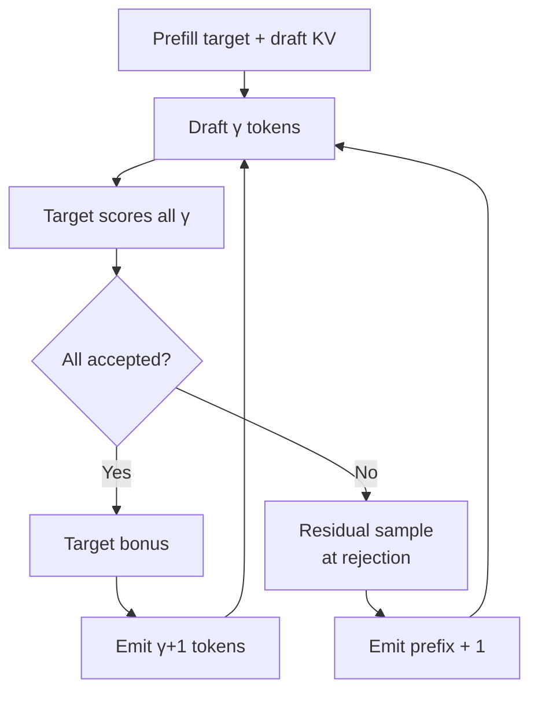

**Speculative decoding** can speed up [autoregressive decoding](glossary://autoregressive-decoding) without changing the target model's output distribution. A cheaper **draft** mechanism proposes several next tokens; the large **target** model scores those candidates in one parallel forward pass, then accepts a prefix under a rejection rule that preserves exact sampling from the target (within numerics). Before end-of-sequence or output-budget truncation, each verification pass yields at least one new token and can yield up to $\gamma + 1$ when the draft is good.

The idea appears as *speculative decoding* / *speculative sampling* in Leviathan et al. (ICML 2023; arXiv:2211.17192) and, independently, Chen et al. (arXiv:2302.01318). Serving engines (vLLM, TensorRT-LLM, SGLang, and others) ship draft-model, n-gram, EAGLE, and multi-token-prediction variants of the same draft-then-verify pattern.

## Intuition

Standard [decode phase](glossary://decode-phase) is serial: one target forward pass per output token. Large Transformers are often memory-bandwidth bound at small batch, so scoring a short continuation of length $\gamma$ costs roughly the same wall time as sampling a single token: weights and [KV cache](glossary://kv-cache) still stream once, while the extra positions add little compute.

Speculative decoding spends that "free" width on verification. The draft model (or draft head) invents cheap guesses. The target model checks them all at once. When the draft matches the target often enough, several output tokens ride on one expensive target step. When it misses, residual sampling from the target still emits a correct token, so worst-case serial target steps never exceed ordinary decoding.

## How it works

Notation follows Leviathan et al.: target distribution $p(\cdot)$, draft distribution $q(\cdot)$, draft depth $\gamma$.

1. **Draft.** Sample $\gamma$ tokens autoregressively from $q$:
   $$
   \tilde{x}_i \sim q(\cdot \mid x_{<t}, \tilde{x}_{<i}), \quad i = 1,\ldots,\gamma.
   $$
2. **Verify in parallel.** Run the target once on the prefix plus the full draft, producing $p_1,\ldots,p_{\gamma+1}$ (logits for the first draft position through one position past the draft). Reuse valid cached prefix positions; an implementation may also need to process the last emitted token if it has not yet entered the cache.
3. **Accept left to right.** For each draft token $\tilde{x}_i$ in order, draw $r_i \sim U(0,1)$ and accept if
   $$
   r_i \le \min\!\left(1,\ \frac{p_i(\tilde{x}_i)}{q_i(\tilde{x}_i)}\right).
   $$
   Stop at the first rejection (or after accepting all $\gamma$).
4. **Resample the mismatch.** If rejection happens at position $n+1$, sample a correction from the residual
   $$
   p'(x) = \mathrm{normalize}\!\big(\max(0,\ p_{n+1}(x) - q_{n+1}(x))\big).
   $$
   If every draft token is accepted, sample one bonus token from the ordinary target distribution $p_{\gamma+1}$. Return the accepted draft prefix plus that one target token.

This modified rejection sampling recovers $x \sim p$ exactly (Chen et al. Theorem 1; Leviathan et al. Appendix A.1). Greedy, temperature, top-$k$, and top-$p$ fold into $p$ and $q$ by standardizing logits before the accept test.

After a rejection, discard target/draft KV entries for the rejected suffix and align both caches with the emitted continuation. Stop at an accepted EOS or the configured output limit rather than emitting the rest of a round.

Draft sources in production:

| Draft source | What proposes tokens | Typical use |
|--------------|----------------------|-------------|
| Small draft LM | Separate smaller model, same tokenizer | Classic Leviathan/Chen setup |
| n-gram / prompt copy | Table lookup or context copy | Near-zero draft cost, lower $\alpha$ |
| EAGLE / draft head | Lightweight head on target hidden states | No full second model |
| Multi-token prediction (MTP) | Extra heads trained to predict several futures | Built into some model families |

## Formula

Define the **acceptance rate** $\alpha = \mathbb{E}[\beta]$, where $\beta$ is the probability that a single draft token is accepted under the rule above. Under Leviathan's analysis,

$$
\alpha = \mathbb{E}\big[\textstyle\sum_x \min\!\big(p(x), q(x)\big)\big] = 1 - \mathbb{E}\big[\mathrm{TV}(p, q)\big],
$$

where $\mathrm{TV}(p,q)=\frac12\sum_x |p(x)-q(x)|$ is total variation (equivalently $1-\sum_x\min(p,q)$). If successive accepts are modeled as i.i.d. with rate $\alpha$, the number of tokens produced by one draft-verify round is a capped geometric random variable, and the expected token count is

$$
\mathbb{E}[\#\ \text{tokens per round}] = \frac{1 - \alpha^{\gamma+1}}{1 - \alpha}
\quad (\alpha \ne 1).
$$

When $\alpha = 1$, every draft token is accepted and the round yields $\gamma + 1$ tokens (full draft plus bonus).

Let $c$ be the wall-time cost of one draft step relative to one target step. Under the assumption that verifying $\gamma+1$ positions costs about one target step (memory-bound regime, small $\gamma$), expected wall-time speedup is

$$
\frac{1 - \alpha^{\gamma+1}}{(1 - \alpha)\,(\gamma c + 1)}.
$$

If $\alpha > c$, some $\gamma \ge 1$ improves latency; at $\gamma = 1$ the factor is at least $(1+\alpha)/(1+c)$. Optimal $\gamma$ grows with $\alpha$ and shrinks with $c$; large $\gamma$ raises variance of tokens-per-round even when the mean still edges up.

## Worked numbers

Suppose $\alpha = 0.7$, $\gamma = 4$, and draft cost $c = 0.05$ (draft about $20\times$ cheaper per step than the target).

Expected tokens per verification:

$$
\frac{1 - 0.7^{5}}{1 - 0.7} = \frac{1 - 0.16807}{0.3} \approx 2.77.
$$

Expected speedup:

$$
\frac{2.77}{4\cdot 0.05 + 1} = \frac{2.77}{1.2} \approx 2.3\times.
$$

Same $\alpha$ with a bad draft ($c = 0.4$) and $\gamma = 4$ drops to $2.77 / 2.6 \approx 1.07\times$: draft overhead eats the win. With $\alpha = 0.3$, $\gamma = 4$, $c = 0.05$:

$$
\frac{1 - 0.3^{5}}{0.7} \approx 1.42,\qquad
\frac{1.42}{1.2} \approx 1.18\times.
$$

Published order-of-magnitude results match this economics: Leviathan et al. report about $2\times$–$3\times$ on T5-XXL (11B) with smaller T5 drafts; Chen et al. report about $2\times$–$2.5\times$ on Chinchilla 70B with a custom 4B draft. Real speedups depend on domain (code often accepts more than open prose), sampling sharpness (greedy/low temperature often raises $\alpha$), and engine overhead under continuous batching.

## Example

Target: a 70B chat model. Draft: a matched 1B–4B model, $\gamma = 5$. Prompt already prefilled; the next answer tokens are being streamed.

| Round | Draft proposes | Target decision | Emitted this round |
|-------|----------------|-----------------|--------------------|
| 1 | `To`, `reset`, `your`, `password`, `,` | accept 4, reject `,` | `To reset your password` + residual token `:` |
| 2 | ` open`, ` Settings`, ` >`, ` Security`, ` and` | accept all 5 + bonus | 6 tokens in one target pass |
| 3 | ` disable`, ` 2FA` , ... | reject first draft | 1 residual token only |

Round 1: five serial target steps replaced by one verification; the rejected fifth draft never enters the stream. Round 2: high $\alpha$ on boilerplate UI text yields $\gamma+1 = 6$ tokens. Round 3: hard, low-probability wording rejects immediately; you still paid draft work plus one target pass for a single token.

Operational sketch of the accept loop (probabilities already standardized for temperature / top-$p$):

```python
import numpy as np

def sample(probs, rng):
    return int(rng.choice(len(probs), p=probs))

def speculative_step(draft_tokens, draft_probs, target_probs, gamma, rng):
    """Valid normalized arrays; target_probs also includes the bonus row.

    draft_tokens: length gamma; *probs[i] is P(token_i | prefix+draft[:i]).
    rng: a numpy.random.Generator. EOS, output limits and KV repair are external.
    """
    if gamma < 1 or len(draft_tokens) != gamma or len(draft_probs) != gamma or len(target_probs) != gamma + 1:
        raise ValueError("inconsistent draft depth or probability row counts")
    accepted = []
    for i, tok in enumerate(draft_tokens):
        p, q = target_probs[i][tok], draft_probs[i][tok]
        if q <= 0:
            raise ValueError("a sampled draft token must have positive draft probability")
        if rng.random() >= min(1.0, p / q):
            # residual resample at first reject
            residual = np.maximum(target_probs[i] - draft_probs[i], 0)
            residual /= residual.sum()
            return accepted + [sample(residual, rng)]
        accepted.append(tok)
    # all accepted: emit bonus token from target at position gamma
    return accepted + [sample(target_probs[gamma], rng)]
```

## Diagram



Test draft tokens from left to right using $r \leq \min(1,p/q)$. Stop at the first rejection, sample from the residual distribution there, and keep the accepted prefix.

## Trade-offs

Speculative decoding wins when decode is memory-bound, outputs are long enough for many rounds, and $\alpha$ stays high enough that $\gamma c + 1$ is smaller than the tokens you free per round. It fails or stalls when:

- **Low acceptance.** Hard domains (creative writing, adversarial prompts, sharp distribution shift vs the draft's training mix) reject early; you pay draft cost for little gain.
- **Draft too expensive.** Large or poorly colocated drafts push $c$ up; topology mismatches (draft and target needing different device counts) waste bandwidth.
- **Short generations / prefill-heavy traffic.** Speedup applies to decode tokens, not prompt prefill. Short answers amortize poorly.
- **High batch concurrency.** Continuous batching already raises arithmetic intensity. Extra draft compute and multi-position verification can hurt aggregate [tokens per second](glossary://tokens-per-second) even if single-stream latency improves at batch size 1.
- **Memory and scheduler cost.** Two models (or draft heads) need weights and often dual KV paths; more tokens per step inflate peak KV and can change fairness under iteration-level scheduling.
- **Quality checks.** Correct implementations are distribution-preserving. Bugs in logit standardization, incompatible token IDs, or using "accept if top-1 matches" for stochastic sampling can change outputs. Top-1 verification is valid for greedy decoding, where the target distribution is a point mass. Always A/B quality and measure acceptance under production sampling settings, with greedy results reported separately.

Metrics that matter in production: acceptance rate $\alpha$ (and mean accepted length per round), target and end-to-end tokens/s, TPOT/ITL, p95 latency and latency variance (larger $\gamma$ can fatten tails), extra GPU memory, and distribution/quality parity vs a non-speculative baseline under the same decoding policy. Identical random seeds need not produce identical strings because the algorithms consume randomness differently.

## Why it matters here

Speculative decoding is one of the few serving levers that can cut decode latency without shrinking the model, changing weights, or accepting a different sample distribution. Curriculum topics on TTFT vs TPS, decode bottlenecks, KV reuse, and engine features (vLLM speculative configs, TensorRT-LLM draft paths, EAGLE heads) all rest on this draft-verify contract: spend cheap parallel work so the expensive target takes fewer serial steps.

## Related terms

- [Autoregressive decoding](glossary://autoregressive-decoding)
- [Decode phase](glossary://decode-phase)
- [KV cache](glossary://kv-cache)
- [Tokens per second](glossary://tokens-per-second)
- [vLLM](glossary://vllm)
