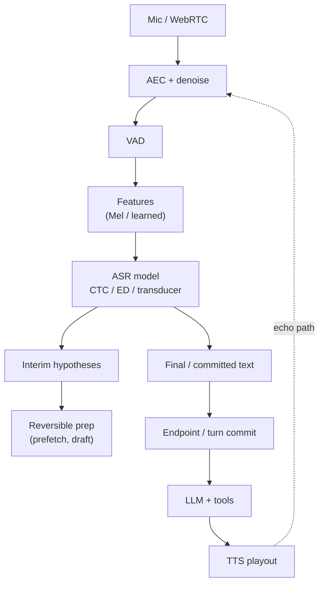

Speech-to-text (STT), also called automatic speech recognition (ASR), maps a waveform of spoken audio to a text string (or a stream of partial hypotheses) that agents, search systems, and tools can consume. In a cascaded voice product it is the input half of the real-time loop: mic audio becomes text, then an LLM plans, then [text-to-speech](glossary://text-to-speech) speaks.

Production STT coordinates model inference with decisions about when speech is present ([voice activity detection](glossary://voice-activity-detection)), when a turn is complete enough to act ([endpointing](glossary://endpointing)), how to handle interruptions ([barge-in](glossary://barge-in)), and whether the agent’s own playback leaks into the mic ([echo cancellation](glossary://echo-cancellation)). Quality includes word error rate on clean studio audio and behavior across real product conditions.

## How it works

At a high level the pipeline is:

1. **Capture and condition.** Sample audio (often $16$ kHz mono PCM for many cloud APIs). Apply gain, noise reduction, and AEC so the recognizer sees the user, not the loudspeaker.
2. **Feature extraction.** Classical and many modern systems convert short windows into a time-frequency representation. Whisper, for example, loads mono audio at $16$ kHz and uses $25$ ms windows with a $10$ ms stride. Original models use $80$ Mel channels; large-v3 and its turbo derivative use $128$. The implementation takes the log of Mel-filtered power, clips its dynamic range, and applies an affine scale; arbitrary inputs can produce values outside $[-1,1]$.
3. **Acoustic sequence model.** A neural network maps the feature sequence $X = (x_1, \ldots, x_T)$ to a distribution over transcripts $Y = (y_1, \ldots, y_U)$. Output units may be characters, subwords (for example byte-level BPE), or words.
4. **Decode and post-process.** Greedy collapse, beam search, external language models, inverse text normalization (numbers, dates), punctuation, and domain biasing produce the string the product consumes.
5. **Stream or batch handoff.** Streaming APIs emit interim and final events while audio is still open. Batch APIs wait for a full file or a committed utterance after endpointing.

Three model families dominate modern practice:

| Family | Core idea | Typical fit |
|---|---|---|
| **CTC** (Connectionist Temporal Classification) | Per-frame label distributions over alphabet $\cup \{\epsilon\}$ (blank); train by marginalizing all alignments that collapse to $Y$ | Monotonic alignment; streaming pairs a CTC head with a causal or chunked acoustic encoder |
| **Encoder–decoder (seq2seq)** | Encoder reads audio; autoregressive decoder emits tokens with cross-attention (Whisper-style Transformer) | Strong batch accuracy and multitask conditioning; streaming needs chunking or specialized variants |
| **Neural transducer (RNN-T / similar)** | Joint acoustic + label history scoring with an explicit blank for “emit nothing this step” | Designed for streaming low-latency recognition |

### CTC objective (alignment-free training)

Speech has no forced frame-level labels. CTC (Graves et al., 2006) introduces a blank $\epsilon$ and defines the probability of a label sequence by summing over every alignment $A$ that collapses to $Y$ after merging repeats and dropping blanks:

$$
p(Y \mid X) = \sum_{A \in \mathcal{A}_{X,Y}} \prod_{t=1}^{T} p_t(a_t \mid X)
$$

Training minimizes $-\log p(Y \mid X)$ with a forward–backward dynamic program. Inference often takes the argmax path per frame and collapses, or uses a CTC-aware beam that merges paths that share the same collapsed prefix. CTC assumes conditional independence of outputs given $X$, so domain language modeling is often added at decode time.

### Encoder–decoder (Whisper-style)

Whisper's original models (Radford et al., 2022) are encoder–decoder Transformers trained on about $680{,}000$ hours of weakly supervised multilingual audio–transcript pairs. Special tokens condition the decoder on language, task (`transcribe` / `translate`), and optional timestamps. That design favors offline or chunked transcription; native streaming needs additional handling. Later variants differ in training data and task support; the turbo derivative targets transcription, while other variants retain translation support. Self-supervised encoders such as wav2vec 2.0 (Baevski et al., 2020) learn speech representations from unlabeled audio and then fine-tune a CTC or other head with far less labeled data.

## Formula: word error rate

The standard accuracy metric is word error rate. Align the hypothesis to a reference with a word-level Levenshtein edit script, then:

$$
\mathrm{WER} = \frac{S + D + I}{N}
$$

where $S$ is substitutions, $D$ deletions, $I$ insertions, and $N$ is the number of words in the reference (NIST-style scoring; $N = S + D + C$ with $C$ correct words). WER can exceed $1$ when the system inserts many spurious words.

## Worked numbers

Reference: `restart the inference worker on node seven` ($N = 7$).

| Hypothesis | Edits | WER |
|---|---|---|
| `restart the difference worker on node seven` | $S=1$ (inference→difference) | $1/7 \approx 0.143$ |
| `restart inference worker on node seven` | $D=1$ (the) | $1/7 \approx 0.143$ |
| `please restart the inference worker on node seven` | $I=1$ (please) | $1/7 \approx 0.143$ |
| `restart the worker on node seven please` | $D=1$, $I=1$ | $2/7 \approx 0.286$ |

Same average WER can hide different product damage. Substituting a release ID or error code is often worse for an agent than inserting a filler word. Always slice WER by domain terms, proper nouns, digits, accents, and channel (phone vs headset).

## Example

A release assistant streams mic audio while an engineer says “roll back release r four two one nine.”

| Time | Event | Safe system action |
|---|---|---|
| $t_0$ | VAD marks speech | Open STT stream; start silence clock later |
| $t_1$ | Interim: `roll back re` | Show partial UI; do not call tools |
| $t_2$ | Interim: `roll back release r 42` | Optional read-only prefetch for release `r42` if policy allows discard |
| $t_3$ | User pauses $700$ ms mid-ID | Endpointing should *not* commit yet if digit pattern is incomplete |
| $t_4$ | Final: `roll back release r4219` | Commit transcript; enter approval flow before any rollback tool runs |

Streaming STT providers mark provisional vs committed text differently (`is_final`, `speech_final`, interim flags). Deepgram-style stacks, for example, combine interim results with silence-based endpointing so earlier words can still revise until a segment is finalized. `is_final` freezes a segment; `speech_final` reports an endpoint. Concatenate finalized segments up to that endpoint to obtain the utterance, and let the application decide whether a pause really completes the user's turn. Downstream code must treat interims as provisional: reversible preparation is fine; a provisional transcript alone should not authorize a state mutation.

```python
def actions_for_hypothesis(text: str, committed: bool) -> list[str]:
    out = ["update_live_caption"]
    if "release" in text.lower():
        out.append("prefetch_release_read_only")
    if committed:
        out.append("append_user_turn")
        if "roll back" in text.lower() and "release" in text.lower():
            out.append("start_rollback_approval_flow")
    return out
```

Batch STT (full-file Whisper after speech end) is simpler and often more accurate per second of audio, but first usable text arrives only after endpointing plus a full decode. That adds hundreds of milliseconds to seconds of dead air before the LLM can start.

## Diagram



STT owns the path from conditioned audio to text hypotheses. Endpointing owns when the turn is complete. Barge-in owns interrupting TTS when VAD sees new user speech.

## Streaming behavior and latency

| Metric | What it measures | Why agents care |
|---|---|---|
| First-partial latency | Speech start → first non-empty interim | Captions and early intent hints |
| Finalization latency | Last speech frame → stable final | When tools and spoken replies may fire |
| Partial-to-final stability | How often earlier words revise | Bad for naive “send every interim to the LLM” |
| Streaming WER vs batch WER | Accuracy under streaming constraints | Low latency often costs some accuracy |

First-partial latency depends on acoustic context, chunking, network transport, and the recognizer. Waiting for full-utterance batch decode can dominate time-to-first-audio even when the LLM is fast. Use provider figures as reference points, then measure p95 with turn-level traces on your path.

## What fails in production

- **Domain vocabulary.** Generic models mishear model names, error codes, and release IDs. Prefer custom vocabulary / keyword boosting, fine-tuning, or post-correction with a domain dictionary. Average WER can look fine while the one token the agent needs is wrong.
- **Partial revision.** Downstream code that fires tools on every interim can duplicate actions when a provisional command or identifier changes before finalization.
- **Confusing finals with turns.** A finalized STT chunk is about transcript stability, not conversational floor-yielding. Endpointing still decides when the user is done.
- **Noise, accents, telephony.** Hold music, far-field mics, and narrowband phone audio inflate WER. Evaluate on real channels alongside LibriSpeech-style clean speech.
- **Echo and self-speech.** Without AEC, STT transcribes the assistant; the agent answers itself.
- **Language and code-switching.** Wrong language ID or mixed-language turns produce garbage text that the LLM then “confidently” misinterprets.
- **Hallucinated text on silence or music.** Some seq2seq models invent plausible sentences on non-speech; gate with VAD and confidence / no-speech scores.

Metrics that matter beyond headline WER: proper-noun and digit accuracy, partial-to-final edit distance, endpointing false cuts, silence handling, language/accent slices, and first-partial / finalization latency at p50 and p95.

## Trade-offs

| Choice | Gain | Cost |
|---|---|---|
| Streaming STT | Overlap STT with speech; lower time-to-first-prep | Interim instability; more orchestration state |
| Batch after endpoint | Simpler API; often stronger offline accuracy | Extra decode after silence; sluggish conversation |
| Large encoder–decoder | Robust multilingual transcription | Higher latency/compute; awkward pure streaming |
| CTC / transducer streaming | Low partial latency | May need stronger LM / domain bias |
| Heavy domain fine-tuning | Identifier and name accuracy | Maintenance, eval, and regression risk |

## Why it matters here

Speech-to-text is the bridge from continuous audio into discrete tokens the LLM stack already understands. On LeetLLM it sits next to VAD, endpointing, barge-in, TTS, and real-time agent design: every voice system-design problem starts with “how does speech become text, when is that text trusted, and what may run on partials?” Bad transcripts look like model mistakes even when the LLM is fine. Good STT engineering is accurate *and* honest about provisional vs committed text under a latency budget.

## Related terms

- [Text-to-speech](glossary://text-to-speech)
- [Endpointing](glossary://endpointing)
- [Voice activity detection](glossary://voice-activity-detection)
- [Barge-in](glossary://barge-in)
- [Echo cancellation](glossary://echo-cancellation)
