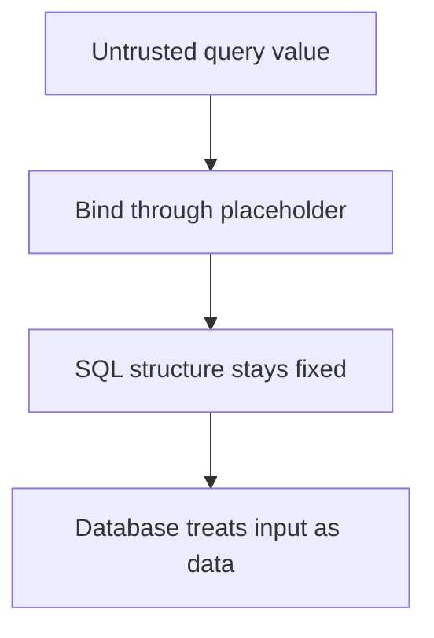

**SQL injection** occurs when untrusted input becomes part of a database statement's executable syntax. An attacker-controlled quote, comment marker, logical condition, or additional expression can then change the query's behavior rather than remaining an ordinary searched value. Chat messages and model-generated strings are still untrusted input.

Parameterized queries separate SQL structure from bound values. The application writes a statement containing placeholders and supplies its values through the database driver's binding interface. The driver and database then treat a value containing quote characters or SQL keywords as data instead of parsing it as a new query fragment.

Value placeholders do not substitute table names, column names, or sort-direction keywords. For those structural choices, map an allowed user option to a fixed SQL fragment or use the driver's identifier-composition API with an allowlist. An ORM or stored procedure can still introduce injection if it builds SQL by concatenating untrusted strings.

## Binding and search semantics are separate

A bound `LIKE` pattern still interprets `%` and `_` as wildcard characters. Parameter binding keeps them out of SQL syntax; escape wildcards when the product requires literal substring behavior, and reject empty queries if they would otherwise match every authorized document.



## Example

With a SQLite connection `conn` (placeholder syntax differs across drivers):

```python
query = "key%' OR 1=1 --"
rows = conn.execute(
    "SELECT id FROM chunks WHERE chunk_text LIKE ?",
    (f"%{query}%",),
).fetchall()
```

The attack-looking string becomes the bound pattern value, leaving the statement's executable structure fixed.

## Why it matters here

Support chat, retrieval filters, agent tools, and user-provided search terms frequently cross a database perimeter. Parameterization preserves statement structure, while separate tenant and permission predicates still remain necessary for authorization.

## Related terms

- [SQL](glossary://sql)
- [permission scope](glossary://permission-boundary)
- [Prompt injection](glossary://prompt-injection)
- [Least privilege](glossary://least-privilege)
