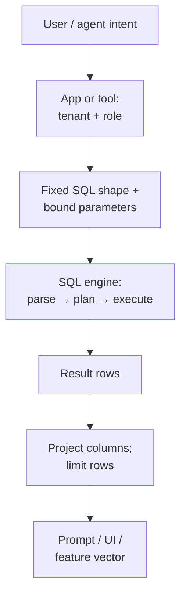

**SQL** (Structured Query Language) is the standard declarative language for defining, querying, and modifying data in relational database systems. It is standardized as [ISO/IEC 9075](https://www.iso.org/standard/76583.html) (first ANSI-standardized in 1986; the published framework edition is from 2023, with a [2026 technical corrigendum](https://www.iso.org/standard/93690.html)). Implementations such as [PostgreSQL](glossary://postgresql), MySQL, SQL Server, and BigQuery implement a dialect on top of that core.

SQL grew out of E. F. Codd's 1970 relational model: data as tables (relations) of rows, with relationships expressed by values (keys) rather than hard-wired pointers. You state *what* set of rows you want; the engine chooses *how* (indexes, join order, scans). In AI systems SQL is how product truth stays inspectable: users, tenants, documents, labels, eval runs, feature tables, tool logs, and (with [pgvector](glossary://pgvector)) embeddings next to the rows that authorize them.

## Intuition

SQL is relational algebra with a readable syntax. A `SELECT` answers: **which tables**, **which rows** (filters, joins), **which columns**, **how grouped**, **in what order**, **how many**. That discipline matters when training labels, retrieval metadata, and online features must mean the same thing offline and online.

Contrast with free-form agent prose: an LLM can invent a ticket id; a parameterized `WHERE tenant_id = $1 AND ticket_id = $2` either returns the row or returns nothing. Prefer a constrained query with a schema and an audit trail over "the model knows the table."

## How it works

### Sublanguages (one language, several jobs)

| Family | Typical verbs | Role |
| --- | --- | --- |
| **DQL** (query) | `SELECT` | Read rows; result is a new table (relation) |
| **DML** (manipulate) | `INSERT`, `UPDATE`, `DELETE` | Change row contents |
| **DDL** (define) | `CREATE`, `ALTER`, `DROP` | Schemas, tables, indexes, constraints |
| **DCL** (control) | `GRANT`, `REVOKE` | Who may run what on which objects |
| **TCL** (transaction) | `BEGIN`, `COMMIT`, `ROLLBACK` | Atomic multi-statement units |

Most application traffic is DQL + DML inside transactions. DDL and DCL belong to migrations and ops, not to model-generated tool calls.

### Declarative execution

A query is translated into a logical plan. The optimizer turns it into a physical plan (index scan vs sequential scan, nested loop vs hash join, etc.). You rarely write the access path yourself; you write predicates and indexes that make a good plan possible. `EXPLAIN` shows the planned execution; `EXPLAIN ANALYZE` actually runs the statement and adds observed counts and timings (vendor-specific). Use the latter carefully for writes or expensive queries.

### Bind parameters through the SQL driver

User and model input must bind as **parameters**, not be concatenated into SQL text. OWASP's primary defense against injection is prepared statements with parameterized queries: define the SQL shape first, then bind values so the engine always treats them as data, never as syntax.

```text
# Unsafe: input becomes SQL text
"SELECT * FROM users WHERE name = '" + user_input + "'"

# Safe: fixed shape, bound value
"SELECT id, name FROM users WHERE name = $1"  + bind(user_input)
```

Identifiers (table names, column names, `ORDER BY` directions) cannot be parameterized on most engines. Those must come from an allow-list in application code, never from free user or model strings.

## Example

Multi-tenant support product. An agent tool must list open tickets for the *current* tenant only, never rewrite rows, and never dump secrets into the prompt.

```sql
-- Application (or tool) runs this fixed shape with binds:
-- $1 = tenant_id from the authenticated session (not from the model)
-- $2 = optional status filter from tool args (allow-listed enum)

SELECT ticket_id, status, priority, updated_at, subject
FROM support_tickets
WHERE tenant_id = $1
  AND status = $2
ORDER BY updated_at DESC
LIMIT 20;
```

Python-side binding with a Psycopg 3 connection (shape fixed in code; model only chooses among allowed tools and args):

```python
ALLOWED_STATUS = {"open", "pending", "waiting_customer"}

def list_open_tickets(conn, tenant_id: str, status: str = "open"):
    if status not in ALLOWED_STATUS:
        raise ValueError(f"status not allowed: {status}")
    return conn.execute(
        """
        SELECT ticket_id, status, priority, updated_at, subject
        FROM support_tickets
        WHERE tenant_id = %s
          AND status = %s
        ORDER BY updated_at DESC
        LIMIT 20
        """,
        (tenant_id, status),
    ).fetchall()
```

What this design enforces:

- **Tenant boundary** comes from the session, not from the model's free text ([tenant isolation](glossary://tenant-isolation)).
- **Column projection** is explicit: no `SELECT *`, no `internal_notes`, no API keys in `metadata`.
- **Mutation** is impossible through this tool: no dynamic `UPDATE`/`DELETE` string.
- **Cardinality** is bounded with `LIMIT`. This caps rows, not field lengths or prompt tokens; apply a response-size/token budget as well when subjects or other selected fields can be large.

A text-to-SQL agent that invents arbitrary SQL is a different product surface. If you ship it, treat generated SQL as untrusted: read-only role, statement timeout, row limit, schema allow-list, no multi-statement, and preferably dry-run / human confirm for writes.

## Diagram



The model sits outside the engine. SQL is the contract between application truth and anything the model is allowed to see or change.

## Production risks

These fail in real AI products more often than syntax errors:

| Failure | What happens | Mitigation |
| --- | --- | --- |
| **String-built SQL** | Injection or accidental multi-tenant reads | Parameterize always; never concatenate model text into SQL |
| **Missing tenant predicate** | Cross-tenant leak into RAG or tool results | Session-scoped `tenant_id`; RLS as defense in depth |
| **`SELECT *` into prompts** | Secrets, PII, or huge JSON in context | Explicit column lists; views for tool-facing projections |
| **Unbounded results** | Context blow-up, cost, timeouts | `LIMIT`, pagination, statement timeouts |
| **Heavy analytics on OLTP** | Serving latency spikes while a notebook scans | Replicas, warehouses, or separate read paths |
| **Free-form LLM SQL** | Wrong joins, full scans, writes | Prefer parameterized tools; if text-to-SQL, lock down role and schema |
| **Schema drift** | Queries break or silently change meaning | Migrations + contract tests on columns, types, and enums |

[Least privilege](glossary://least-privilege) database roles matter: grant the app role only the table access the product needs, and reserve superuser and migration privileges for controlled roles. Add a correct `WHERE tenant_id = …` filter to each query and use row-level security (RLS) in Postgres as an additional boundary if a filter is missing.

## Trade-offs

- **SQL vs document / key-value stores:** SQL wins when you need joins, constraints, multi-row transactions, and ad-hoc reporting. Document stores win for flexible nested payloads with weaker relational integrity.
- **SQL vs pure vector DBs:** Co-locating embeddings with rows (pgvector) keeps ACL and metadata in one transaction boundary. Dedicated vector systems can scale ANN further but split the source of truth.
- **ORMs vs hand-written SQL:** ORMs reduce boilerplate; raw SQL keeps plans and projections honest for hot paths and agent tools. Either way, parameters and tenant filters are non-negotiable.
- **Declarative power vs cost opacity:** One elegant join can be a sequential scan of a billion rows. Measure with `EXPLAIN` and production metrics, not with "it returned the right answer once."

## Why it matters here

LLM products still rest on relational truth: who the user is, which tenant owns a document, which label is gold, which eval row failed, which tool call was allowed. SQL is how those facts stay queryable, auditable, and consistent under RAG and agent load. Feature stores and offline training pipelines are full of SQL (or SQL-shaped warehouse dialects); online serving often joins the same entities. When the model is probabilistic, the database is where you put the answers that must not be invented.

## Related terms

- [PostgreSQL](glossary://postgresql)
- [pgvector](glossary://pgvector)
- [Feature store](glossary://feature-store)
- [Tenant isolation](glossary://tenant-isolation)
- [Least privilege](glossary://least-privilege)
