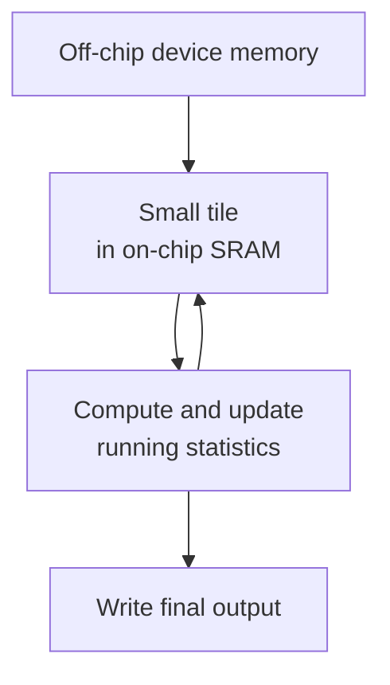

**SRAM** is static random-access memory used for small, fast on-chip storage structures. In GPU programming discussions, it often refers to the on-chip resources behind shared memory and caches that sit much closer to execution units than large off-chip device DRAM. It has much lower access latency and higher local bandwidth than global memory, but its capacity is tiny in comparison. Registers, caches, and programmer-managed shared memory have different scopes and shouldn't be treated as interchangeable allocations.

“Static” means the storage cells retain their bits while powered without DRAM-style periodic refresh; SRAM remains volatile. Shared memory is a programmer-visible GPU resource implemented with on-chip storage, while registers and caches are separate SRAM structures.

## Why tiling changes an attention kernel

Naive attention can materialize a large score matrix in off-chip memory and repeatedly move its values between device DRAM and compute units. A tiled kernel instead loads small query, key, and value blocks into fast on-chip storage, updates running softmax statistics, and writes the final output without storing the complete attention matrix. The mathematical attention result can remain exact while memory traffic falls.

On-chip capacity constrains the tile size. Greater register use can cause spills or reduce occupancy; greater shared-memory use can reduce resident blocks, and exceeding the supported allocation can prevent launch. Shared memory does not automatically spill into global memory. Choosing a larger block isn't automatically faster.

## Example

Suppose an attention kernel processes a long sequence by loading a compact block of keys and values into shared memory. Threads reuse that block for several query computations before loading the next one. The implementation still performs the required attention comparisons, but avoids repeatedly writing and rereading a full sequence-by-sequence score matrix. Profiling should compare global-memory traffic, kernel occupancy, and runtime; reduced theoretical storage alone doesn't prove a faster kernel.

## Why it matters here

FlashAttention, selective-scan kernels, and fused serving operators derive their benefits from moving work into a limited on-chip memory hierarchy. Confusing SRAM with total GPU memory hides why an algorithm can reduce memory traffic without increasing the model's maximum checkpoint size.

## Related terms

- [HBM](glossary://hbm)
- [FlashAttention](glossary://flashattention)
- [CUDA](glossary://cuda)
- [Fused kernel](glossary://fused-kernel)
