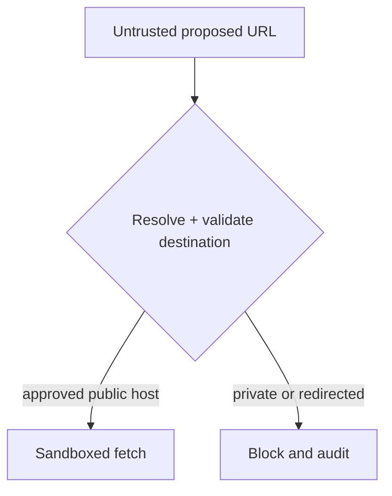

**Server-side request forgery (SSRF)** tricks a server into sending a network request chosen or influenced by an untrusted party. Because the request originates from trusted infrastructure, it may reach private services, cloud metadata endpoints, internal dashboards, or other destinations that the original caller couldn't access directly.

An LLM agent introduces SSRF risk whenever it can fetch a URL from a prompt, retrieved document, webpage, redirect, or tool result. Validate every proposed URL, including links labeled as research. Treat the model as an untrusted planner and bound the HTTP client's real network authority.

## Reject unsafe destinations before fetching

This strict policy disables redirects. A fetcher that allows them must reapply destination checks at every hop.

## Example

A corrective-RAG system decides that its internal documents don't answer a question and invokes a web-search fallback. A malicious document suggests `http://169.254.169.254/latest/meta-data/` as its supporting citation. If the retriever fetches that address from a cloud worker, it may disclose instance credentials or infrastructure metadata.

Use explicit destination allowlists, allow only required schemes and ports, reject loopback/private/link-local and other disallowed address ranges in IPv4 and IPv6, limit response size, and enforce outbound network policy below the application. Validate all resolved addresses and connect to an approved address without a second unchecked resolution; preserve the intended hostname for HTTP and TLS verification. Disable redirects or validate every hop. The [OWASP SSRF prevention guidance](https://cheatsheetseries.owasp.org/cheatsheets/Server_Side_Request_Forgery_Prevention_Cheat_Sheet.html) explains why redirects and DNS changes can bypass input validation. Destination checks belong inside a controlled fetching boundary.

## Why it matters here

Corrective retrieval, browser agents, repository tools, and OpenClaw plugins all convert model-selected destinations into real requests. Treat network egress as a privileged tool action, record denials, and refuse fetches whose actual destination cannot satisfy the egress policy. Treat fetched content as untrusted even after its destination passes SSRF checks.

## Related terms

- [Sandbox](glossary://sandbox)
- [Prompt injection](glossary://prompt-injection)
- [Action allowlist](glossary://action-allowlist)
- [Least privilege](glossary://least-privilege)
