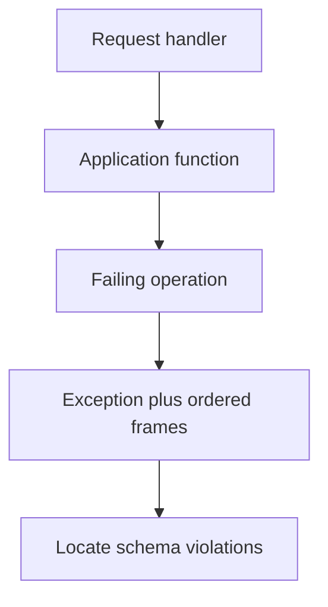

A **stack trace** is an ordered record of active function calls at the point where a program encounters an exception, captures a diagnostic snapshot, or reports an execution failure. Each stack frame usually identifies a function, source file, and line number. Reading those frames connects the visible error to the chain of calls that led there.

## Find the first relevant application frame

Framework wrappers, task schedulers, and exception handlers often add frames around the actual application failure. Start with the exception class and message, identify the innermost relevant application frame, and inspect the values or schema at that perimeter. An asynchronous accelerator error may surface on a later synchronization call, so the displayed frame isn't always the operation that first triggered the device failure.

A stack trace records nested function calls within an execution context. A distributed trace connects timed operational spans across services and asynchronous partitions. Attach both to one incident: the stack trace shows the call chain, and the distributed trace shows request timing.

## Example

Suppose `handle_request()` calls `load_model()`, which calls `read_checkpoint()`. The checkpoint reader raises `FileNotFoundError` because the configured path doesn't exist. A useful traceback lists the request handler, model loader, and checkpoint reader, then names the missing path in the exception message. The repair belongs at checkpoint configuration or artifact availability, not at the outer HTTP handler.

Keep the detailed traceback in access-controlled diagnostics. Tool responses and user-facing errors should expose a concise error category and actionable correction because full frames can reveal filesystem paths, source code, tenant identifiers, or secrets embedded in exception arguments.

## Why it matters here

Python debugging, CUDA failures, distributed training, agent tools, and incident analysis all rely on stack frames. Correctly distinguishing program tracebacks from distributed observability traces improves diagnosis while preventing sensitive implementation details from leaking into model-visible output.

## Related terms

- [Tracing](glossary://tracing)
- [Observability](glossary://observability)
- [Secrets management](glossary://secrets-management)
- [Audit trail](glossary://audit-trail)
