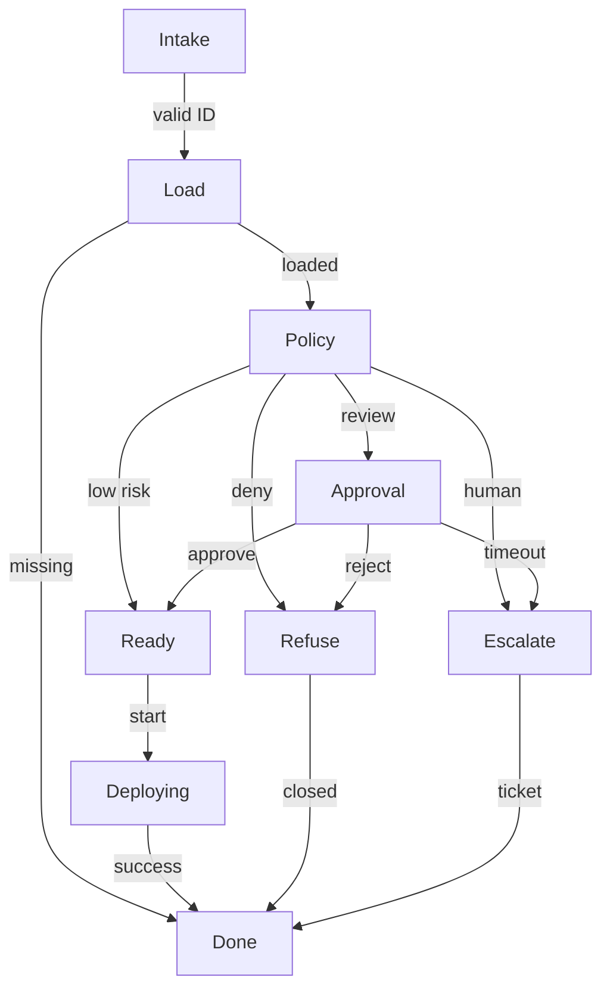

A **finite-state machine (FSM)** models a system that is always in exactly one named control state from a finite set, and moves only along **explicit transitions** triggered by events. State machines more generally can have infinite state spaces; this entry focuses on finite control machines. In LLM products the interesting machines are rarely pure acceptors of strings; they are control planes around agents, tool sessions, deployments, voice turns, and incident runbooks. The model may *propose* the next action; trusted code owns whether that action is legal from the current state and what side effects run on the edge.

Formally, a deterministic finite acceptor is a quintuple

$$
M = (Q, \Sigma, \delta, q_0, F)
$$

where $Q$ is a finite set of states, $\Sigma$ is the input alphabet (events), $\delta : Q \times \Sigma \to Q$ is the transition function (classically total; production machines often make it partial so undefined pairs reject), $q_0 \in Q$ is the start state, and $F \subseteq Q$ are accepting or terminal states. Production control machines also carry **payload state** (release id, tool results, approval flags) and **actions** on entry, exit, or transition (Mealy: output depends on state and event; Moore: output depends only on state). The finite *control* state is still the contract you test; unbounded conversation text sits in attached data, not in $Q$.

## Intuition

An explicit state machine replaces `if`s over free-form history such as "if the last message mentioned production and we already loaded the release, maybe deploy." That structure is easier to unit-test, protects transitions from retry races, and surfaces invalid model proposals.

With a state machine you name every legal place the session can be, every event that may move it, and every side effect that may fire. Invalid transitions raise errors instead of changing production. Crash recovery reloads a known state. Concurrent workers serialize on the same session id so two transitions cannot both succeed.

## Diagram



The diagram shortens state names: Load is `LoadRelease`, Policy is `PolicyCheck`, Approval is `AwaitApproval`, and Ready is `DeployPending`. The transition table below gives the exact event names.

Nodes are control states. Edge labels are events (validated tool results, policy outcomes, human decisions). `DeployPending` means policy has authorized the rollout but no API call has started. `Deploying` is a durable pending-effect state that recovery can replay with the same idempotency key.

## How it works

1. **Enumerate control states.** Prefer a small closed enum: `intake`, `load_release`, `policy_check`, `await_approval`, `deploy_pending`, `deploying`, `refuse`, `escalate`, `done`. If you need dozens of states, split machines (child workflow per subgoal) rather than growing one soup.

2. **Define the event alphabet.** Events are structured: `tool_ok`, `tool_error`, `policy_allow`, `policy_deny`, `human_approved`, `human_rejected`, `budget_exhausted`, `timeout`. Do not treat raw LLM prose as a transition key; parse model output into a typed event first.

3. **Table the transition function.** For each $(q, e)$ either define $\delta(q, e) = q'$ and optional actions, or reject. Partial $\delta$ is a feature: illegal pairs fail closed.

4. **Separate control state from data state.** Control state answers "what may happen next?" Data state holds ids, amounts, transcripts, and evidence. Persist both atomically at each successful transition (a [workflow checkpoint](glossary://workflow-checkpoint)).

5. **Bind side effects to transitions.** Deploy, email, ticket create, and tool calls with external writes run only after the transition is authorized, under an [idempotency](glossary://idempotency) key derived from session id + transition id. Terminal states have no outgoing mutating actions.

6. **Guard concurrency.** One logical session, one writer: lease, row lock, or optimistic version column so two workers cannot apply conflicting transitions.

Graph runtimes such as [LangGraph](glossary://langgraph) encode the same idea as nodes (work), edges (routing), shared state, and checkpoints at super-step boundaries. Product value comes from the explicit machine and applies across libraries.

### Transition table (release agent)

| Current state $q$ | Event $e$ | Next state $\delta(q,e)$ | Side effect |
|---|---|---|---|
| `intake` | `release_id_valid` | `load_release` | none |
| `load_release` | `release_loaded` | `policy_check` | cache release and eval snapshot |
| `load_release` | `release_missing` | `done` | write refuse reason |
| `policy_check` | `canary_allowed_low_risk` | `deploy_pending` | none |
| `policy_check` | `approval_required` | `await_approval` | notify reviewer |
| `policy_check` | `policy_deny` | `refuse` | none |
| `policy_check` | `needs_human` | `escalate` | open human path |
| `await_approval` | `approved` | `deploy_pending` | none |
| `await_approval` | `rejected` | `refuse` | none |
| `await_approval` | `timeout` | `escalate` | open human path |
| `deploy_pending` | `deploy_started` | `deploying` | persist pending effect |
| `deploying` | `deploy_succeeded` | `done` | persist `rollout_id` |
| `refuse` | `closed` | `done` | write refuse reason |
| `escalate` | `ticket_opened` | `done` | persist ticket result |
| any non-terminal | unlisted $e$ | reject | audit + error |

From `policy_check`, a model proposal to jump straight to `deploying` without a recorded policy event is rejected. The scaffold never calls the rollout API on that path.

## Example

This compact Python sketch separates durable transitions from the external rollout. The store's `load` returns an isolated snapshot; compare-and-swap atomically checks the stored `version` and persists the complete session, raising `RuntimeError("stale_session: concurrent writer")` on conflict. The rollout API promises that one idempotency key plus one payload always returns the same `rollout_id`. A trusted event adapter must authenticate approvals and validate policy/tool results before calling `transition`; an event name alone is not authorization. Release ID and canary percentage are set at `release_loaded` and remain fixed through authorization and recovery.

```python title="release-state-machine.py"
from dataclasses import dataclass, field
from typing import Protocol

State = str
Event = str

TRANSITIONS: dict[tuple[State, Event], State] = {
    ("intake", "release_id_valid"): "load_release",
    ("load_release", "release_loaded"): "policy_check",
    ("load_release", "release_missing"): "done",
    ("policy_check", "canary_allowed_low_risk"): "deploy_pending",
    ("policy_check", "approval_required"): "await_approval",
    ("policy_check", "policy_deny"): "refuse",
    ("policy_check", "needs_human"): "escalate",
    ("await_approval", "approved"): "deploy_pending",
    ("await_approval", "rejected"): "refuse",
    ("await_approval", "timeout"): "escalate",
    ("deploy_pending", "deploy_started"): "deploying",
    ("deploying", "deploy_succeeded"): "done",
    ("refuse", "closed"): "done",
    ("escalate", "ticket_opened"): "done",
}

TERMINAL = {"done"}


@dataclass
class Session:
    id: str
    state: State = "intake"
    version: int = 0
    release_id: str | None = None
    canary_percent: int | None = None
    rollout_id: str | None = None
    audit: list[str] = field(default_factory=list)


class SessionStore(Protocol):
    def load(self, session_id: str) -> Session: ...

    def compare_and_swap(
        self, session: Session, *, expected_version: int
    ) -> None: ...


class RolloutAPI(Protocol):
    def shift_canary(
        self,
        release_id: str,
        percent: int,
        *,
        idempotency_key: str,
    ) -> str: ...


def transition(
    store: SessionStore,
    session_id: str,
    event: Event,
    *,
    expected_version: int,
    updates: dict[str, object] | None = None,
) -> Session:
    session = store.load(session_id)
    if session.version != expected_version:
        raise RuntimeError("stale_session: concurrent writer")
    if session.state in TERMINAL:
        raise RuntimeError(f"terminal:{session.state}")
    key = (session.state, event)
    if key not in TRANSITIONS:
        raise RuntimeError(f"illegal_transition:{session.state}+{event}")
    updates = updates or {}
    allowed_updates = {
        "release_loaded": {"release_id", "canary_percent"},
        "deploy_succeeded": {"rollout_id"},
    }.get(event, set())
    if not set(updates) <= allowed_updates:
        raise ValueError("updates_not_allowed_for_event")
    for name in ("release_id", "rollout_id"):
        if name in updates and (not isinstance(updates[name], str) or not updates[name]):
            raise ValueError(f"invalid_{name}")
    if "canary_percent" in updates:
        percent = updates["canary_percent"]
        if type(percent) is not int or not 1 <= percent <= 100:
            raise ValueError("invalid_canary_percent")
    session.state = TRANSITIONS[key]
    for name, value in updates.items():
        setattr(session, name, value)
    session.version += 1
    session.audit.append(f"{key[0]} --{event}--> {session.state}")
    store.compare_and_swap(session, expected_version=expected_version)
    return session


def recover_canary(
    store: SessionStore, rollout_api: RolloutAPI, session_id: str
) -> str:
    session = store.load(session_id)
    if session.state == "done" and session.rollout_id:
        return session.rollout_id
    if session.state == "deploy_pending":
        session = transition(
            store,
            session.id,
            "deploy_started",
            expected_version=session.version,
        )  # durable `deploying` checkpoint before side effect
    if session.state != "deploying":
        raise RuntimeError(f"deployment_not_authorized:{session.state}")
    if session.release_id is None or session.canary_percent is None:
        raise RuntimeError("deployment_payload_missing")

    effect_key = f"{session.id}:deploy_canary:v1"
    rollout_id = rollout_api.shift_canary(
        session.release_id,
        session.canary_percent,
        idempotency_key=effect_key,
    )
    try:
        finished = transition(
            store,
            session.id,
            "deploy_succeeded",
            expected_version=session.version,
            updates={"rollout_id": rollout_id},
        )
    except RuntimeError as exc:
        if str(exc) != "stale_session: concurrent writer":
            raise
        finished = store.load(session.id)
        if finished.state != "done" or finished.rollout_id != rollout_id:
            raise
    if finished.rollout_id is None:
        raise RuntimeError("deployment_outcome_missing")
    return finished.rollout_id
```

Trace for a production canary that needs a human:

1. `intake` + `release_id_valid` $\to$ `load_release`
2. `load_release` + `release_loaded` $\to$ `policy_check`
3. `policy_check` + `approval_required` $\to$ `await_approval` (checkpoint; pause for HITL)
4. On resume: `await_approval` + `approved` $\to$ `deploy_pending`
5. Recovery persists `deploy_started` $\to$ `deploying`, then calls the rollout API with `session_id:deploy_canary:v1`
6. The API returns one stable `rollout_id`; `deploy_succeeded` stores that id and moves to `done`

If the worker crashes before the API call, recovery reloads `deploying` and starts it. If it crashes after the API commits but before `deploy_succeeded`, recovery calls the API again with the same key and payload, receives the same `rollout_id`, and records the outcome. Two workers may make the same keyed call, but compare-and-swap lets only one persist the final transition.

## What fails in production

| Failure | Symptom | Fix |
|---|---|---|
| Implicit states in prompts only | "Sometimes it deploys twice" | Enum + transition table in code; model proposes, machine decides |
| Side effect before commit | Deploy then crash; retry deploys again | Persist transition intent, then effect under idempotency key, then mark done |
| Partial $\delta$ implemented as silence | Invalid tool call ignored; agent loops | Reject with structured error; count toward step budget |
| No version / lease | Two pods both leave `policy_check` into `deploy_pending` | Optimistic locking or single-writer lease per session |
| Soft terminals | `done` still exposes the rollout tool | Terminal states: empty allowlist for mutating tools |
| State explosion | Hundreds of nearly identical states | Hierarchical / nested machines, or data fields + fewer control states |
| Resume after code change | Old checkpoint names missing nodes | Version the machine; migrate or fail with repair path |

The non-negotiable invariant: every accepted event either causes a **legal** transition (and optional side effect) or is **rejected**. Persistence restores the same control state after crash. Concurrent workers cannot apply two conflicting transitions to the same session.

## Why it matters here

Agent scaffolds, tool loops, [human-in-the-loop](glossary://human-in-the-loop) approvals, voice barge-in, and multi-step RAG self-critique become debuggable when states and transitions are explicit. Free-form "just call the next tool" logic is an untestable tangle under retries and partial failures. The model proposes; the state machine (plus [policy gates](glossary://policy-gate)) decides what is currently allowed. That split is how you keep non-deterministic LLM outputs inside a deterministic product envelope.

## Related terms

- [Agent scaffold](glossary://agent-scaffold)
- [Policy gate](glossary://policy-gate)
- [Workflow checkpoint](glossary://workflow-checkpoint)
- [Human-in-the-loop](glossary://human-in-the-loop)
- [Idempotency](glossary://idempotency)
