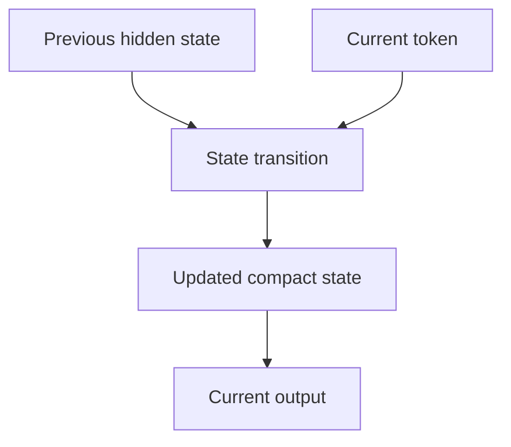

A **state-space model** describes a system through hidden-state evolution and observed outputs. In neural sequence modeling, it represents a sequence by updating a compact hidden state whenever a new input arrives. The model carries a learned summary of previous inputs forward in that state. Linear time-invariant sequence models use fixed transition and input matrices, while selective variants make parts of the update depend on the current input so important content can be retained or discarded dynamically. State-space models more generally can be nonlinear, time-varying, or stochastic; fixed matrices describe a particular family.

## Follow one recurrent state

A discrete state-space update can be written:

$$
h_t = \bar A h_{t-1}+\bar B x_t, \qquad y_t = Ch_t
$$

Here, $x_t$ is the current input, $h_t$ is the updated hidden state, $y_t$ is the output, and $\bar A$, $\bar B$, and $C$ control state transition, input mixing, and readout (a direct input-to-output term is omitted). With fixed model dimensions, this recurrent layer's state storage and update work per new token do not grow with sequence length. Its output still depends on history through that state, and compression can discard details retained by a per-token attention cache. A hybrid model with attention layers can still have a growing KV cache.

## Example

Consider the scalar recurrence $h_t=0.5h_{t-1}+x_t$, starting from $h_0=0$. Inputs $2$, $4$, and $6$ produce states $2$, $5$, and $8.5$. Earlier inputs still influence later outputs, but their contribution decays by half each step. A selective model can change that transition using the current token, keeping a critical identifier while forgetting irrelevant filler. An identifier dropped from the compact state becomes unavailable unless the system rereads its original token.

## Why it matters here

The Mamba lesson compares recurrent state updates with transformer attention, growing KV caches, and hybrid architectures. A clear state-space definition makes the memory and retrieval trade-off concrete before introducing selective scan, state-space duality, or specialized hardware kernels.

## Related terms

- [Mamba](glossary://mamba)
- [KV cache](glossary://kv-cache)
- [Transformer](glossary://transformer)
- [Decode phase](glossary://decode-phase)
