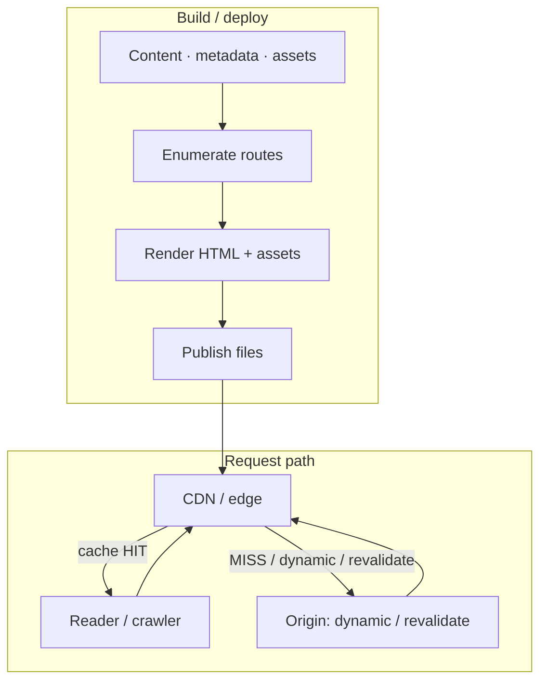

**Static generation** (also **static site generation**, **SSG**, or **prerendering**) builds page HTML and related assets **at build time**, then reuses that output on every request. The origin does not re-run the full application for each hit. A CDN or object store can serve the bytes near the reader.

Next.js documents the core rule clearly: if a page uses Static Generation, HTML is produced when you run `next build`, reused on each request, and cacheable at the edge. The product question is always the same: *can this page be computed before a user arrives?* If yes, prefer static generation over per-request server rendering.

Static sites can still run a Node server for API routes, auth, and on-demand regeneration. Public, cacheable routes use HTML built ahead of time or refreshed on a schedule, which keeps the request path cheap.

## Intuition

Rendering strategies differ by **when** user-facing HTML is produced:

| Strategy | When HTML is produced | Good for |
|:---|:---|:---|
| **Static generation (SSG)** | At `build` (and optionally on revalidate) | Docs, lessons, marketing, known product pages |
| **Server-side rendering (SSR)** | On every request | Fully personalized or live-data pages |
| **Client-only (SPA)** | In the browser after JS loads | Heavy interactive apps; weak first paint / SEO unless you also prerender |
| **ISR / revalidate** | Build once, then background refresh after a TTL or on demand | Large catalogs that change sometimes |

Static generation is **ahead-of-time SSR**: the same render path runs once in CI (or at deploy), not once per visitor. Cost moves from request latency to build time and content freshness.

## How it works

A typical static path for a dynamic URL like `/learn/[slug]` has three steps:

1. **Enumerate routes.** The framework needs a finite list of param sets. In the Next.js App Router that is `generateStaticParams` (Pages Router: `getStaticPaths`). It returns objects such as `{ slug: "attention-is-all-you-need" }` for every page to prerender.
2. **Load data and render.** For each param set, the page (and layouts) run at build time: load Markdown, metadata, illustrations, glossary links, compute prev/next, emit HTML (and often an RSC payload for client navigations).
3. **Publish artifacts.** Built HTML/CSS/JS (or a server that serves precomputed HTML) ships with the deploy. Public traffic can hit a [CDN](glossary://cloudflare) first; origin only runs when the edge misses, when a route is dynamic, or when regeneration runs.

### With and without data

- **Without data:** a fixed page (`/about`) needs no external fetch. One HTML file per route at build.
- **With data:** content or paths come from a CMS, Git tree, or DB. You fetch during the build (Pages: `getStaticProps` / `getStaticPaths`; App Router: Server Components + `generateStaticParams`). The snapshot is whatever the data source returned **at build time**.

### Incremental Static Regeneration (ISR)

Pure SSG freezes content until the next full rebuild. **ISR** keeps the static *shape* (serve prerendered HTML, low origin cost) but allows updates without rebuilding the whole site:

- **Time-based:** `export const revalidate = 3600` (seconds). After the TTL, the next request still gets the cached page immediately; a fresh version regenerates in the background (stale-while-revalidate). On success, later requests get the new page. On failure, the last good page stays.
- **On-demand:** `revalidatePath` / `revalidateTag` (App Router) or `res.revalidate` (Pages) invalidate after a content publish webhook.

These route-level `revalidate` examples describe the App Router without Cache Components enabled. With Next.js Cache Components, use the supported `use cache`/`cacheLife` model instead; dynamic request-time content can coexist with a prerendered shell. ISR needs a Node runtime and a durable or shared cache when you run multiple instances. A pure static export (`output: 'export'`) writes files to disk and does **not** support ISR.

### Static export vs static generation on a server

| Mode | Output | Hosting |
|:---|:---|:---|
| Static generation + Node | Prebuilt routes + optional SSR/API/ISR | Cloud Run, Node host, Vercel, etc. |
| Static export (`output: 'export'`) | HTML/CSS/JS and static payload assets under `out/` | Any static file host; no request-time server cookies, server actions, or ISR (client-side cookies still exist) |

Curriculum sites often use the first mode: static public pages plus dynamic auth, progress APIs, and search.

## Example

A curriculum app prerenders every public lesson at deploy; the edge serves HTML without rebuilding the content tree for each request.

```tsx
// app/learn/[slug]/page.tsx  (conceptual App Router page)
import { getLesson, getLessonSlugs } from "@/lib/content";

// Cached output stays fresh for 4 hours; a later request can trigger refresh.
// This route config assumes Cache Components is disabled.
export const revalidate = 14400;

export async function generateStaticParams() {
  // Finite set of known slugs from the content tree / roadmap index.
  return getLessonSlugs().map((slug) => ({ slug }));
}

export default async function LearnPage({
  params,
}: {
  params: Promise<{ slug: string }>;
}) {
  const { slug } = await params;
  const lesson = await getLesson(slug); // runs at build (and on revalidate)
  return (
    <article>
      <h1>{lesson.title}</h1>
      {/* body, diagrams, prev/next from the build-time snapshot */}
    </article>
  );
}
```

What happens at `next build`:

1. `generateStaticParams` returns the published lesson slugs selected for prerendering.
2. For each slug, the page loads the article bundle, resolves glossary spans, and emits HTML.
3. Deploy ships those artifacts. A reader hitting `/learn/attention-is-all-you-need` gets prebuilt HTML; progress or auth UI can still hydrate client-side without forcing the whole lesson body to SSR.

If a lesson exists in the deployed data source but was not included in the build-time slug list, the route can be missing or generated on demand depending on `dynamicParams` and route configuration. Adding a file to Git without deploying that content does not make it available to on-demand rendering. Diagnose the enumeration and deployed snapshot separately.

## Diagram



## Trade-offs

**Fits well**

- Public, crawlable content with a known route set: lessons, glossary, docs, marketing, blog.
- Read-heavy traffic where TTFB and origin cost matter more than second-level freshness.
- SEO: crawlers receive full HTML without waiting on client JS.

**Fits poorly**

- Every response depends on the signed-in user, live resource state, or per-request model output (chat completions, personalized dashboards).
- Data that must be correct within seconds of a write (unless you use on-demand revalidation carefully).
- Unbounded dynamic paths with no build-time enum and no safe on-demand policy.

**Freshness is the main product risk.** The page is only as current as the last successful build or revalidation. Content, prices, model cards, or eval numbers that change hourly need rebuilds, ISR, hybrid client fetch for the volatile fragment, or a true dynamic route. A successful app deploy that still serves yesterday's content usually points to **pipeline ordering**: the image may contain an old content snapshot, the edge cache may remain unpurged, or revalidation may never have run.

**Build-time cost scales with route count.** Thousands of pages can make `next build` slow or timeout CI. Common mitigations: prerender the hot subset at build, allow the rest on first visit (`dynamicParams`), or split sites. Raising a runtime revalidation interval does not by itself reduce the number of build-time routes. Full static export of a huge catalog is often the wrong default.

## Debug path

When a page is **stale**, **missing**, or **unexpectedly dynamic**:

1. **Build log:** did `generateStaticParams` / path enumeration include the slug? Did the page fail during prerender?
2. **Route config:** without Cache Components, request-time `cookies()`, `headers()`, `searchParams`, or `export const dynamic = 'force-dynamic'` can opt the route out of static rendering even if you listed params. With Cache Components, isolate request-time fragments behind Suspense so the public shell can remain prerendered.
3. **Content snapshot:** which commit / content hash was in the image or artifact store? App code and content can ship out of order.
4. **CDN headers:** `CF-Cache-Status`, `Age`, `Cache-Control`, and (where emitted by Next) `x-nextjs-cache` (`HIT` / `STALE` / `MISS`). HTML is often not edge-cached by default on Cloudflare until a Cache Rule allows it. Cache Components and hosting adapters can expose different cache signals, so inspect the deployed configuration.
5. **Revalidation:** for ISR, confirm TTL, on-demand hooks after publish, and that multi-instance hosts share a cache handler if you need cross-instance invalidation.

A reader seeing old lesson prose after a "successful" deploy may be receiving frozen HTML or an edge-cached response. Check the deployed content artifact and cache headers before editing the Markdown again.

## Why it matters here

AI curriculum and model-docs products are mostly **public, stable HTML** with a thin dynamic shell (auth, progress, search, chat). Static generation is how those pages stay fast and crawlable without paying full SSR cost on every hit. The [content pipeline](glossary://content-pipeline) (validate, build illustrations, compile glossary) feeds the static snapshot; wrong ordering ships a fast page with wrong content. For engineers shipping LLM products, the same split applies: prerender marketing, docs, and model cards; keep token streams, tool calls, and secrets on dynamic server routes.

## Related terms

- [Next.js](glossary://nextjs)
- [Content pipeline](glossary://content-pipeline)
- [Cloudflare](glossary://cloudflare)
- [Frontmatter](glossary://frontmatter)
- [Article bundle](glossary://article-bundle)
